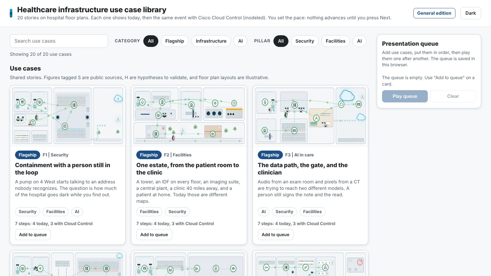
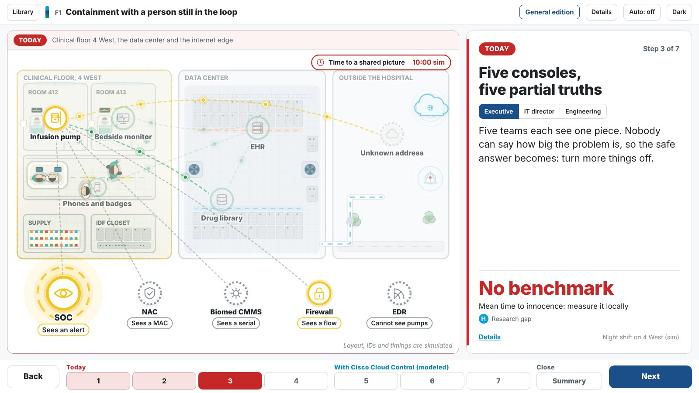
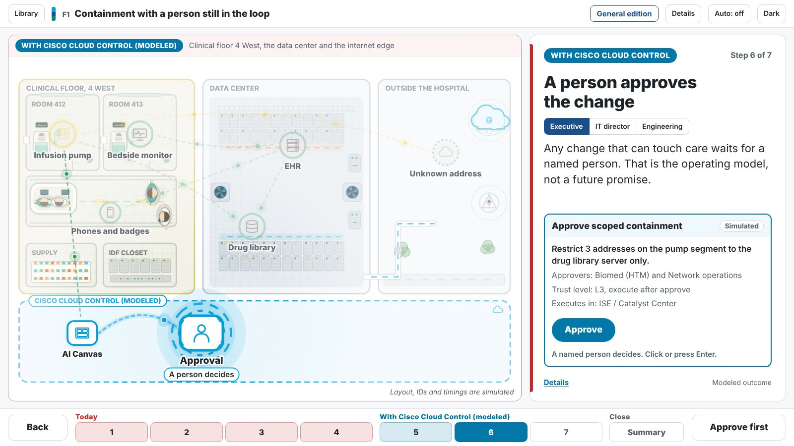
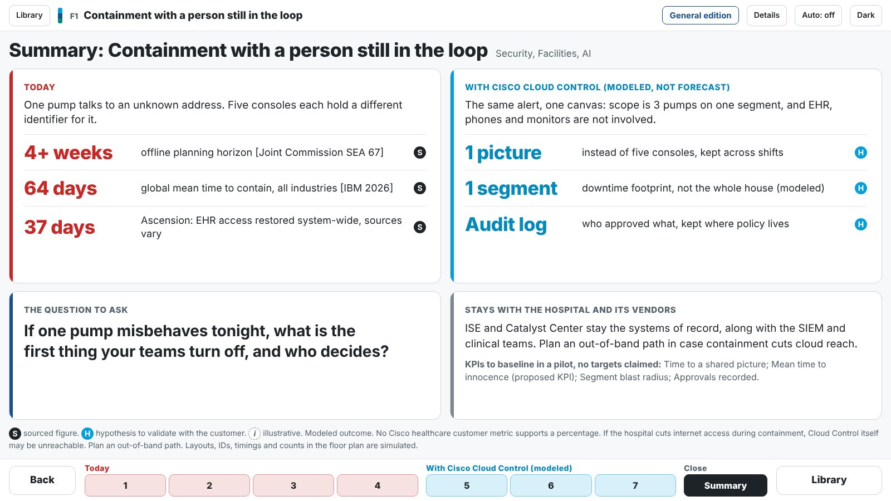
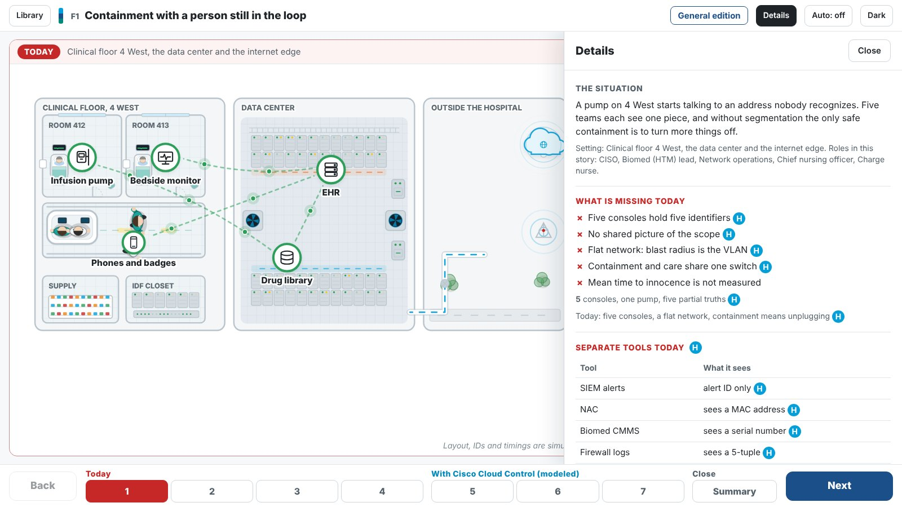
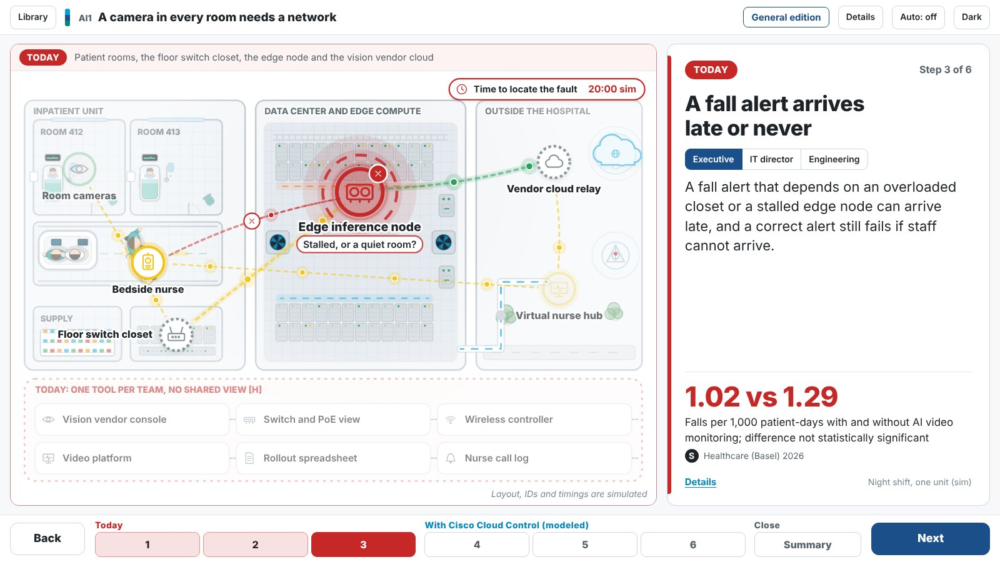
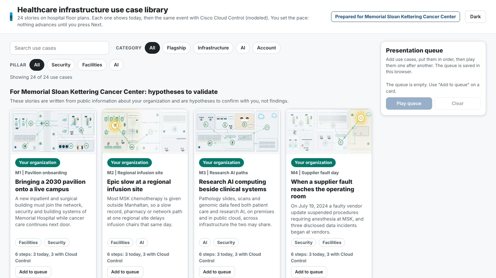
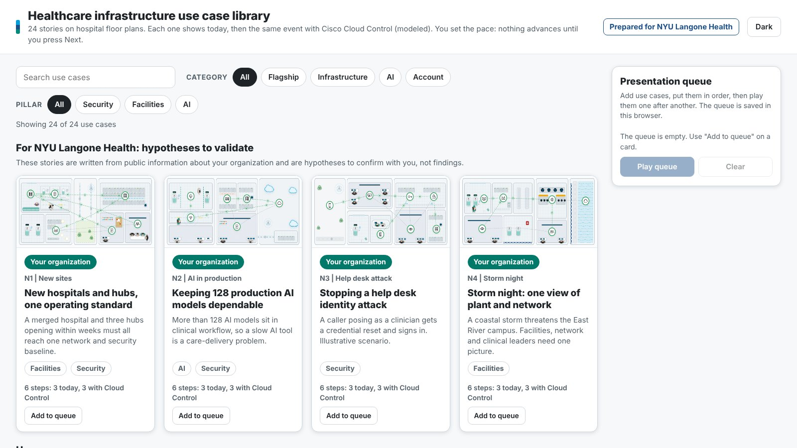

# Healthcare Use Case Atlas

An interactive presentation system for healthcare account teams. It shows, on hospital floor plans, how an infrastructure problem plays out **today** and how the same event plays out **with Cisco Cloud Control**, one step at a time, at the presenter's pace.

The system is in [`atlas/`](atlas/). It grew out of the original 2D showcase in `showcase/` and keeps its look, with three things fixed: it was busy, the type was small, and it ran on a timer.



## What you get

| | |
|---|---|
| **A use case library** | 28 use cases you can search, filter by category and pillar, and line up in a presentation queue. |
| **Presenter-paced stories** | Nothing moves until you press Next. One large card says what is happening; the floor plan shows where. |
| **Three separate editions** | General, Memorial Sloan Kettering, and NYU Langone Health. Each is built on its own and never contains the other account's name. |
| **A human approval before any change that could touch care** | In the stories that make such a change, the story stops until you click Approve. |
| **A closing summary** | Outcomes, the question to ask the room, and what stays with the hospital. |
| **Sources on every number** | Tagged S (public source), H (hypothesis to validate) or I (illustrative). Cloud Control outcomes are modeled. |

## How a story looks

Each story runs red **Today** steps, then blue **With Cisco Cloud Control** steps, then a **Summary**.

| Today: the problem | The approval |
|---|---|
|  |  |

| The summary | Details on demand |
|---|---|
|  |  |

The 28 use cases:

- **3 flagship stories:** Security, Facilities, AI in care.
- **10 infrastructure use cases:** EHR slow, medical devices, downtime, clinical Wi-Fi, imaging, hospital at home, acquired clinic, identity, compliance, AI at work.
- **7 healthcare AI use cases:** virtual nursing and room cameras, AI agents in patient access, private clinical AI on hospital GPUs, bedside prediction, agents with access to the EHR, digital pathology, AI cost.
- **4 for Memorial Sloan Kettering** and **4 for NYU Langone Health**, each built from public sources and labelled as hypotheses to validate. They appear only in that organization's edition.



## The three editions

| General | Memorial Sloan Kettering | NYU Langone Health |
|---|---|---|
| 20 shared use cases | 20 shared + 4 of its own | 20 shared + 4 of its own |
|  |  |  |

An account edition says who it was prepared for and lists that organization's use cases first. There is no switch between editions in the interface, and the build fails if one account's name appears anywhere in another edition's files.

## How to run it

You need [Node.js](https://nodejs.org) 18 or later. Nothing else to install.

1. Build the three editions:

```bash
node atlas/build.mjs
```

2. Start the server:

```bash
node atlas/server.mjs
```

3. Open one of these in a browser:

- `http://localhost:8080/general/`
- `http://localhost:8080/msk/`
- `http://localhost:8080/nyulh/`

## How to present

1. **Pick the edition** for the audience and open its address.
2. **Build a queue.** On the library page, press "Add to queue" on the use cases you plan to show, then "Play queue". Or click any card to open it directly.
3. **Choose the audience** on the story card: Executive, IT director or Engineering. The narration changes with it.
4. **Step through.** Right arrow, Space or the Next button moves forward; Left arrow goes back. You can also click any numbered step. Nothing advances by itself.
5. **Approve.** At the approval step, click Approve or press Enter. Say who approves and where the change runs.
6. **Open Details** when someone asks for more: the gaps today, the console view, the data path and outcomes.
7. **Finish on the Summary.** It holds the question to ask the room.

| Key | Action |
|---|---|
| Right, Space, PageDown | Next step |
| Left, PageUp | Previous step |
| Enter | Approve, when an approval is waiting |
| I | Open or close Details |
| Esc | Close Details |
| Home, End | First step, Summary |

Use the Library button to go back to the library. In a queue, Back on the first step of a story returns to the summary of the previous story.

## How to add a use case

1. Copy `atlas/usecases/_template.mjs` to a new numbered file, for example `atlas/usecases/280-my-story.mjs` (`300` to `399` are MSK account stories, `400` to `499` NYULH).
2. Set `editions` to who should see it: `['general','msk','nyulh']` for everyone, or `['msk']` or `['nyulh']` for one account.
3. Write the steps, pick an existing floor plan with `scene.decor`, and place each device with `scene.pos`. Rename rooms to fit your story with `scene.labels`.
4. Build and check it:

```bash
node atlas/build.mjs
```

```bash
node atlas/tools/check.cjs --fast --ed=general --uc=my-story
```

[`atlas/AUTHORING.md`](atlas/AUTHORING.md) has every field, the floor plans available and their room names, and the coordinate system. The build stops with a clear message if a device has no position, a label override matches nothing, or an account name appears where it should not.

## How to host it

**On your own server.** Run `node atlas/server.mjs` on any machine with Node.js. Set an access code per edition so only the right audience gets in:

```bash
ATLAS_CODE_MSK=choose-a-code ATLAS_CODE_NYULH=choose-another node atlas/server.mjs
```

The root address lists nothing, so one audience cannot discover another's edition. `ATLAS_SLUG_MSK` and `ATLAS_SLUG_NYULH` rename the paths if you want addresses that cannot be guessed.

**On here.now** (static hosting). Each edition becomes its own site:

```bash
node atlas/tools/publish-herenow.mjs msk
```

Without an account the site expires after 24 hours and anyone with the link can open it. Set `HERENOW_API_KEY` for a permanent site, then add a password in the here.now dashboard before sharing an account edition.

## How it is checked

```bash
node atlas/tools/check.cjs
```

This opens every use case in every edition in a headless browser and steps through it with the keyboard. It fails on a console error, any text under 14 pixels, text that overflows its box, overlapping labels, a callout that hides a device or a zone name, a device without a position, another account's name on screen, or a story that advances by itself. Last run (13 Nov 2026): 16,464 checks across the three editions, none failed. Tested in Chromium at 1600x900 and 1280x720 only.

## Rules the content follows

- Cisco Cloud Control is generally available in the United States only (25 August 2026). Its outcomes here are modeled; no healthcare customer metric exists, so no percentage is claimed.
- Cisco Data Fabric holds machine data. It is not a clinical record and does not replace the EHR.
- Account use cases come from public sources and are hypotheses. Nothing states what an organization has bought.
- Any action that can touch clinical systems waits for a named person.

## What else is in this repository

| Folder | What it is |
|---|---|
| `atlas/` | The system described above. |
| `research/` | Twelve cited research briefs and their data extracts. `sources.md` is the bibliography. |
| `showcase/` | The original 2D showcase that `atlas/` is built from. |
| `experience/` | An earlier dark, isometric redesign. Kept for reference; superseded by `atlas/`. |
| `skills/` | An exportable skill describing how to build this kind of explainer (written for the `experience/` version). |
| `app/`, `stage/` | The first storyboard app and a paused 3D deck. `app/src/scenes.ts` is the source of the original 13 narratives. |

## Start here

| File | What it is |
|---|---|
| [healthcare-storyboard-context.md](healthcare-storyboard-context.md) | Master context document. Use this as AI context for 3D and 2D builds. |
| [healthcare-storyboard-context.docx](healthcare-storyboard-context.docx) | Shareable Word copy of the master. |
| [sources.md](sources.md) | Numbered bibliography. Citations in the master are `[C-n]`, `[S-n]`, `[F-n]`, `[A-n]`, `[K-n]`. |

## Animated 2D storyboards (`app/`)

An interactive Vite + TypeScript app with a custom Canvas 2D engine. It plays 13 stories (3 flagships and the 10 use cases). Each story steps from "Today, any infrastructure" to "With Cisco Cloud Control, modeled", with traffic flowing along links, devices changing state, a downtime clock, and an approval you click through before any change touches care. Narration switches between Executive, IT director, and Engineering.

```
cd app
npm install
npm run dev      # http://localhost:5173
npm run build    # static site in app/dist
```

Controls: left and right arrows step, up and down change story, 1, 2, 3 switch audience, Space autoplays (it pauses at each approval). Hover any device for all three audience views. Link directly to a story with `#security`, `#facilities`, `#ai`, `#ehr`, `#iomt`, `#ransom`, `#wifi`, `#imaging`, `#home`, `#wan`, `#identity`, `#compliance`, or `#aiwork`. Story content lives in `app/src/scenes.ts`.

## Interactive 2D hospital models (`showcase/`)

A single self-contained HTML file, in the format of a "store of the future" 2D showcase. It has 13 tabs (3 flagships, 10 use cases), each a hospital floor plan. **The story is the workflow:** a step rail across the top walks through the whole story, Today first and then With Cisco Cloud Control (modeled), and the floor plan plays whichever step is active. The element the step is about becomes the primary one: it grows, the rest of the scene is dimmed, and a soft spotlight and a slight push-in follow it. The floor plan takes all the space available, with larger type, a narration card, the gaps or the simulated console, the data path, outcomes and the discovery question beside it. Key figures, the event feed, roles and the legend live in a retractable panel (button, edge tab, or the P key), so the stage can use the full window.

The floor plans are dressed in detail: patient rooms with beds, patients, monitors and IV poles; nurse stations; data halls with racks, hot and cold aisles, cooling and UPS; cloud connectivity with fibre drops and clouds; network paths with duct, manholes and a radio tower; a CT suite, a plant with air handlers and a generator, houses, clinics and a neighbor hospital; and people who look like people (nurse, doctor, patient, vendor, IT and visitor) and walk the corridors. Provenance tags (S sourced, H hypothesis, I illustrative), hover tooltips with an owner chip, an Executive / IT director / Engineering switch, a guided tour, and light and dark themes are included.

```
cd showcase
node build.mjs                    # writes showcase/healthcare-2d-models.html (open it directly, no server)
npm install                       # only needed for the test tools below
node tools/check.mjs              # overflow sweep: 13 use cases x 3 audiences x 18 times through the whole story, both themes
node tools/smoke.mjs              # hover, rail click, story flow, panels, audience, theme, tab and tour checks
node tools/shoot.mjs --uc=1,2 --mode=tobe --theme=dark --u=0.8 --panel=0   # screenshots into showcase/shots (--mode is the flow: story, legacy or tobe)
```

Controls: Space pauses, left and right change use case, M cycles the flow (Story, Today only, Cloud Control only), P shows or hides the side panel, 1, 2, 3 switch audience, D toggles dark. Click any step in the rail to replay from it. URL parameters: `uc`, `flow` (or `mode`), `u` (0 to 1 position in the flow), `aud`, `theme`, `panel` (0 or 1), `t`, `paused`, `tour`, `check`; `#ehr/tobe` also works.

How it is built: `stage/js/narrative.js` (generated from `app/src/scenes.ts`) is the single source of truth for nodes, links, step states, narration, facts and caveats. `showcase/src/10-engine.js` draws the scene (focus, camera, links, callouts), `12-kit.js` is the set-dressing kit, `20-page.js` is the layout, and `44-decor.js` draws the floor plan of each use case. Each use case file in `showcase/src/4x-*.js` adds only node placement and the authored Today and With Cloud Control content. The `stage/` 3D build is paused.
## How the pack is structured

1. **Part 0.** Macro picture (margins, breach cost, outages, AI adoption) and a glossary.
2. **Part 1.** Ten infrastructure use cases, each with patient, engineering, and clinical journeys, plus security / network / WAN / visibility / orchestration jargon, MTTx, cost, and compliance.
3. **Three pillars.** Healthcare security, healthcare facilities, and AI in healthcare. These are full sections, not a paragraph inside a use case.
4. **Part 2.** Personas, KPI tables, compliance recap.
5. **Part 3.** Cisco Cloud Control and Cisco Data Fabric mapping, including a Data Fabric-as-aggregation-layer story that stays on machine data (not the EHR).
6. **Part 4.** Storyboard scenes: flagship sequences for security, facilities, and AI, plus four scenes per use case, plus an object library.

## Research briefs

Underlying cited research lives in `research/`. Do not discard these; they hold full source lists, gap lists, and status tags.

- `research/01-clinical-ops.md`
- `research/02-security.md`
- `research/03-facilities.md`
- `research/04-ai-healthcare.md`
- `research/05-cisco-cloud-control-data-fabric.md`
- `research/06-cloud-control-agentic-orchestrator.md` (13 Nov 2026: what Cloud Control manages product by product, how it is agentic, AgenticOps, what is new since 26 Oct)
- `research/07-data-fabric-third-party-reach.md` (13 Nov 2026: architecture, federated targets, Splunkbase integrations, hospital data-source map, governance)
- `research/08-cisco-healthcare-portfolio.md` (13 Nov 2026: Cisco healthcare positioning, product map for the ten use cases, 21 named customer stories)
- `research/09-agentic-clinical-and-workplace-ops.md` (13 Nov 2026: evidence for the four operating lenses, infrastructure demands of agentic care, risks)
- `research/10-account-nyu-langone.md` (13 Nov 2026: NYU Langone Health from public sources, four account use cases)
- `research/11-account-memorial-sloan-kettering.md` (13 Nov 2026: Memorial Sloan Kettering from public sources, four account use cases)
- `research/12-healthcare-ai-use-cases.md` (13 Nov 2026: evidence for seven healthcare AI use cases and what each demands from infrastructure)
- `research/data/*.json` (machine-readable extracts the explainer is generated from)

Briefs 06 and 07 correct brief 05 in places. Each has a section headed "Where this brief differs from Brief 05". The main ones: Machine Data Lake is now documented for AWS regions except GovCloud; "Agentic Actions for networking" is in Controlled Availability while the Actions view is shipped; Identity for AI Canvas is beta; Topology shows data center and compute relationships at Layer 1 and 2 only; AI model training on AI Canvas data is enabled by default per tenant; the phrase "commodity object storage cost" is now verified.

Sectional drafts used to assemble the master live in `docs/`.

## Rules for anyone using this as context

- Preserve **ESTIMATE**, **VENDOR-REPORTED**, **Analysis**, **Gap**, and **Modeled** labels.
- Do not invent a number to close a Gap. Mean time to innocence (written MTTInn so it is not confused with IBM's mean time to identify) has no published healthcare benchmark.
- Do not turn a Modeled Phase 2 outcome into a percentage. No Cisco healthcare customer metric for Cloud Control was found.
- Cloud Control is generally available in the United States only as of 25 August 2026.
- Data Fabric is an aggregation layer for **machine data** (network, security, identity, IoMT connectivity, nurse call and RTLS system events, EHR performance telemetry). It is not a clinical data repository and it does not replace the EHR.
- Do not use the phrase "clinical data fabric."
- "Reversible" in Cloud Control sources means rollback of **agent versions**, not automatic undo of network changes.
- Human approval is required on any action that can touch clinical systems.
- Do not show attacker procedures in any scene.
- Account briefs (10 and 11) use public sources only. Every account use case is a hypothesis to validate. Do not state or imply what an account has bought; no public source names NYU Langone's or MSK's current network or security vendors.

## Rebuild

```
python scripts/assemble_and_convert.py
```

Requires Python 3.12 and `python-docx`.
