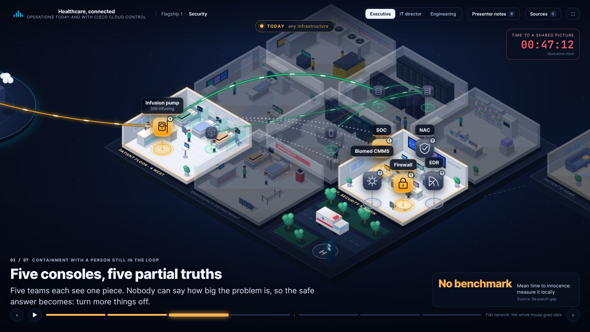

# Healthcare Infrastructure Storyboard

Context pack and interactive explainer for healthcare customers. Research first prepared 12 November 2026; extended and rebuilt 13 November 2026.

The pack describes how a health system runs network, security, facilities, and AI infrastructure today, then maps the same stories onto Cisco Cloud Control and Cisco Data Fabric. Phase 1 is vendor-neutral. Phase 2 is Cisco-specific and tags every capability GA, CA, or Roadmap.

## The explainer (`experience/`)

A web app for account teams. Run it:

```bash
cd experience && npm install && npm run dev
```

It shows a health system (patient floor, emergency department, imaging, pharmacy and lab, network core, data center, offices, central plant, a clinic, a patient's home and the outside world) as a flat 2D plan or an isometric model, with Cisco Cloud Control and Cisco Data Fabric at its centre. It plays an opening film, four operating lenses, three flagship stories, ten infrastructure use cases and seven healthcare AI use cases, each as amber Today beats followed by blue Cloud Control beats with a human approval.

It is also a working tool: account workspaces (Generic, NYU Langone Health, Memorial Sloan Kettering) with their own researched use cases kept separate, a rating and notes on every story, and an account plan you can export.



See [`experience/README.md`](experience/README.md) for controls and build steps, and [`experience/PRESENTER-GUIDE.md`](experience/PRESENTER-GUIDE.md) for a 20-minute run. A single-file build for offline hand-off is at `experience/healthcare-cloud-control.html`.

## The skill (`skills/`)

[`skills/interactive-explainer.skill`](skills/interactive-explainer.skill) is an exportable skill that teaches Claude how to build this kind of explainer for another product or industry: the method, the research briefs, the story data model, the renderer, and a starter kit with the working code. The source is in `skills/interactive-explainer/`; `python3 skills/pack.py` refreshes the starter from `experience/` and re-packages it.

Earlier iterations are kept for reference: `showcase/` (the first single-file 2D floor plans), `app/` (the 2D Canvas storyboard whose `scenes.ts` is still the narrative source of truth) and `stage/` (a paused 3D deck).

## Start here

| File | What it is |
|---|---|
| [healthcare-storyboard-context.md](healthcare-storyboard-context.md) | Master context document. Use this as AI context for 3D and 2D builds. |
| [healthcare-storyboard-context.docx](healthcare-storyboard-context.docx) | Shareable Word copy of the master. |
| [sources.md](sources.md) | Numbered bibliography. Citations in the master are `[C-n]`, `[S-n]`, `[F-n]`, `[A-n]`, `[K-n]`. |

## Animated 2D storyboards (`app/`)

An interactive Vite + TypeScript app with a custom Canvas 2D engine. It plays 13 stories (3 flagships and the 10 use cases). Each story steps from "Today, any infrastructure" to "With Cisco Cloud Control, modeled", with traffic flowing along links, devices changing state, a downtime clock, and an approval you click through before any change touches care. Narration switches between Executive, IT director, and Engineering.

```
cd app
npm install
npm run dev      # http://localhost:5173
npm run build    # static site in app/dist
```

Controls: left and right arrows step, up and down change story, 1, 2, 3 switch audience, Space autoplays (it pauses at each approval). Hover any device for all three audience views. Link directly to a story with `#security`, `#facilities`, `#ai`, `#ehr`, `#iomt`, `#ransom`, `#wifi`, `#imaging`, `#home`, `#wan`, `#identity`, `#compliance`, or `#aiwork`. Story content lives in `app/src/scenes.ts`.

## Interactive 2D hospital models (`showcase/`)

A single self-contained HTML file, in the format of a "store of the future" 2D showcase. It has 13 tabs (3 flagships, 10 use cases), each a hospital floor plan. **The story is the workflow:** a step rail across the top walks through the whole story, Today first and then With Cisco Cloud Control (modeled), and the floor plan plays whichever step is active. The element the step is about becomes the primary one: it grows, the rest of the scene is dimmed, and a soft spotlight and a slight push-in follow it. The floor plan takes all the space available, with larger type, a narration card, the gaps or the simulated console, the data path, outcomes and the discovery question beside it. Key figures, the event feed, roles and the legend live in a retractable panel (button, edge tab, or the P key), so the stage can use the full window.

The floor plans are dressed in detail: patient rooms with beds, patients, monitors and IV poles; nurse stations; data halls with racks, hot and cold aisles, cooling and UPS; cloud connectivity with fibre drops and clouds; network paths with duct, manholes and a radio tower; a CT suite, a plant with air handlers and a generator, houses, clinics and a neighbor hospital; and people who look like people (nurse, doctor, patient, vendor, IT and visitor) and walk the corridors. Provenance tags (S sourced, H hypothesis, I illustrative), hover tooltips with an owner chip, an Executive / IT director / Engineering switch, a guided tour, and light and dark themes are included.

```
cd showcase
node build.mjs                    # writes showcase/healthcare-2d-models.html (open it directly, no server)
npm install                       # only needed for the test tools below
node tools/check.mjs              # overflow sweep: 13 use cases x 3 audiences x 18 times through the whole story, both themes
node tools/smoke.mjs              # hover, rail click, story flow, panels, audience, theme, tab and tour checks
node tools/shoot.mjs --uc=1,2 --mode=tobe --theme=dark --u=0.8 --panel=0   # screenshots into showcase/shots (--mode is the flow: story, legacy or tobe)
```

Controls: Space pauses, left and right change use case, M cycles the flow (Story, Today only, Cloud Control only), P shows or hides the side panel, 1, 2, 3 switch audience, D toggles dark. Click any step in the rail to replay from it. URL parameters: `uc`, `flow` (or `mode`), `u` (0 to 1 position in the flow), `aud`, `theme`, `panel` (0 or 1), `t`, `paused`, `tour`, `check`; `#ehr/tobe` also works.

How it is built: `stage/js/narrative.js` (generated from `app/src/scenes.ts`) is the single source of truth for nodes, links, step states, narration, facts and caveats. `showcase/src/10-engine.js` draws the scene (focus, camera, links, callouts), `12-kit.js` is the set-dressing kit, `20-page.js` is the layout, and `44-decor.js` draws the floor plan of each use case. Each use case file in `showcase/src/4x-*.js` adds only node placement and the authored Today and With Cloud Control content. The `stage/` 3D build is paused.
## How the pack is structured

1. **Part 0.** Macro picture (margins, breach cost, outages, AI adoption) and a glossary.
2. **Part 1.** Ten infrastructure use cases, each with patient, engineering, and clinical journeys, plus security / network / WAN / visibility / orchestration jargon, MTTx, cost, and compliance.
3. **Three pillars.** Healthcare security, healthcare facilities, and AI in healthcare. These are full sections, not a paragraph inside a use case.
4. **Part 2.** Personas, KPI tables, compliance recap.
5. **Part 3.** Cisco Cloud Control and Cisco Data Fabric mapping, including a Data Fabric-as-aggregation-layer story that stays on machine data (not the EHR).
6. **Part 4.** Storyboard scenes: flagship sequences for security, facilities, and AI, plus four scenes per use case, plus an object library.

## Research briefs

Underlying cited research lives in `research/`. Do not discard these; they hold full source lists, gap lists, and status tags.

- `research/01-clinical-ops.md`
- `research/02-security.md`
- `research/03-facilities.md`
- `research/04-ai-healthcare.md`
- `research/05-cisco-cloud-control-data-fabric.md`
- `research/06-cloud-control-agentic-orchestrator.md` (13 Nov 2026: what Cloud Control manages product by product, how it is agentic, AgenticOps, what is new since 26 Oct)
- `research/07-data-fabric-third-party-reach.md` (13 Nov 2026: architecture, federated targets, Splunkbase integrations, hospital data-source map, governance)
- `research/08-cisco-healthcare-portfolio.md` (13 Nov 2026: Cisco healthcare positioning, product map for the ten use cases, 21 named customer stories)
- `research/09-agentic-clinical-and-workplace-ops.md` (13 Nov 2026: evidence for the four operating lenses, infrastructure demands of agentic care, risks)
- `research/10-account-nyu-langone.md` (13 Nov 2026: NYU Langone Health from public sources, four account use cases)
- `research/11-account-memorial-sloan-kettering.md` (13 Nov 2026: Memorial Sloan Kettering from public sources, four account use cases)
- `research/12-healthcare-ai-use-cases.md` (13 Nov 2026: evidence for seven healthcare AI use cases and what each demands from infrastructure)
- `research/data/*.json` (machine-readable extracts the explainer is generated from)

Briefs 06 and 07 correct brief 05 in places. Each has a section headed "Where this brief differs from Brief 05". The main ones: Machine Data Lake is now documented for AWS regions except GovCloud; "Agentic Actions for networking" is in Controlled Availability while the Actions view is shipped; Identity for AI Canvas is beta; Topology shows data center and compute relationships at Layer 1 and 2 only; AI model training on AI Canvas data is enabled by default per tenant; the phrase "commodity object storage cost" is now verified.

Sectional drafts used to assemble the master live in `docs/`.

## Rules for anyone using this as context

- Preserve **ESTIMATE**, **VENDOR-REPORTED**, **Analysis**, **Gap**, and **Modeled** labels.
- Do not invent a number to close a Gap. Mean time to innocence (written MTTInn so it is not confused with IBM's mean time to identify) has no published healthcare benchmark.
- Do not turn a Modeled Phase 2 outcome into a percentage. No Cisco healthcare customer metric for Cloud Control was found.
- Cloud Control is generally available in the United States only as of 25 August 2026.
- Data Fabric is an aggregation layer for **machine data** (network, security, identity, IoMT connectivity, nurse call and RTLS system events, EHR performance telemetry). It is not a clinical data repository and it does not replace the EHR.
- Do not use the phrase "clinical data fabric."
- "Reversible" in Cloud Control sources means rollback of **agent versions**, not automatic undo of network changes.
- Human approval is required on any action that can touch clinical systems.
- Do not show attacker procedures in any scene.
- Account briefs (10 and 11) use public sources only. Every account use case is a hypothesis to validate. Do not state or imply what an account has bought; no public source names NYU Langone's or MSK's current network or security vendors.

## Rebuild

```
python scripts/assemble_and_convert.py
```

Requires Python 3.12 and `python-docx`.
