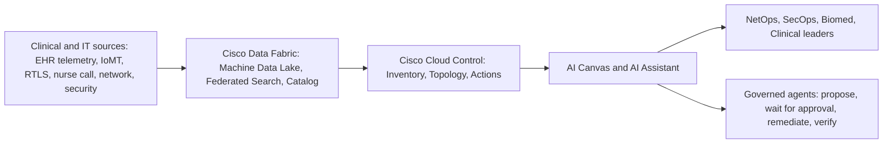

# Healthcare Infrastructure Storyboard: Context Document (Part B)

**Part 2 (cross-cutting: personas, KPIs, compliance recap) and Part 3 (Phase 2: Cisco Cloud Control and Cisco Data Fabric). Prepared November 12, 2026.**

This file follows `part-a1.md` (Part 0 and Part 1, the ten use cases today) and `part-a2.md` (the three pillars). Storyboard scenes are in `part-c-storyboards.md`.

---

## How to read Part B

**Citations.** Phase 1 prefixes still apply: [C-n] clinical, [S-n] security, [F-n] facilities, [A-n] AI. Two prefixes are new or extended in this file:

| Prefix | Research brief | Scope |
|---|---|---|
| [K-n] | `research/05-cisco-cloud-control-data-fabric.md` | Cisco Cloud Control, Cisco Data Fabric (powered by Splunk), status, licensing, guardrails. [K-3b] is the HTML release notes. |
| [A-n] (83 and up) | `research/04-ai-healthcare.md`, section F | Cisco AI Defense, AI infrastructure, Agent Observability, AI POD for Splunk |

Section-level K citations follow the Phase 1 convention: [K-E n] is item n of research 05's overclaim guardrails (section E); [K-gaps n] is item n of its Gaps section (section H); [K-PHI] is its PHI versus machine-data boundary section.

**Status tags on every Cisco capability.**
- **GA**: a Cisco or Splunk source calls it generally available or "available now." Cloud Control GA is **US only**.
- **CA**: Controlled Availability, beta, or alpha. The source's exact word is given in parentheses, for example CA (beta) or CA (alpha).
- **Roadmap**: announced, "coming," "will," "targeted," or no shipping evidence found.
- Where sources conflict, both are shown, for example "CA (beta, June 2026); October 2026 deck says AVAILABLE; confirm."

**Labels carried from Phase 1.** ESTIMATE, VENDOR-REPORTED, Analysis, and Gap keep their Phase 1 meanings. Part B adds one more:
- **Modeled**: a qualitative description of how work changes when operators use one shared investigation. It is not a measured result, and it is never expressed as a percentage. No Cisco healthcare customer metric for Cloud Control or Data Fabric was found [K-E 11][K-E 14]; non-healthcare customer figures in Cisco's GA blog must not be reused as healthcare results [K-1].

**Scope reminder.** No Cisco healthcare-specific SKU exists for Cloud Control or Data Fabric [K-E 11][K-30]. Every healthcare mapping in this file is positioning, not a Cisco healthcare product claim.

---

# Part 2: Cross-cutting

## 2.1 Personas (day in the life, tagged to pillar)

Personas are roles, not named individuals. Frictions trace back to the Phase 1 journeys in `part-a1.md`.

**CIO (pillar: Facilities, with Security and AI).** Owns the operating budget at a 2.5% system margin [C-4] and answers to the board for every hour the EHR is down. Cares about uptime, total cost of tools, and how fast an acquired clinic can be brought onto the standard stack. Typical friction: the 2 a.m. call where five teams each say "not us" and nobody can tell the CIO which part of the estate is actually broken (use case 1). Lives in the Facilities pillar because the estate (campus, clinics, data center) is the CIO's balance sheet.

**CISO (pillar: Security).** Owns ransomware readiness, identity, segmentation, and the regulator conversation. Cares about blast radius, mean time to contain (64 days global, IBM 2026 [C-1]), and evidence that a segment was isolated on a given date. Typical friction: being asked to decide whether to sever internet connectivity before anyone can say which segments are clean (use case 3), and finding vendor accounts without MFA (use case 8).

**CMIO (pillar: AI).** A physician executive who owns clinical informatics, ambient documentation rollout, and AI model governance. Cares about clinician time in the EHR, scribe reliability, and whether AI output is safe enough to sign. Typical friction: a Monday-morning scribe outage that IT cannot explain for two hours because the root cause is an upstream model provider (use case 10) [A-39][A-40].

**CNIO (pillar: AI and Facilities).** Owns nursing informatics: badge workflows, nurse call integration, mobile EHR apps, and downtime documentation. Cares about the 35% of a shift nurses already spend documenting [C-59] and about every login and roam that steals time. Typical friction: co-signing a Wi-Fi change that enables 802.11r for badges and breaks an older barcode scanner on the same SSID (use case 4).

**CNO (pillar: Facilities).** Accountable for nurse staffing, safety events, and patient experience across every unit. Cares about call-light response (averages about 3 to 4 minutes; one hospital averaged over 17 minutes [F-47][F-48]) and how long units run on paper. Typical friction: running a downtime drill during a short-staffed week and finding a binder with a dead phone extension (use case 9).

**Network engineer (pillar: Facilities).** Runs campus switching, Wi-Fi, SD-WAN, and the data center fabric. Cares about change windows, configuration drift (configuration and change failures caused 34% of major network outages [C-81]), and proving the network innocent quickly. Typical friction: spending the first hour of every P1 bridge pulling dashboards from separate consoles to show the core links are fine (use case 1).

**SOC analyst (pillar: Security).** Watches detections, triages alerts, and writes the first incident notes. Cares about mean time to acknowledge and mean time to know, neither of which has a published healthcare benchmark [S-gaps 1]. Typical friction: seeing SMB traffic from a pump VLAN address, then finding the inventory, CMMS, and MDS2 records all disagree about what the device even is (use case 2).

**Biomed / HTM engineer (pillar: Security and Facilities).** Owns medical device maintenance, the CMMS, and vendor remote access. Cares about devices that keep infusing safely when the network changes, and about the 10 to 15 devices per bed they are responsible for [F-23]. Typical friction: being called at night to confirm pumps still work standalone after an emergency ACL went in with no tested rollback (use case 2).

**VP of Facilities (pillar: Facilities).** Owns the building: BMS and HVAC, access control, life-safety, power, and telecom rooms on the critical branch. Cares about pressure relationships in ORs, Joint Commission Physical Environment findings, and OT that can run off-network [F-17][F-19]. Typical friction: building systems that share network paths with clinical endpoints, so a cyber event on either side threatens both (Analysis) [F-17].

**Bedside nurse (pillar: Facilities).** Works a 12-hour shift with a badge, a workstation on wheels, and a voice device. Cares about logging in fast, calls that do not drop, and pumps that talk to the EHR. Typical friction: writing vitals on a glove because Hyperspace is spinning (use case 1), and a choppy badge call during a rapid response (use case 4).

**Physician (pillar: AI).** A hospitalist or primary care physician who depends on the EHR and, increasingly, an ambient scribe. Cares about finishing notes before going home and about access that does not fight back. Typical friction: typing notes at night after a mid-clinic scribe failure (use case 10), and a different username at the newly acquired hospital (use case 8).

**Radiologist (pillar: AI).** Reads locally or remotely, often with AI triage reprioritizing the worklist. Cares about STAT studies loading in seconds and AI flags arriving before the read, not after. Typical friction: a STAT head CT streaming slice by slice while PACS, NetOps, and the VNA team argue from separate logs (use case 5).

**Patient (pillar: Facilities and Security).** Experiences infrastructure only as delay: a repeat ECG, a rerouted ambulance, a frozen video visit. Cares about safe, timely care and about their data. Typical friction: an ambulance diverted to a farther hospital during a cyber downtime (use case 3), or a hospital-at-home video visit that freezes twice (use case 6).

**Family member (pillar: Facilities).** Supports a patient at the bedside or at home. Cares about being able to reach the care team and trusting the equipment in the living room. Typical friction: watching a pulse oximeter tile go gray at home and not knowing whether it is the patient or the cellular hub (use case 6) [F-37].

## 2.2 KPI and ROI reference tables

All figures carry their Phase 1 label. "Proposed KPI" rows have no published benchmark and must be shown in storyboards as "measured locally; no industry benchmark" (`part-a2.md` S.4) [S-gaps 1].

### Table 2.2a: Detection, response, and recovery (MTTx)

| # | Metric | Figure | Label | Source |
|---|---|---|---|---|
| 1 | MTTI (IBM mean time to identify), global | 183 days (2026); 181 days (2025) | Cited | [C-1] |
| 2 | MTTC (mean time to contain), global | 64 days (2026); 60 days (2025) | Cited | [C-1] |
| 3 | Breach lifecycle, healthcare | 279 days (2025; no 2026 healthcare figure) | Cited; Gap for 2026 | [C-2][S-gaps 2] |
| 4 | Breach lifecycle, global | 247 days (2026); 241 days (2025) | Cited | [S-3] |
| 5 | MTTD proxy: median dwell time | 14 days global (2026, up from 11) | Cited | [S-8] |
| 6 | Detected internally | 52% of all cases; 41% of ransomware cases (2026) | Cited | [S-9] |
| 7 | MTTR: ransomware recovery within a week | 58% (2025; 21% in 2024) | VENDOR-REPORTED | [C-86] |
| 8 | MTTR: full breach recovery | 42% fully recovered; 19% needed over 150 days (2026) | Cited | [S-3] |
| 9 | CrowdStrike event recovery | 58.1% of services within 6 hours; 7.8% over 48 hours; median hospital downtime about 5 hours | Cited (methodology disputed by CrowdStrike) | [C-64][S-81] |
| 10 | Healthcare downtime durations | Ascension EHR about 6 to 7 weeks (C) or 37 days to full restore (S); Kettering Epic 13 days; Lurie Epic about 33 days; Synnovis about 6 months | Cited; sources conflict on Ascension | [C-11][S-60][C-62][C-69][C-67] |
| 11 | Critical system restore target | 72 hours | Proposed rule, not final | [C-13] |
| 12 | Offline planning horizon | 4 weeks or longer (Sentinel Event Alert 67); CRR targets 30+ day outages | Cited | [C-19][S-14] |
| 13 | **MTTA** (alert to human acknowledgment) | No published benchmark | Proposed KPI | [S-gaps 1] |
| 14 | **MTTK** (acknowledgment to root cause known) | No published benchmark | Proposed KPI | [S-gaps 1] |
| 15 | **MTTInn** (mean time to innocence: symptom to every candidate domain cleared or implicated) | No published benchmark | Proposed KPI | [C-gaps 3][S-gaps 1] |
| 16 | Device MTTD, device patch latency, device MTTR | No neutral benchmark | Gap | [C-gaps 8] |
| 17 | Vulnerability dwell time on medical devices | 3.2 years average (2025) | VENDOR-REPORTED | [C-24] |
| 18 | Critical vulnerability remediation, all sectors | 26% fully remediated; 43-day median | Cited | [S-7] |

### Table 2.2b: Clinical performance thresholds and targets

| # | Metric | Figure | Label | Source |
|---|---|---|---|---|
| 19 | ICA RTT thresholds | Warning 300 ms; critical 400 ms | Cited (product defaults) | [C-37] |
| 20 | Logon duration thresholds | Warning 40 s; critical 70 s | Cited (product defaults) | [C-37] |
| 21 | SSO login time | Reconnect 29.3 s to 8.9 s; first-of-shift 34.6 s to 29.3 s | Cited | [C-77] |
| 22 | Voice roam targets | Under 50 ms ideal; under 100 ms acceptable | Cited | [C-44] |
| 23 | Measured roams | WPA3-SAE without FT about 174 ms; with FT about 31 ms | VENDOR-REPORTED | [C-45] |
| 24 | Stroke transfer door-to-device goal | 60 minutes for 50% or more of transfer patients | Cited | [C-89] |
| 25 | AI PE triage report turnaround (work hours) | 68.9 to 46.7 minutes; off-hours change not significant | Cited | [C-50] |
| 26 | CT study transfer time | 1 GB over 100 Mbps at 70% usable: about 114 s; over 1 Gbps: about 11 s | ESTIMATE (arithmetic) | [C-101] |
| 27 | Hospital-at-home response | Emergency personnel within 30 minutes; process for patients unreachable within 15 minutes | Cited (waiver condition) | [F-83] |
| 28 | Cellular cardiac monitor alarms over 30 s threshold | 33.5% traced to damaged devices or inadequate cellular connections | Cited (pilot) | [F-37] |
| 29 | Ambient scribe vendor outages, 2026 | 1 h 35 min to 2 h 10 min, four incidents tied to upstream dependencies | Cited (vendor status pages) | [A-39][A-40][A-41][A-42] |
| 30 | GPU rack density | 120 to 132 kW per rack vs about 9 kW typical | Cited | [A-49][A-50][A-51] |

### Table 2.2c: Cost and ROI

| # | Metric | Figure | Label | Source |
|---|---|---|---|---|
| 31 | Average healthcare breach cost | $6.64M (2026); $7.42M (2025) | Cited | [C-1][S-3] |
| 32 | EHR downtime lost charges, large hospital | Up to $1M per hour (quoted 2018) | ESTIMATE | [C-78] |
| 33 | Physician cost of unplanned downtime | $634 per physician per hour (cited 2017) | ESTIMATE | [C-80] |
| 34 | Last major outage cost (all industries) | 57% over $100,000; 1 in 5 over $1M | Cited (survey) | [C-82] |
| 35 | SSO clinician time value | $168,474 per hospital per year; $3.2M across 19 hospitals | ESTIMATE of dollar value | [C-77] |
| 36 | Change Healthcare / UnitedHealth Group | $3.09B in 2024; $799M more in Q4 2025 | Cited | [C-9][S-54] |
| 37 | Ransomware recovery cost, healthcare | $1.02M average | VENDOR-REPORTED | [C-86] |
| 38 | Change Healthcare revenue impact | About 60% of affected hospitals reported $1M per day or more | Cited | [F-70] |
| 39 | Medicare RPM payments | $536M in 2024, up 31% | Cited | [C-35] |
| 40 | Cisco telemetry ingest into Splunk | Eligible Cisco security, network, and operational data receives a built-in 50% weighted ingest rate | Verified Cisco/Splunk statement (pricing mechanism, not a customer outcome) | [K-17] |

**ROI framing rule (Analysis).** Cloud Control and Data Fabric ROI in this storyboard is expressed only as (a) the cited cost of the Phase 1 problem, (b) the verified pricing mechanisms in row 40 and the "included with eligible Essential and Advantage subscriptions" licensing statement [K-8], and (c) modeled workflow change. No healthcare Cloud Control ROI figure exists.

## 2.3 Compliance matrix recap

Full detail is in `part-a2.md` section S.7 and in each use case's "Compliance hooks." The right-hand column is positioning: it describes evidence that operational tooling can help produce, not compliance that any tool confers. HIPAA alignment of Cloud Control and AI Canvas is the customer's responsibility to confirm [K-29].

| Framework | Status (Nov 12, 2026) | Requirement most relevant to infrastructure | Where Phase 2 tooling can help produce evidence (positioning) | Phase 1 detail |
|---|---|---|---|---|
| HIPAA Security Rule | In force | Risk analysis; safeguards | Audit log, inventory, retained machine data | S.7 [S-23] |
| HIPAA NPRM (Jan 6, 2025) | Proposed, not final; July 2027 target | Asset inventory, network map, segmentation, MFA, 72-hour restore | Inventory and Layer 3 topology as map inputs; Identity posture; incident timeline in AI Canvas | S.7 [S-19][S-21]; UC9 |
| HHS CPGs / HICP | Voluntary | Segmentation, MFA, monthly unsegmented-device count | Identity and topology views; Splunk searches over retained telemetry | S.7 [S-25][S-27] |
| FDA 524B | In force (on manufacturers) | SBOM, vulnerability plan for cyber devices | Indirect only: device connectivity telemetry retained for investigations | S.5 [S-30] |
| Joint Commission EM / SEA 67 / CRR | Accreditation; CRR voluntary | Continuity, 4+ week offline readiness, drills | Persistent AI Canvas incident record for after-action review (Analysis) | S.6 [C-19][S-14] |
| CMS emergency preparedness CoP | In force | All-hazards plan including cyber | Same as above | S.7 [S-38] |
| NY 10 NYCRR 405.46 | In force | 72-hour incident reporting, MFA | Incident timeline; Identity posture | S.7 [S-45] |
| Section 1557, HTI-5, FDA CDS | In force / evolving | AI tool governance | AI Defense discovery; Agent Observability traces (not model validation for clinical use) | A.6 [A-65][A-68][A-70] |

---

# Part 3: Phase 2, Cisco Cloud Control and Cisco Data Fabric

## 3.1 Platform primer: Cisco Cloud Control

**Availability.** Cisco Cloud Control entered Controlled Availability in the US on June 2, 2026 at Cisco Live, and became **GA for US customers on August 25, 2026** [K-1][K-2][K-3]. It is **US only**; other regions are "future milestones" with no date [K-4]. **Status: GA (US).**

**What it is.** "With one login, Cisco Cloud Control delivers a single view of Cisco networking, security, compute, observability, and collaboration in one secure environment" [K-1]. In healthcare terms (positioning): one operating view for the health system's network, security, and data center teams across the hospital campus, clinics, and data center.

**Core experience (all GA, US).**
- **Unified identity:** single sign-on across supported connected products, subject to existing permissions [K-1].
- **Inventory:** one asset view with AI-powered search and product-specific sync intervals [K-1][K-3].
- **Topology,** including Layer 3 (subnets, VRF, VLAN, protocol, IP) for SD-WAN, Meraki, Nexus Hyperfabric, Nexus Dashboard, and Catalyst Center; role-filtered topology [K-3].
- **AI Insights in Topology:** which sites and devices need attention first, with reasoning and evidence [K-3].
- **Actions:** correlated alerts, incidents, site-level summaries, RBAC, bulk dismiss or resolve [K-3][K-3b]. **GA** as a Cloud Control feature. Note: "Agentic Actions for networking" was **CA (beta)** in June 2026, and an October 13, 2026 Cisco deck labels Actions "CONTROLLED AVAILABILITY" [K-7][K-10]. These may be two different things; confirm with Cisco [K-gaps 5].
- **Audit log, licensing visibility, tenant groups, environments** [K-3][K-3b]. Tenant groups can include only one ThousandEyes tenant and one Security tenant [K-3].

**Connected domains (GA, US, August 25, 2026 unless noted)** [K-1][K-3][K-3b][K-4]:
Meraki; Catalyst Center (through Meraki Global Overview); Catalyst SD-WAN; Nexus Dashboard; Nexus Hyperfabric; Cisco Intersight (SaaS US-East only, no Virtual Appliance); Cisco Identity (Okta, ISE, Active Directory; non-Cisco sources need Duo Advantage+ or ISE Advantage+); Security Cloud Control (including Secure Access licensing visibility and notifications); ThousandEyes (AI features must be enabled for AI Canvas); Splunk (integration June 30, 2026; requires Splunk Cloud 10.5+ on US Commercial AWS); Collaboration Control Hub; Cisco IQ; Cisco Spaces (GA November 10, 2026; connector health only).

**Third parties.** **GA:** ServiceNow, BlueCat, Infoblox, Atlassian, "within a broader ecosystem backed by more than 60 integration commitments" [K-1]. AWS, Linear, Microsoft, PagerDuty, Slack, and Google Cloud were named at launch with individual GA status not confirmed [K-2]. The press-reported Marketplace partner list is **Roadmap** [K-11]. No native Citrix, EHR vendor, nurse call, or RTLS vendor connector was found [K-E 20].

**AI layer.**
- **AI Assistant** (natural-language entry point, supported and authorized actions): **GA (US)** [K-1][K-10].
- **AI Canvas** (multiplayer, persistent investigation workspace; Default Mode and Deep Reasoning Mode; generated widgets): entered **CA** June 2, 2026 [K-6]; included in the August 25 **GA** experience and the licensing FAQ [K-1][K-8]. The Workflows agent inside AI Canvas is **CA (beta)** [K-3].
- **Cisco agents in AI Canvas** (choose Meraki, ThousandEyes, Security, and other product agents): **GA (US)** [K-3].
- **Deep Reasoning** (competing hypotheses, evidence, impact, root cause, next steps): **CA (beta)** in June 2026; the October 13, 2026 deck labels it "AVAILABLE"; confirm [K-7][K-10].
- **Cisco Agentic Workflows** (turn recommendations and repetitive tasks into reusable automations): **GA** [K-1][K-3]. Running workflows from inside AI Canvas: **CA (beta, Default Reasoning mode only)** [K-3].
- **Deep Network Model:** announced as the reasoning model in Cloud Control and powering AI Canvas for data center networking; no standalone GA statement [K-2][K-13].

**Not GA (do not present as shipping).**

| Capability | Status | Source |
|---|---|---|
| Cloud Control Studio: Agent Builder | Roadmap ("targeted for late 2026" per press) | [K-2][K-5][K-11] |
| Cloud Control Studio: App Builder | Roadmap | [K-2][K-11] |
| Cloud Control Marketplace | Roadmap | [K-1][K-11] |
| Digital Twin | CA (alpha, July 2026); no later status | [K-7] |
| Expanded (Enhanced) Experience Metrics | CA (beta, still beta October 13, 2026) | [K-7][K-10] |
| Autonomous agentic loop (sense, diagnose, remediate, validate, deploy) | Roadmap ("will be able to") | [K-2][K-7] |

**Licensing.** Cloud Control and AI Canvas are included with eligible Cisco product subscriptions at Essential and Advantage tiers at no additional cost, and Cisco "reserve[s] the right to change this in the future" [K-8][K-14][K-15]. Eligibility must be confirmed per product.

**Domain controllers remain the system of record.** "Domain controllers remain responsible for their specialized management and execution, while Cloud Control connects the work between them" [K-1]. Cloud Control "complements existing Cisco product controllers" without replacing product dashboards [K-3][K-4]. In every scene, changes execute in Meraki, Catalyst Center, SD-WAN Manager, ISE, Security Cloud Control, and other domains of record.

**Supported autonomy framing.** Cisco's trust levels: L1 Diagnose only, L2 Recommend, **L3 Supervised autonomy ("Execute after I click approve")**, L4 Autonomous ("Act within policy") [K-10]. This storyboard uses **human-approved L3** as the ceiling for anything that touches clinical systems. Phase 1's agentic risk Tier 3 (firewall rule, pump VLAN, identity policy, segment isolation) maps to Cisco L3 with a named human approver (Analysis; see `part-a2.md` A.5).

**What "reversible" means here.** The cited rollback is "full rollback support" for **agent versions** in the Studio draft, sandbox, and publish lifecycle [K-5], which itself is Roadmap. No source says network configuration changes made through Cloud Control are automatically reversible. Network rollback remains a change-management responsibility executed in the domain controller. Digital Twin is the change-validation story and is **CA (alpha)** [K-7].

**Governance mapping (the storyboard's five words).**

| Word | Supported by | Caveat |
|---|---|---|
| Visible | Agent traces [K-5]; AI Canvas reasoning trail [K-6] | None |
| Auditable | Audit log [K-3]; traces [K-5] | None |
| Bounded | AI Defense policy enforcement (Studio framing) [K-5]; RBAC [K-3]; AI gateway [K-14] | Studio is Roadmap |
| Human-approved | "Agents propose. Humans approve" [K-5]; L3 [K-10]; plan approval before agents run [K-6] | None |
| Reversible | Agent version rollback only [K-5] | Not network changes |

## 3.2 Cisco Data Fabric (powered by Splunk) deep dive

Splunk describes Cisco Data Fabric powered by the Splunk Platform as "the system of record and intelligence for the agentic enterprise," in three layers: data, context, and action [K-17][K-18][K-25]. In this storyboard, "system of record" means system of record for **machine data**, never for clinical records.

Diagram note: "Clinical and IT sources" means the **machine data** those systems emit (performance, connectivity, system events), not patient records. "Remediate" happens in the domain controller after human approval.

### Components and status

| Component | What it does | Status | Source |
|---|---|---|---|
| **Machine Data Lake** | Full-fidelity machine data in a "low-cost, Splunk-managed" tier, "cataloged and schematized but not indexed"; promote slices to an index or Analytics Table, including streaming promotion | **GA** August 4, 2026, Splunk Cloud 10.5.2605.5 in US-East, Frankfurt, Tokyo, Sydney (not every region) | [K-17][K-18][K-19] |
| **Catalog** | Keyword search over dataset names, owners, types, fields; inspect coverage before promotion; Splunk RBAC | **GA** August 4, 2026 (same regions) | [K-17][K-18] |
| MCP-enabled Catalog Discovery | Agent-driven discovery | Roadmap (announced September 15, 2026; no GA statement) | [K-20] |
| **Federated Search** | Search data where it lives, with schema inference | **GA** targets: Amazon S3 (May 18, 2026); Azure Blob, ADLS Gen2, Azure Databricks, Snowflake, Splunk DDSS (July 6, 2026); AWS CloudWatch Lake and Databricks (September 15, 2026). Federated Analytics for Amazon Security Lake listed as current. **Splunk Cloud Platform only**; S3 and Azure options in AWS regions only | [K-19][K-20][K-21][K-22] |
| Federated Search over Iceberg, Delta Lake | Named only on a product page | **Not GA; unverified.** Do not list | [K-23] |
| **AI-Powered Data Management** | Guided Onboarding, Auto Schematization with CIM mapping recommendations, Self-Healing Pipelines for CIM drift | **GA** August 4, 2026 | [K-17] |
| Context Layer (knowledge graph, lineage) | Connect a log to service, host, site, impact | Catalog is GA; knowledge graph and lineage have no GA date (Roadmap) | [K-24][K-25][K-26] |
| **Agent Launchpad** | No-code agent build: choose the LLM, connect tools, select skills; RBAC; every run traceable | **GA** in Splunk Cloud (August 4, 2026); on-prem Splunk Enterprise on AI POD is Roadmap ("coming later this year") | [K-17][K-27] |
| Splunk agent skills | Open source reusable investigation steps | **GA** (released August 4, 2026) | [K-17] |
| Splunk MCP Server | Required app for the Cloud Control Splunk integration | **GA** | [K-4] |
| **Cisco AI POD for Splunk** | Self-managed Splunk AI on-prem, private cloud, or air-gapped | **GA** September 15, 2026 | [K-27] |
| Self-hosted models | Cisco Deep Time Series Model, Google Gemma 4, OpenAI GPT-OSS 20B | **GA** September 15, 2026; NVIDIA Nemotron is Roadmap | [K-27] |
| **Splunk Agent Observability with Tokenomics** | Agent tracing and AI cost visibility; also available in Cloud Control | **GA** September 15, 2026 | [K-19][K-27] |
| Network Intelligence App | SD-WAN, firewall, Nexus intelligence surfaced in Cloud Control | Released September 15, 2026 per Splunk and press; confirm GA wording with account team | [K-19][K-20] |
| **50% weighted ingest** | "Eligible Cisco security, network, and operational data is automatically recognized in Splunk and receives a built-in 50% weighted ingest rate" | **GA** (verified) August 4, 2026 | [K-17] |
| Activity-Based Pricing | Weights search and ingest equally | Roadmap ("Set to release this Fall") | [K-20] |

**Storage economics wording.** Use "low-cost tier," "retaining all ingested data in open formats," and "promote when premium costs warrant" [K-17][K-19][K-24]. TechTarget: "This shifts the cost decision from what should be retained to what needs to be activated for analysis" [K-19]. Do not say "object storage cost." Say "schema inference" and "cataloged and schematized but not indexed," not "schema-on-read engine."

### The PHI versus machine-data boundary

**In scope for Data Fabric (machine data)** [K-PHI]:
- Network telemetry (Meraki, Catalyst, SD-WAN, Nexus, ThousandEyes).
- Security telemetry (firewalls, Secure Access, Splunk Enterprise Security detections).
- Identity events (ISE, Duo, Okta, Active Directory).
- IoMT **connectivity** telemetry (connection, posture, segmentation events).
- Nurse call and RTLS **system events** and infrastructure health (controller up or down, gateway errors), not clinical call content or patient location.
- EHR **performance** telemetry (response time, availability, synthetic tests).

**Out of scope.** The designated record set (45 CFR 164.501 [A-61]) stays in the EHR and clinical systems of record. Data Fabric is not a clinical data repository, not an EHR data store, and not HIPAA-certified [K-E 8].

**Watch the edges (Analysis).** Machine data can become PHI if it carries identifiers such as MRNs, patient-linked IP addresses, or device serials, or if it captures prompt contents with patient details [A-60][A-D]. Splunk states sensitive data can be masked or tokenized at ingest and that federation leaves regulated data in its home region (blog with unconfirmed date) [K-24]. For data that cannot leave the data center, Cisco AI POD for Splunk (**GA**) runs on-prem or air-gapped, and Splunk names healthcare among industries where "their data will never leave their data centers" [K-20][K-27].

**HIPAA is the customer's responsibility.** Splunk Lantern: Cloud Control and AI Canvas are "Third Party Content" under Splunk terms, and customers are "responsible for reviewing the applicable Cisco terms... to confirm alignment with your compliance requirements, including... HIPAA" [K-29]. Cisco's Getting Started guide lists identifying HIPAA requirements as a prerequisite [K-4]. No Cisco BAA or HIPAA statement specific to Cloud Control or AI Canvas was found [K-gaps 9].

### "No separate Splunk license" (narrow claim)

- **What is supported:** Agent Observability and the Network Intelligence app "surface in Cisco Cloud Control, giving Cisco customers Splunk-powered insights without requiring a Splunk license" [K-19]. Splunk's blog says "this same functionality" is available through Cloud Control with "no separate Splunk license required," without defining scope [K-20].
- **What requires Splunk:** searching your own Splunk data from AI Canvas, Splunk skills in AI Canvas, and the Splunk AI Assistant through the Cisco Unified AI Assistant require an existing **Splunk Cloud Platform stack, version 10.5 or later, hosted on US Commercial AWS**, with the Splunk MCP Server and Splunk AI Assistant apps installed and the `mcp_tool_execute` capability assigned [K-4]. GCP, Azure, FedRAMP, and Gov Cloud are future support [K-4].
- **Regional note:** Cloud Control's Splunk connection runs in US West, while Machine Data Lake GA regions exclude US-West; customers in AWS US East should review regional data requirements [K-4][K-18][K-gaps 8].
- **Separate products:** Splunk Enterprise Security and Splunk Observability are separate Splunk products and licenses; Cloud Control does not include a SIEM [K-E 19].
- **Known issue:** the Splunk AI Assistant may generate SPL with the `rest` command, which the Splunk MCP cannot execute [K-3].

## 3.3 Use cases with Cisco Cloud Control

Each use case below rewrites the Phase 1 journeys, lists components in order of use with status tags, states the expected MTTx shift as **cited** or **modeled**, and closes with risk and governance. Journeys are illustrative composites. No Cisco healthcare customer metric exists for any of them.

Shared governance pattern (applies to every use case, stated once here):
1. **Human in the loop:** any action that can touch a clinical system (EHR path, medical device segment, identity policy, building system path) is L3: proposed by an agent or workflow, approved by a named human, executed in the domain controller [K-10][K-5].
2. **Auditability:** the AI Canvas investigation persists and is shared; the Cloud Control audit log and agent traces record who approved what [K-3][K-5][K-6].
3. **Reversibility caveat:** network rollback is a change-management step in the domain controller; the only cited "rollback" is for agent versions [K-5].

### Use case 1: EHR availability and clinical application performance

**Journeys.**
- **Patient. Today:** at ED shift change, registration hangs, a repeat ECG is ordered because results will not load, and the bed board goes stale. **With Cloud Control:** the same slowdown begins, but the operations team sees it as one incident within the shift. Registration still prints a downtime face sheet for a few minutes; the window in which the patient waits on a stale bed board is shorter because teams stop debating whose problem it is (modeled).
- **Engineering. Today:** a P1 bridge where virtualization, application, network, and storage each pull their own dashboards and spend the first hour proving innocence; the storage path is found late. **With Cloud Control:** the on-call engineer opens an AI Canvas investigation, brings in the ThousandEyes and network agents, and sees EHR synthetic tests failing from some sites but not others, campus and SD-WAN topology healthy, and Intersight and Nexus Dashboard views of the data center. Federated Search and Splunk add the virtualization logon-duration telemetry. The storage team joins a canvas that already shows "network cleared" with evidence.
- **Clinical. Today:** the nurse jots vitals on a glove while Hyperspace spins, then the unit goes to BCA printouts. **With Cloud Control:** the charge nurse gets one status update from the command center that names the cause and an estimated path to restore, instead of conflicting messages from five teams. Downtime procedures are unchanged and still required (Analysis).

**Components in order.**
1. ThousandEyes synthetic tests toward the EHR and virtualization front end, surfaced in AI Canvas: **GA** [K-1][K-4]. (Tests are customer-configured; no native EHR or Citrix connector [K-E 20].)
2. Actions correlates alerts into a site-level incident: **GA** [K-3].
3. AI Canvas (Default Mode) with Cisco agents for ThousandEyes, Meraki, SD-WAN: **GA (US)** [K-1][K-3].
4. Topology with Layer 3 and AI Insights to clear campus, Wi-Fi, and WAN: **GA** [K-3].
5. Intersight and Nexus Dashboard views of compute and fabric: **GA** [K-1].
6. Splunk data (virtualization and application telemetry, if collected in Splunk or Splunk Observability) via the Splunk integration: **GA** with Splunk Cloud 10.5+ on US AWS [K-4]; promote the incident window from Machine Data Lake: **GA** [K-18].
7. Deep Reasoning for a defensible root cause write-up: **CA (beta); October deck says AVAILABLE; confirm** [K-7][K-10].
8. ServiceNow ticket enrichment: **GA** [K-1].

**Expected MTTx shift.** MTTInn (proposed KPI): **modeled:** operators work from one investigation instead of five consoles, so domains are cleared with shared evidence rather than sequentially. MTTK: **modeled:** root cause hypotheses are ranked in one place. No cited Cisco healthcare metric.

**Risk and governance.** Investigation is L1 to L2 (diagnose, recommend). Any change to the data center or storage path is L3 and executes in the owning tool. EHR application internals remain the EHR vendor's and application team's domain.

### Use case 2: IoMT and medical device security plus visibility

**Journeys.**
- **Patient. Today:** overnight, the pump segment is isolated, auto-programming stops, and two nurses double-check rates by hand; a dose is late. **With Cloud Control:** the abnormal traffic is contained to the specific addresses involved after biomed confirms the pump class can run standalone, so fewer pumps lose server connectivity (modeled). Manual verification still happens for any affected pump.
- **Engineering. Today:** SecOps sees SMB from a pump VLAN address; inventory, CMMS, and MDS2 disagree; NetOps writes an emergency ACL with no tested rollback. **With Cloud Control:** a Splunk Enterprise Security detection arrives as a correlated Action. In AI Canvas, the analyst adds Identity context (ISE profile and session for the address) and topology (which switch, which VLAN, which site). An Agentic Workflow proposes a scoped quarantine. The workflow waits. Biomed and the network engineer review the proposal in the same canvas and approve. The change executes in the domain controller, and the canvas shows post-change verification.
- **Clinical. Today:** the ICU nurse sees gray monitor tiles and the call chain loops between biomed and IT. **With Cloud Control:** biomed sees the same topology view as IT, so the "which VLAN is that monitor on" question has one answer (modeled).

**Components in order.**
1. Splunk Enterprise Security detection (separate Splunk license): **GA** as a Splunk product [K-E 19].
2. Actions (correlated alert, incident): **GA** [K-3]; agentic remediation Actions: **CA** per October deck [K-10].
3. AI Canvas with Security agent: **GA (US)** [K-3].
4. Cisco Identity (ISE context): **GA** [K-3].
5. Topology and Inventory to locate the device and segment: **GA** [K-3].
6. Cisco Agentic Workflow proposing a VLAN or policy quarantine that requires approval: **GA**; running it from inside AI Canvas is **CA (beta)** [K-1][K-3].
7. Human approval (biomed plus network or security), executed in the domain controller (for example ISE, Meraki, or Catalyst Center): L3 [K-10][K-1].
8. Machine Data Lake retention of IoMT connectivity telemetry for the investigation; Self-Healing Pipelines for unusual device log formats: **GA** [K-17][K-18].
9. Agent Launchpad for a no-code SOC triage agent: **GA** in Splunk Cloud only [K-17].

**Expected MTTx shift.** MTTA and MTTK (proposed KPIs): **modeled:** the detection, identity context, and network location arrive in one investigation, and biomed reviews the same evidence instead of receiving a phone summary. Device MTTD and MTTR remain Gap [C-gaps 8].

**Risk and governance.** Medical device segments are Phase 1 Tier 3; approval by a named biomed and network owner is mandatory. HICP keeps scanners away from clinical devices [F-12]; nothing in this flow implies active scanning. Rollback of the quarantine is a planned change in the domain controller, not automatic.

### Use case 3: Ransomware resilience and downtime procedures

**Journeys.**
- **Patient. Today:** a stroke patient's ambulance is diverted; chemotherapy is cancelled; e-prescribing is down. **With Cloud Control:** downtime may still occur. The goal shown is narrower: leaders decide which segments must disconnect with better evidence, which may let some services (for example a clinic WAN region or the imaging network) stay up if they are shown to be clean (modeled; no cited outcome).
- **Engineering. Today:** mass file renames, HICS activation, and a decision to sever internet connectivity made with little segment-level evidence; the identity directory is suspect. **With Cloud Control:** the SOC opens an AI Canvas war room that persists across shifts. Splunk ES detections, Security Cloud Control and Secure Access notifications, Identity risk, and topology sit in one place. The team builds a blast-radius view by segment and site. Containment steps (isolating segments, disabling tunnels) are proposed and approved by the incident commander, then executed in each domain. Retained machine data in Machine Data Lake and federated archives in S3 support forensics.
- **Clinical. Today:** downtime binders, paper MAR, runners, CD couriers. **With Cloud Control:** the same paper procedures run. The clinical change is better information: the command center can tell nursing which systems are confirmed clean and which are not (modeled).

**Components in order.**
1. Splunk ES detections; Security Cloud Control; Secure Access notifications: **GA** (Splunk ES separate license) [K-3b][K-E 19].
2. Actions: correlated incident across sites: **GA** [K-3].
3. AI Canvas war room, multiplayer and persistent across shift changes: **GA (US)** [K-1][K-6].
4. Cisco Identity posture and risk for privileged and vendor accounts: **GA** [K-3].
5. Topology and Inventory for segment-by-segment blast radius: **GA** [K-3].
6. Agentic Workflows for pre-built isolation runbooks, approved by the incident commander: **GA**; from inside AI Canvas **CA (beta)** [K-1][K-3].
7. Machine Data Lake and Federated Search (S3, Azure, Snowflake) for forensic retention and search: **GA**, Splunk Cloud only [K-18][K-21][K-22].
8. Cisco AI POD for Splunk for organizations that require analysis to stay on-prem: **GA** [K-27].
9. Audit log for the after-action and regulator timeline: **GA** [K-3].

**Expected MTTx shift.** MTTC: **modeled:** containment decisions are made from one shared segment map instead of assembled spreadsheets. MTTInn (incident variant, Phase 1 UC3): **modeled:** clean segments are identified with evidence. MTTR to normal operations: not claimed; Phase 1 durations (13 days to about 6 months) reflect rebuild work no operations tool removes [C-62][C-67].

**Risk and governance (Analysis).** Cloud Control is a cloud service. If the incident commander severs internet connectivity, cloud console access may also be affected; the downtime plan must include out-of-band access to domain controllers and offline runbooks. Every isolation step is L3. No autonomous containment: the autonomous loop is Roadmap [K-2]. The storyboard does not depict attacker techniques.

### Use case 4: Clinical mobility and Wi-Fi reliability

**Journeys.**
- **Patient. Today:** a call-light page reaches the nurse late because the badge is between access points in a stairwell. **With Cloud Control:** the coverage and roaming problem near the stairwell was already ranked as a site needing attention, so the fix was scheduled before the fall-risk patient pressed the button (modeled). No cited source ties Wi-Fi to a specific fall (Gap) [C-gaps 12].
- **Engineering. Today:** the wireless engineer pulls roaming data, finds WPA3-SAE without fast transition (about 174 ms vs about 31 ms with FT [C-45]), and enabling 802.11r breaks an older scanner. **With Cloud Control:** AI Insights in Topology flags 5 East; the AI Assistant answers "which APs near the 5 East elevators show client issues"; the engineer works the fix in Meraki or Catalyst Center. The SSID split still needs a change request co-signed by biomed and nursing informatics. Digital Twin, which could validate the change, is **CA (alpha)** and is shown only as future.
- **Clinical. Today:** a rapid-response badge call drops; RTLS shows a pump "on 5 East" without a room. **With Cloud Control:** the call drop is investigated as one incident. RTLS location quality is not changed by Cloud Control; the Spaces connector shows connector health only [K-3b].

**Components in order.**
1. Meraki and Catalyst Center (through Meraki Global Overview) inventory and topology: **GA** [K-1][K-3].
2. AI Insights in Topology: **GA** [K-3].
3. AI Assistant: **GA** [K-1].
4. Cisco Spaces connector health in Inventory and Topology: **GA** (November 10, 2026), connector health only [K-3b].
5. Nurse call and badge platform **system events** onboarded to Splunk via Guided Onboarding and Auto Schematization: **GA** [K-17] (no native nurse call or RTLS connector [K-E 20]).
6. Expanded Experience Metrics for clinician Wi-Fi experience: **CA (beta)** [K-10].
7. Digital Twin to pre-validate RF or SSID changes: **CA (alpha)**; future only [K-7].

**Expected MTTx shift.** MTTInn for "badge dropped a call" (proposed KPI): **modeled:** RF, authentication, and controller health are visible together, with voice server and PBX events available only if onboarded to Splunk. Clinical WLAN MTBF and MTTR remain Gap [C-gaps 7].

**Risk and governance.** RF and SSID changes affect voice badges, monitors, and pumps; treat as L3 with nursing informatics and biomed sign-off. Automatic channel and power tuning remains a domain-controller function.

### Use case 5: Imaging and PACS data movement

**Journeys.**
- **Patient. Today:** a stroke CTA crawls across a WAN link saturated by overnight prefetch; the transfer team calls twice. **With Cloud Control:** the saturation pattern was visible in topology and path tests before the stroke case, and the prefetch window was moved (modeled). The 60-minute transfer door-to-device goal is unchanged [C-89].
- **Engineering. Today:** PACS blames the network, NetOps blames prefetch, VNA notes a cloud AI engine pulling every CT; no study-level view; a week of change requests. **With Cloud Control:** one AI Canvas investigation shows SD-WAN link utilization and Layer 3 path, ThousandEyes tests toward the AI orchestrator and cloud endpoint, and data center fabric and compute health from Nexus Dashboard, Hyperfabric, and Intersight. DICOM association logs, if onboarded into Splunk, are searchable in the same investigation. QoS and path changes are proposed and approved, then executed in SD-WAN Manager.
- **Clinical. Today:** the radiologist waits for a STAT head CT to stream and switches studies. **With Cloud Control:** the radiologist sees no new tool; the change is fewer slow STAT loads over time (modeled).

**Components in order.**
1. Catalyst SD-WAN interfaces in Inventory and Layer 3 Topology: **GA** [K-1][K-3].
2. ThousandEyes tests toward PACS, VNA, AI orchestrator, and cloud AI endpoints: **GA** [K-1].
3. Nexus Dashboard, Nexus Hyperfabric, Intersight for the imaging data center: **GA** [K-1].
4. Splunk with Auto Schematization for DICOM and PACS logs: **GA** [K-17] (no native PACS connector).
5. AI Canvas with Deep Reasoning for the root cause: AI Canvas **GA (US)**; Deep Reasoning **CA (beta); confirm** [K-1][K-7][K-10].
6. Agentic Workflow for the QoS or prefetch-window change request, approved by NetOps and the PACS admin: **GA**; from inside AI Canvas **CA (beta)** [K-3].

**Expected MTTx shift.** MTTInn for a slow study (proposed KPI): **modeled:** WAN, fabric, compute, and path are cleared in one view; modality and PACS application internals still require the PACS team. PACS retrieval latency benchmark remains Gap [F-gaps 1].

**Risk and governance.** QoS changes can starve other clinical traffic; L3 approval. Images and DICOM headers are PHI and must not be pulled into Data Fabric; only transfer telemetry (timing, association success, byte counts) is machine data (Analysis) [A-60].

### Use case 6: Telehealth, virtual care, and hospital-at-home

**Journeys.**
- **Patient. Today:** a hospital-at-home video visit freezes twice; the patient uses on-demand audio. **With Cloud Control:** the visit may still freeze if the home cellular link is weak. What changes is that the hospital can quickly say whether the video platform and the hospital's own paths were healthy at that time (modeled).
- **Engineering. Today:** "video visit failed" closes as "could not reproduce" because nothing on the path is instrumented. **With Cloud Control:** ThousandEyes tests toward the video platform and Secure Access status appear in AI Canvas alongside the clinician-side path. The engineer can clear or implicate the platform, the hospital edge, and Secure Access. The patient's home cellular hub and consumer devices remain outside Cisco visibility.
- **Clinical. Today:** a virtual nurse sees an SpO2 tile go gray and must decide whether it is the patient or the device; the 15-minute unreachable process and 30-minute emergency response clocks run [F-83]. **With Cloud Control:** the virtual nurse's escalation workflow is unchanged; IT can tell the command center within the shift whether a platform-wide issue exists (modeled).

**Components in order.**
1. ThousandEyes tests toward telehealth and RPM SaaS platforms: **GA** [K-1].
2. Security Cloud Control and Secure Access notifications: **GA** [K-3b].
3. AI Canvas with ThousandEyes agent: **GA (US)** [K-3].
4. Expanded Experience Metrics for clinician-side experience: **CA (beta)** [K-10].
5. RPM platform system events (not readings) onboarded to Splunk if available: **GA** onboarding tools [K-17].

**Expected MTTx shift.** MTTInn for a failed visit (proposed KPI): **modeled:** platform and hospital-side paths are cleared from one view; home-side causes remain hard to prove. Visit failure rate benchmark remains Gap [C-6 MTTx].

**Risk and governance.** RPM readings and video content are PHI and stay with the RPM and telehealth vendors under BAAs [A-57]. No change in this flow touches the patient's home equipment.

### Use case 7: Multi-site WAN, M&A integration, and clinic connectivity

**Journeys.**
- **Patient. Today:** at a newly acquired clinic, the patient refills paper history; referrals are faxed. **With Cloud Control:** clinical record integration is still an EHR project. What changes is that the clinic network is brought into the standard operating view sooner and safely (modeled).
- **Engineering. Today:** Day 1 reveals overlapping 10.x space, a flat VLAN with an X-ray unit, and open RDP. **With Cloud Control:** the acquired site's Meraki organization joins a tenant group or environment; Inventory and Layer 3 Topology show its subnets, VLANs, and devices next to the parent system's, which helps engineers spot overlap and flat segments (operator analysis, not an automated overlap feature). Security Cloud Control and Identity show posture. Cisco IQ highlights lifecycle risk. The site stays behind a firewall until the security baseline is met. SD-WAN with broadband plus LTE is provisioned through SD-WAN Manager.
- **Clinical. Today:** a storm takes out the rural clinic's single circuit; paper encounter forms. **With Cloud Control:** the circuit can still fail. AI Insights in Topology ranks the clinic as needing attention, and the SD-WAN view shows whether backup transport took over (modeled).

**Components in order.**
1. Tenant groups and Environments for multiple organizations and regions: **GA** [K-3][K-3b]. Constraint: one ThousandEyes and one Security tenant per tenant group [K-3].
2. Inventory and Layer 3 Topology (Meraki, SD-WAN, Catalyst Center): **GA** [K-3].
3. AI Insights in Topology: **GA** [K-3].
4. Security Cloud Control and Cisco Identity: **GA** [K-1][K-3].
5. Cisco IQ (lifecycle, end of support): **GA** [K-1]. Quantum Ready Assessments: status unconfirmed [K-gaps 14].
6. Agentic Workflows for golden-config rollout to new clinics, with approval: **GA** [K-1].
7. BlueCat or Infoblox for IP address management: **GA** third-party integrations [K-1].

**Expected MTTx shift.** Site onboarding time (Gap in Phase 1): **modeled:** the acquired site appears in the same inventory and topology as existing sites instead of a separate tool. MTTInn for "clinic EHR down" (proposed KPI): **modeled.**

**Risk and governance.** Connecting an acquired network is a high-impact decision; L3 approval by security. The OCR acquired-practice case puts responsibility on the acquirer [F-10].

### Use case 8: Identity, zero trust, and clinician access

**Journeys.**
- **Patient. Today:** during a directory outage, a trauma CT is ordered under a break-glass credential. **With Cloud Control:** break-glass remains a procedural control and still applies. Identity health is visible sooner, so the outage is scoped faster (modeled).
- **Engineering. Today:** a vendor uses a shared account without MFA; leavers keep accounts; impossible-travel alerts for a physician working across merged hospitals. **With Cloud Control:** Cisco Identity shows Okta, ISE, and Active Directory identities with posture and risk in one view. Splunk ES detections and Identity risk sit in the same AI Canvas investigation. Remediation (disable account, enforce MFA) is proposed and approved, then executed in the identity provider.
- **Clinical. Today:** a physician uses a different username at the acquired hospital and needs a phone in her locker for a second factor. **With Cloud Control:** clinician login experience does not change from Cloud Control itself; it changes only when IAM projects complete. Cloud Control helps IAM teams see where identities are fragmented (modeled).

**Components in order.**
1. Cisco Identity (Okta, ISE, AD; posture and risk): **GA**; non-Cisco sources require Duo Advantage+ or ISE Advantage+ [K-3].
2. Unified identity for admins across connected Cisco products: **GA** [K-1].
3. Security Cloud Control and Secure Access: **GA** [K-1][K-3b].
4. Splunk ES detections in AI Canvas: Splunk integration **GA** with Splunk Cloud 10.5+ on US AWS [K-4].
5. AI Canvas with Security agent: **GA (US)** [K-3].

**Expected MTTx shift.** Identity-based MTTD (Gap in Phase 1): **modeled:** identity risk and network detections are correlated in one investigation.

**Risk and governance.** Conditional access and account changes are Tier 3 (can lock clinicians out); L3 approval with clinical leadership awareness. Changes execute in the identity provider of record.

### Use case 9: Compliance, audit, and data governance

**Journeys.**
- **Patient. Today:** a breach letter about a vendor the patient never heard of; the call center cannot answer. **With Cloud Control:** no direct patient-facing change. Retained machine data may help the hospital determine scope faster (modeled).
- **Engineering. Today:** the compliance officer asks for a current ePHI network map; inventory lives in four places; segmentation evidence is screenshots. **With Cloud Control:** Inventory and Layer 3 Topology provide current inputs to the network map; the audit log records administrative actions; Machine Data Lake retains telemetry so the team can show segment isolation on a date in question; Catalog shows which datasets exist and who owns them. Cloud Control is not a GRC system, and the map still needs ePHI flow annotation by people.
- **Clinical. Today:** a nurse manager staffs a drill and finds a dead extension in a binder. **With Cloud Control:** unchanged; drills remain a human process. After-action reviews can use the persistent AI Canvas record (Analysis).

**Components in order.**
1. Inventory and Layer 3 Topology: **GA** [K-3].
2. Audit log: **GA** [K-3].
3. Licensing visibility: **GA** [K-3].
4. Machine Data Lake and Catalog (retention, discoverability): **GA**, listed regions only [K-18].
5. Federated Search over archived logs in S3, Azure, Snowflake: **GA**, Splunk Cloud only [K-21][K-22].
6. ServiceNow integration for evidence workflows: **GA** [K-1].
7. Cisco IQ for lifecycle and vulnerability posture: **GA** [K-1].

**Expected MTTx shift.** Audit evidence cycle time (Gap): **modeled:** evidence is queried rather than assembled from screenshots. Compliance-variant MTTInn (proving a segment was isolated on a date): **modeled**, dependent on retention.

**Risk and governance.** Cloud Control and AI Canvas HIPAA alignment is the customer's to confirm [K-29]. Retention policies for machine data must be set deliberately, since logs can carry identifiers [A-60].

### Use case 10: AI workload delivery

**Journeys.**
- **Patient. Today:** a scribe note includes a dose that was never discussed. **With Cisco:** Cloud Control does not validate clinical note accuracy; physician review remains the control. AI Defense runtime guardrails address prompt injection and sensitive-data leakage, not clinical correctness [A-83].
- **Engineering. Today:** scribe notes stop; the network team checks Wi-Fi and the edge for two hours before the vendor blames an upstream model provider. **With Cloud Control:** ThousandEyes tests toward the scribe vendor's endpoints appear in AI Canvas next to exam-room Wi-Fi and internet edge health. The team clears the hospital side quickly and escalates to the vendor with evidence (modeled). Visibility inside the vendor's upstream model provider is not claimed.
- **Clinical. Today:** the physician types at night; a resident pastes a case into a consumer chatbot. **With Cisco:** AI Defense discovery helps security find unsanctioned AI apps [A-83]; on-prem inference options (Unified Edge, AI POD for Splunk for operational AI) keep some workloads inside the hospital [A-104][K-27].

**Components in order.**
1. ThousandEyes tests toward AI SaaS endpoints: **GA** [K-1].
2. Meraki and Catalyst topology for exam-room Wi-Fi: **GA** [K-3].
3. AI Defense (discovery, model validation, runtime guardrails): **GA** [A-83]; AI BOM **GA** [A-85]; February 2026 additions (MCP Catalog, real-time agentic guardrails) announced, per-feature GA not confirmed [A-84].
4. Splunk Agent Observability with Tokenomics (traces, AI cost), also surfaced in Cloud Control: **GA** [K-19][K-27].
5. AI infrastructure for on-prem inference: UCS C885A M8 **GA** [A-98]; Nexus Hyperfabric AI **GA** (secondary source) [A-97][A-99]; Unified Edge XE130c M8 **GA** [A-102][A-103]; Intersight and Nexus Dashboard in Cloud Control **GA** [K-1].
6. Cisco AI POD for Splunk with self-hosted models for operational AI that must stay on-prem: **GA**; Nemotron **Roadmap** [K-27].

**Expected MTTx shift.** MTTInn for a scribe failure (proposed KPI): **modeled:** hospital-side domains cleared in one view. AI service SLA remains Gap [C-gaps 9].

**Risk and governance.** Agents that act on infrastructure follow L3. Agent Builder and the governed Studio lifecycle are Roadmap [K-5]. AI vendors handling PHI need BAAs [A-57].

## 3.4 Three pillar Phase 2 narratives

### Security: defend and contain

Phase 1 showed a security team that sees attacks late (14-day median dwell time [S-8]), contains them slowly (64 days global [C-1]), and makes "shut it all off" decisions without segment-level evidence (use case 3). The Phase 2 story is **containment with a human still in the loop**.

Security Cloud Control (**GA**) and Secure Access notifications (**GA**) bring firewall and SSE context into Cloud Control [K-3b]. Cisco Identity (**GA**) puts Okta, ISE, and Active Directory posture in one view, which matters because the costliest recent incidents began with identity failures [S-51][S-64]. ThousandEyes (**GA**) tells defenders which clinical services are actually degraded. Splunk Enterprise Security (separate license) supplies detections, and Data Fabric (Machine Data Lake, Federated Search, Catalog: **GA**) keeps the full-fidelity telemetry an investigation needs without indexing all of it [K-18][K-21]. The 50% weighted ingest rate for eligible Cisco telemetry (**GA**) lowers the cost of bringing that data in [K-17].

All of this converges in an AI Canvas war room (**GA, US**) that persists across shift changes [K-6]. Agentic Workflows (**GA**) package isolation runbooks, but every step that can touch a clinical system (pump segments, EHR paths, identity policy, building system paths) is proposed, approved by a named human, and executed in the domain controller [K-10][K-1]. Biomed sees the same evidence as the SOC. The audit log records the decision trail [K-3]. What the story does not claim: autonomous containment (Roadmap), automatic rollback of network changes, or HIPAA certification.

### Facilities: one estate across buildings and life-safety

Phase 1 described a health system as a hospital campus, critical access hospitals, clinics, ASCs, imaging centers, and homes, each with its own network history (use case 7), and building systems that now live on IP networks [F-16]. The Phase 2 story is **one estate**.

Inventory and Topology (**GA**), including Layer 3 for Meraki, Catalyst Center (through Meraki Global Overview), SD-WAN, Nexus Dashboard, and Hyperfabric, give one view from the patient-room access point to the IDF, the imaging suite, the data center, and the rural clinic [K-3]. AI Insights in Topology (**GA**) ranks which building or clinic needs attention first. Tenant groups and Environments (**GA**) let a multi-hospital system keep each hospital distinct while operating them together [K-3][K-3b].

Data Fabric aggregates facilities **machine data** next to network and security data: badge and access-control system events, RTLS and nurse call system health, and BMS system events, onboarded with Guided Onboarding and Auto Schematization (**GA**) [K-17]. These are system events (a controller went offline, a gateway is erroring), not patient locations, call content, or clinical records. There is no native nurse call, RTLS, or BMS vendor connector in Cloud Control [K-E 20]. The Cisco Spaces connector in Cloud Control (**GA**, November 10, 2026) shows Spaces Connector health, inventory, topology, and cross-launch; it is **not** patient, staff, or asset location [K-3b]. The facilities team still runs the BMS in its own tools, and AHA's guidance on off-network operation for life-critical OT still applies [F-17].

### AI: governed models, governed agents, and a data layer that does not scrape the clinical record

Phase 1 showed AI arriving in the clinical path (ambient scribes, imaging triage) with new PHI flows, shadow AI (40% had encountered unauthorized tools [A-55]), outages traced to upstream model providers [A-39], and agents that could change production systems [A-79]. The Phase 2 story has three parts.

**Governed models.** Cisco AI Defense (**GA**) discovers shadow and sanctioned AI applications, validates models through algorithmic red teaming, and applies runtime guardrails against prompt injection and sensitive-data leakage [A-83]; AI BOM is **GA** [A-85]. These protect the AI supply chain; they do not certify clinical accuracy.

**Governed agents.** Splunk Agent Observability with Tokenomics (**GA**, also in Cloud Control) traces every agent run and shows AI cost [K-19][K-27]. Agents operate at L3: they propose, wait for approval, remediate through the domain controller, and verify [K-10]. Agent Builder, App Builder, Marketplace, and the autonomous loop are Roadmap; Digital Twin is CA (alpha).

**A data layer that does not scrape the clinical record.** Data Fabric carries machine data (EHR performance, IoMT connectivity, network, security, identity), and the designated record set stays in the EHR [A-61]. For data that cannot leave the data center, Cisco AI POD for Splunk (**GA**) runs on-prem or air-gapped with self-hosted models [K-27]. For clinical AI inference at the edge or in the data center, Cisco's GA infrastructure includes UCS C885A M8 [A-98], Nexus Hyperfabric AI [A-97][A-99], and Unified Edge [A-102][A-103], each visible in Cloud Control through Intersight, Nexus Dashboard, and Hyperfabric [K-1]. Avoid the phrase "clinical data fabric" [A-107].

## 3.5 Overclaim guardrails (condensed from research 05, section E)

1. Cloud Control is GA in the **US only**; never "globally available" [K-4].
2. Cloud Control does **not replace** Meraki, Catalyst Center, SD-WAN Manager, Nexus Dashboard, Intersight, or other controllers [K-1].
3. Never say "no Splunk license needed" unqualified. Agent Observability and Network Intelligence surface without one; Splunk data in AI Canvas requires Splunk Cloud 10.5+ on US Commercial AWS [K-4][K-19][K-20].
4. Never "free forever"; Cisco reserves the right to change licensing, and eligibility varies [K-8].
5. Agent Builder, App Builder, Marketplace, Digital Twin (alpha), Expanded Experience Metrics (beta), and autonomous agents are **not GA**.
6. No fully autonomous remediation in clinical networks; the supported framing is **L3 human-approved** [K-10].
7. Network changes are not "reversible"; cited rollback is for **agent versions** only [K-5].
8. Data Fabric is not a clinical data repository, EHR store, or HIPAA-certified; HIPAA alignment is on the customer [K-29].
9. Do not list **Iceberg or Delta Lake** as GA Federated Search targets [K-23].
10. Federated Search to S3, Azure, and Snowflake is **Splunk Cloud only** (AWS regions), not Splunk Enterprise on-prem [K-22].
11. No healthcare-specific Cloud Control or Data Fabric SKU exists.
12. Say "low-cost tier," not "object storage cost."
13. Cisco Spaces in Cloud Control is **connector health**, not patient, staff, or asset location [K-3b].
14. Non-healthcare customer metrics (300+ onboarded, 5,000+ waitlist, "more than 10 hours to under 10 minutes") are **not** healthcare results [K-1].
15. No FedRAMP, Gov Cloud, GCP, or Azure support for the Splunk integration yet [K-4].
16. Machine Data Lake GA regions are US-East, Frankfurt, Tokyo, Sydney only [K-18].
17. Agent Launchpad is **not** on-prem today [K-27].
18. Activity-Based Pricing is not available yet [K-20].
19. Cloud Control does not include Splunk Enterprise Security or a SIEM.
20. No native Citrix, EHR vendor, nurse call, or RTLS vendor connectors in Cloud Control.

**Storyboard additions (this document).** Do not depict attacker procedures. Do not use the phrase "clinical data fabric." Do not show a percentage improvement for any Cloud Control outcome; use "modeled" language. Show proposed KPIs (MTTA, MTTK, MTTInn) as "measured locally; no industry benchmark."
