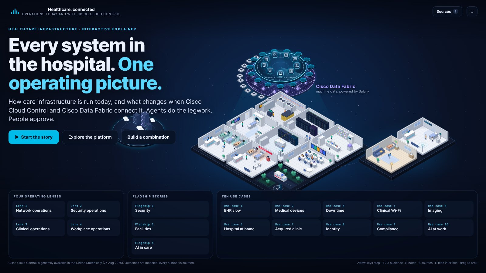
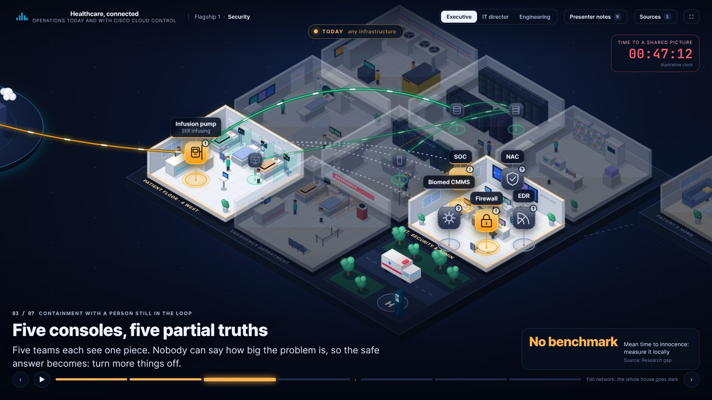
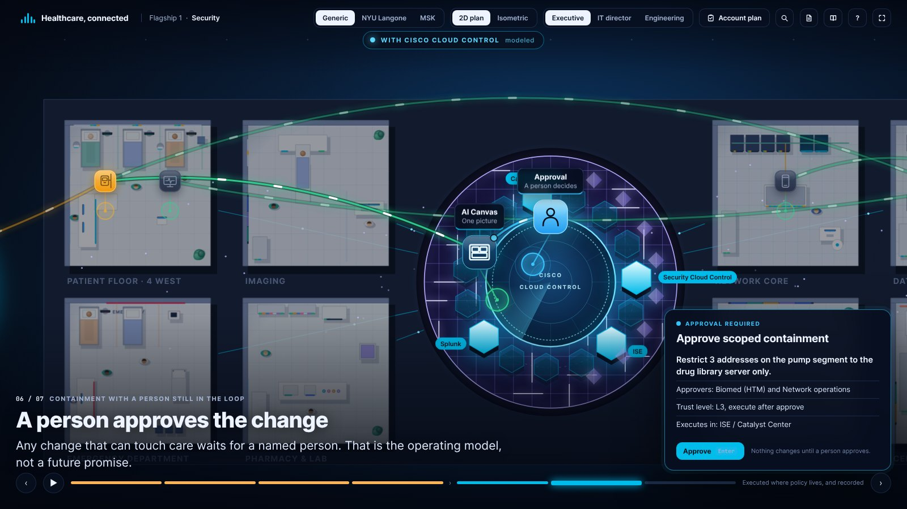
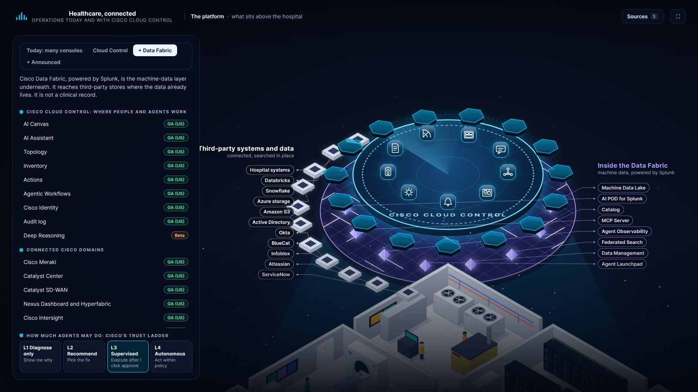
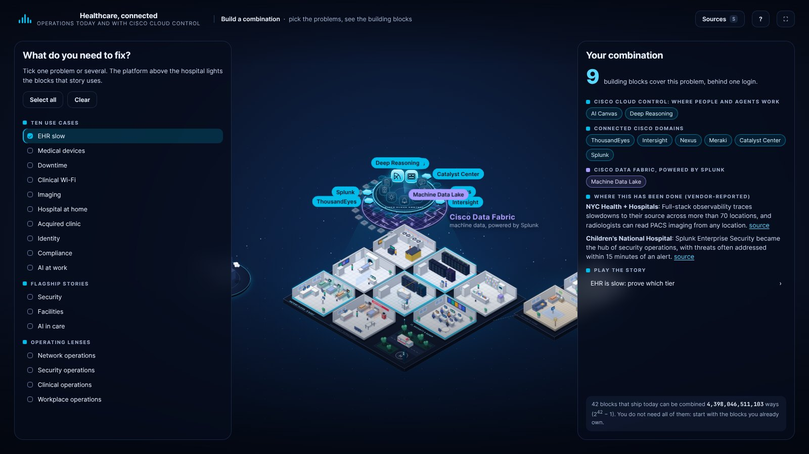

# Healthcare, connected

An interactive explainer and working tool for healthcare account teams: how hospital infrastructure and operations are run today, what changes when Cisco Cloud Control and Cisco Data Fabric connect them, and what a specific customer said about it.

It is a web app. Run it with `npm run dev`, or build a static site with `npm run build` and host `dist/` anywhere. A single-file build for offline hand-off is still available (`npm run build:single`).



## Two views of the same hospital

- **2D plan (default).** Rooms seen from above in a wide band: clinical rooms on the left, infrastructure on the right, Cisco Cloud Control over a court in the middle, the internet on the far left and remote care on the far right. The whole world stays on screen.
- **Isometric.** The same rooms as a lit model, with Cloud Control and Data Fabric floating above. Press **V** or use the view switch.

## What is in it

| Part | What it does |
|---|---|
| **The story so far** (8 beats) | The opening film: the estate, the many consoles that run it today, the bridge call, then Cloud Control, Data Fabric, agents with a person approving, and where the change executes. |
| **Four operating lenses** | Network operations, security operations, clinical operations, and workplace and office operations. Each shows today, then the agentic operating model with a human approval. |
| **Three flagship stories** | Security, Facilities, AI in care. |
| **Ten use cases** | EHR slow, medical devices, downtime, clinical Wi-Fi, imaging, hospital at home, acquired clinic, identity, compliance, AI at work. |
| **Seven AI use cases** | Virtual nursing and computer vision, AI agents in patient access, private clinical AI in the hospital data center, bedside prediction, agents with access to clinical systems, digital pathology and imaging AI, and AI cost governance. |
| **Account workspaces** | Generic, NYU Langone Health and Memorial Sloan Kettering. Each account has a brief built from public sources and four use cases of its own, shown only in that workspace and labelled as hypotheses to validate. |
| **Discovery capture** | On every closing beat, rate how much the problem hurts and note what the customer said. Saved per account in the browser. |
| **Account plan** | The rated stories in order, the building blocks they need split into "already in place" and "to add", suggested next steps, and export to Markdown, JSON or print. |
| **Explore the platform** | An annotated model of what sits above the hospital: Cloud Control capabilities, 15 connected Cisco domains, Data Fabric, third-party systems, and what is only announced. Every block has its availability and its sources. |
| **Build a combination** | Tick the problems a customer has; the platform lights the building blocks those stories use, with customer evidence. |

Every story runs the same way: amber **Today** beats, then blue **With Cisco Cloud Control** beats. Inactive rooms recede so the room goes where the story is. Any action that can touch care stops for an approval you click.

| Today: five consoles, five partial truths | A person approves the change |
|---|---|
|  |  |

| Platform explorer | Combination builder |
|---|---|
|  |  |

## Controls

| Key | Action |
|---|---|
| Right / Left | Next / previous beat (Right also approves when an approval is waiting) |
| Down / Up | Next / previous story |
| 1, 2, 3 | Audience: Executive, IT director, Engineering |
| Space | Autoplay (pauses at approvals). On the home page: start the story |
| N | Presenter notes: the line for all three audiences, the question to ask, what stays with the hospital, the caveat to say out loud, Cisco's wider portfolio for the use case |
| S | Sources |
| P / C / A | Platform explorer / Combination builder / Account plan |
| V | Switch between the 2D plan and the isometric view |
| / or Ctrl+K | Search stories and platform blocks |
| H | Hide the interface (clean stage for a screenshot or a pause) |
| ? | Controls and how to read the picture |
| F | Full screen |
| Esc | Close a panel, or go home |

Mouse: drag to pan, wheel to zoom, double-click to reset. Hover a room to light it, click it to zoom in. Hover a dimmed pin to read it, click a pin for all three audience views. Click any platform block for its detail card.

Deep links: `#/s/<story>/<beat>` (for example `#/s/security/6`), `#/platform/ring`, `#/platform/fabric`, `#/platform/future`, `#/platform/today`, `#/compose`. Add `?aud=dir` or `?aud=eng` to start on another audience.

Story ids: `opening`, `netops`, `secops`, `clinops`, `workops`, `security`, `facilities`, `ai`, `ehr`, `iomt`, `ransom`, `wifi`, `imaging`, `home`, `wan`, `identity`, `compliance`, `aiwork`, the AI use cases (`ai-vision`, `ai-access`, `ai-factory`, `ai-bedside`, `ai-agents`, `ai-pathology`, `ai-cost`) and the account stories (ids starting `nyu-` and `msk-`). Add `?acct=nyu` or `?acct=msk` to open a workspace and `?view=iso` for the isometric view.

## Build it

```bash
npm install
```

```bash
npm run dev
```

```bash
npm run build
```

`npm run build` type-checks and builds a static site in `dist/`. Preview it with `npm run preview`.

```bash
npm run build:single
```

`npm run build:single` inlines everything into `healthcare-cloud-control.html` for offline hand-off.

```bash
npm run check
```

`npm run check` serves the build, opens it in headless Chromium and walks every story beat at three screen sizes. Add `Q=view=iso` to check the isometric view, or `BASE=http://localhost:5173/` to check a running dev server. It fails on a console error, a node without a place, a catalog id that does not exist, a caption that overlaps the rail or the side column, a label off screen, overlapping labels, or an approval that does not advance. It also hovers a dimmed pin, clicks a pin, a platform block and a room, and zooms with the wheel.

```bash
node tools/shoot.cjs "#/s/security/6" "#/platform/fabric"
```

`tools/shoot.cjs` writes screenshots of any route to `shots/`. `node tools/check.cjs --shots` captures every beat to `shots/all/`.

## How it is made

No 3D engine. The scene is a hand-built vector renderer on Canvas 2D with two projections (flat plan and isometric) that share one set of drawing primitives. No runtime dependencies.

| File | Role |
|---|---|
| `src/engine/iso.ts` | The two projections, three-tone shading, drawing primitives, camera with pan, zoom and fit-to-frame. |
| `src/engine/rooms.ts` | The hospital: ten rooms drawn object by object (beds, CT, racks, chillers, people), the plaza, the outside world. Rooms are baked to bitmaps at the current zoom and re-baked when the camera settles, so the picture stays sharp and fast. |
| `src/engine/platform.ts` | Cloud Control deck, domain tiles, Data Fabric weave, third-party tiles, announced items, label call-outs. |
| `src/engine/world.ts` | Story pins, animated links, focus dimming, automatic camera framing, hover and click, label de-cluttering. |
| `src/story/scenes.ts` | The 13 original stories. Copied unchanged from `app/src/scenes.ts`, which stays the source of truth for the narrative. |
| `src/story/extra.ts` | The opening film and the four operating lenses. |
| `src/story/ai.ts`, `src/story/accounts.ts` | The AI use cases and the account-specific stories. |
| `src/data/accounts.ts`, `account-content.ts`, `store.ts` | Account workspaces, their researched briefs (generated), and the browser store for ratings, notes and owned blocks. |
| `src/story/staging.ts` | Where each story node stands in the hospital, which building blocks the story uses, the closing question. |
| `src/data/catalog.ts` | Every platform block with its availability wording and source ids. |
| `src/data/sources.ts`, `research.ts` | Generated from `research/` by `tools/gen-data.py`. Do not edit by hand. |

To change a story, edit `scenes.ts` or `extra.ts`. To move a pin, change its room in `staging.ts`. To change a status, edit `catalog.ts` and cite a source id. After new research, run `python3 tools/gen-data.py` from this folder's parent, then `npm run build`.

## Rules the explainer follows

These come from the research briefs. Keep them when you edit.

- Cisco Cloud Control is generally available in the United States only (25 August 2026). A press report gives February 2027 for Australia, the EU and the UK; Cisco documentation does not, so the explainer does not.
- Outcomes with Cloud Control are modeled. No Cisco healthcare customer metric for Cloud Control exists, so no percentage is claimed.
- Data Fabric holds machine data. It is not a clinical data repository and does not replace the EHR.
- Domain controllers stay the systems of record. Cloud Control connects the work between them.
- Any action that can touch clinical systems waits for a named person.
- Every block carries its status: generally available, beta, alpha, controlled availability, or announced.
- Customer evidence is vendor-reported and labeled so.
- Account workspaces are built from public sources only. Every account use case is a hypothesis to validate; nothing states what an account has bought.
- Ratings and notes stay in the presenter's browser (localStorage). Nothing is sent anywhere.
- No attacker procedures are shown.
