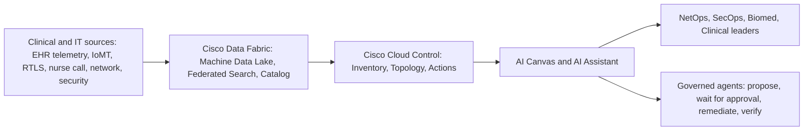

# Healthcare Infrastructure Storyboard: Context Document

**Prepared November 12, 2026.** Master file for 3D and 2D storyboard development.

This document is the assembled context pack. Use it as AI context when you design 3D and 2D examples of how a health system runs infrastructure today, and how Cisco Cloud Control and Cisco Data Fabric change the operating model.

**How to read it**
- **Phase 1** (Parts 0 and 1, plus the three pillars) is vendor-neutral. It describes the customer, engineering, and clinical experience with any technology stack.
- **Phase 2** (Parts 2 and 3) maps Cisco Cloud Control and Cisco Data Fabric onto those problems. Every Cisco capability is tagged GA, CA (Controlled Availability, beta, or alpha), or Roadmap. Cloud Control general availability is the United States only as of this date.
- **Part 4** is the scene-by-scene storyboard, including flagship sequences for Security, Facilities, and AI.

**Three pillars.** Security protects the facility and the clinical workflow. The facility is where care and infrastructure live. AI depends on that infrastructure and creates new risk inside it. Every use case names which pillars it touches.

**Citation prefixes**

| Prefix | File | Scope |
|---|---|---|
| [C-n] | `research/01-clinical-ops.md` | Macro context, ten use cases, KPI table |
| [S-n] | `research/02-security.md` | Threats, architecture, identity, MTTx, compliance, incident file |
| [F-n] | `research/03-facilities.md` | Facility types, clinical spaces, building/OT, plant, M&A, hospital-at-home |
| [A-n] | `research/04-ai-healthcare.md` | AI landscape, failure modes, infrastructure, governance, Cisco AI section F |
| [K-n] | `research/05-cisco-cloud-control-data-fabric.md` | Cloud Control, Data Fabric, status, licensing, guardrails |

Full URLs live in `sources.md` and in the research briefs. Labels **ESTIMATE**, **VENDOR-REPORTED**, **Analysis**, **Gap**, and **Modeled** must be preserved in any derived storyboard. Do not invent numbers to fill a Gap. Do not turn a Modeled outcome into a percentage.

**Companion files**
- `sources.md`: numbered bibliography by prefix.
- `research/`: the underlying research briefs (do not discard; they hold the full source lists and gaps).
- `docs/`: the sectional drafts this master was assembled from.

---

## Contents

1. How to use this document (Phase 1 conventions)
2. Part 0: Executive framing and glossary
3. Part 1: Ten use cases (today, vendor-neutral)
4. Pillar: Healthcare security
5. Pillar: Healthcare facilities
6. Pillar: AI in healthcare (today state)
7. Part 2: Personas, KPI tables, compliance recap
8. Part 3: Phase 2, Cisco Cloud Control and Cisco Data Fabric
9. Part 4: Storyboard scenes and visual cues
10. Gaps and unverified claims (end of this file)
11. `sources.md` (bibliography)

---

## How to use this document

This is context for later 3D and 2D storyboards. Phase 1 describes how health systems operate today, with any technology vendor. Nothing in Phase 1 assumes or names a specific network, security, or observability vendor's product. Phase 2 (in a later file) maps Cisco Cloud Control and Cisco Data Fabric onto the problems described here.

**Citations.** Every figure carries a bracketed citation that points to a numbered source in one of four research briefs:

| Prefix | Research brief | Scope |
|---|---|---|
| [C-n] | `research/01-clinical-ops.md` | Macro context, ten use cases, KPI table |
| [S-n] | `research/02-security.md` | Threats, architecture, identity, MTTx, compliance matrix, incident file |
| [F-n] | `research/03-facilities.md` | Facility types, clinical spaces, building/OT, plant, M&A, hospital-at-home |
| [A-n] | `research/04-ai-healthcare.md` | AI landscape, failure modes, infrastructure, governance, regulation |

**Labels that must be preserved in any derived storyboard.**
- **ESTIMATE**: arithmetic, planning ranges, or third-party estimates, not measured results.
- **VENDOR-REPORTED**: a technology vendor's own research, survey, case study, or benchmark. Treat as directional.
- **Analysis**: an inference drawn from cited facts, not a cited fact itself.
- **Gap**: no published number exists or none could be verified. The storyboard must not fill gaps with invented numbers.

**Section-level citations.** Most citations point to a numbered source (for example, [C-64]). Where a statement summarizes a research brief's own synthesis rather than a single source, the citation points to the section instead: [C-1 jargon] means the "Technical jargon" list under use case 1 of the clinical brief; [C-gaps 3] means item 3 of that brief's Gaps section; [S-gaps 1], [F-gaps 1], and [A-gaps] work the same way; [S-B] is the security brief's compliance matrix.

**Journeys are illustrative composites.** The Patient, Engineering, and Clinical journeys in Part 1 are composite narratives built from the cited mechanics of real incidents and workflows. They are not accounts of a single named event unless a citation says so. Any number inside a journey carries its citation.

**Conflicting sources.** Where research briefs disagree (for example, Ascension's restoration date or Synnovis incident counts), both values are shown with their sources. Do not silently pick one.

**Terminology note.** Executive Order 14434 (September 29, 2026) directs federal agencies to use "Super Intelligence (SI)" in place of "AI" in new documents; newer HHS, ONC, and FDA pages may say "SI" [A-78]. This document uses "AI" throughout because statutory wording, prior regulations, and the cited studies use it.

---

## Part 0: Executive framing

### 0.1 The macro picture in 2026

**Margins are thin and volatile.** Kaufman Hall's National Hospital Flash Report (August 2026 data, published October 13, 2026) puts the calendar year-to-date operating margin index at 2.5% including health-system allocations (8.0% excluding allocations). The single-month August margin was 1.8%, down from 3.8% in July. Roughly 43% of hospitals were operating at a loss, versus about 33% before COVID-19 [C-4][C-5].

**Expenses are outrunning prices.** The AHA reports total hospital expenses grew 7.5% in 2025 (workforce +5.6%, supplies +9.9%, drugs +13.6%), after 5.1% growth in 2024 against 2.9% inflation. Labor is the largest cost category, at 56% of costs in the 2025 report and about 60% in the 2026 report [C-6][C-7].

**Infrastructure spend is rising fastest.** AHA analysis of Lightcast data found hospitals spent nearly $4.5 billion on computing infrastructure and data processing in 2024, up 15% from 2023 [C-7].

**Healthcare remains the costliest industry for breaches.** IBM/Ponemon's Cost of a Data Breach 2026 report puts the average healthcare breach at $6.64 million, down 10.5% from $7.42 million in 2025 and still the highest of all industries [C-1][S-3]. In the 2025 report, healthcare breaches took the longest of any industry to identify and contain: 279 days [C-2]. IBM's 2026 report gives no healthcare-specific lifecycle, so 279 days remains the latest healthcare figure (Gap) [S-3]. Globally, IBM 2026 reports a mean time to identify of 183 days and a mean time to contain of 64 days (247 days total, up from 241 in 2025), and the U.S. average breach cost rose to $11.5 million [C-1][C-3].

**Third-party concentration risk is systemic.** The February 2024 Change Healthcare ransomware attack affected approximately 192.7 million individuals (final count reported to HHS OCR on July 31, 2025), and UnitedHealth Group reported $3.09 billion in total 2024 costs ($2.2 billion direct response, $867 million business disruption) [C-8][C-9][C-93]. An additional $799 million was reported in Q4 2025 [S-54].

**Ransomware harms patients, not just data.** A University of Minnesota analysis of Medicare claims (2016 to 2021) found hospital volume fell 17% to 25% in the first week of a ransomware attack, Medicare revenue fell 19% to 41%, and in-hospital mortality for patients already admitted rose roughly 20% to 35% (working paper; peer-review status not re-verified) [C-15][C-16].

**Spillover hits neighbors.** At unaffected EDs adjacent to a month-long 2021 San Diego ransomware attack, ambulance arrivals rose 35.2%, stroke code activations rose 74.6% (59 to 103), and confirmed strokes rose 113.6% (22 to 47) [C-17][C-99]. Cardiac arrests rose from 21 to 38, and favorable neurologic survival after out-of-hospital cardiac arrest fell from 40.0% to 4.5% [C-18].

**Accreditors now assume long outages.** Joint Commission Sentinel Event Alert 67 tells hospitals to be prepared for life- and safety-critical technology to be offline for four weeks or longer. It counts 99 cyberattack, ransomware, or hacking events reported to the Joint Commission over 10 years, 90% impacting hospitals [C-19][C-20]. In 2026 the Joint Commission and AHA launched a Cyber Resilience Readiness (CRR) program aimed at outages of 30 days or more [S-14][S-15][S-16].

**Regulation is tightening, slowly.** The HIPAA Security Rule NPRM (published January 6, 2025) would require MFA, encryption at rest and in transit, network segmentation, a technology asset inventory and network map, vulnerability scans every 6 months, annual penetration tests, and written procedures to restore critical systems and data within 72 hours [C-12][C-13]. It is **not final**. HHS moved it to "long-term actions" with final action projected for July 2027; that is a target, not a legal deadline [C-14][C-94][S-20][S-21].

**Breach volume stays high.** HIPAA Journal counted 710 large (500+ record) healthcare breaches in 2025 affecting at least 61,556,256 individuals, with hacking/IT incidents at 570 of 710 (about 80%) [C-85]. That was a January 2026 snapshot; a later count of OCR portal data shows 804 breaches and over 140 million people for 2025 [S-97][S-98]. H1 2026 recorded 397 breaches affecting 33.77 million people [S-98]. 2024 set the record at 289,162,330 individuals, largely due to Change Healthcare [C-85].

**Outages are increasingly network and change driven.** Uptime Institute 2025: IT and networking issues caused 23% of impactful outages in 2024, and configuration/change management failure was the top cause of major network-related outages (34%). In Uptime's 2025 survey, 57% said their last major outage cost more than $100,000 and 1 in 5 said more than $1 million [C-81][C-82].

**Care is moving out of the building.** Medicare telehealth flexibilities run through December 31, 2027, and the Acute Hospital Care at Home (AHCAH) waiver runs through September 30, 2030 (Consolidated Appropriations Act, 2026, signed February 3, 2026). CMS lists 358 approved hospital CCNs across 134 health systems in 37 states (as of October 19, 2026) [C-28][C-29][C-32][C-33]. Outpatient visits rose 9.8% in 2025 [C-7].

**AI is mainstream in clinical work.** The AMA's 2026 Physician Survey found 81% of physicians use AI professionally, up from 38% in 2023 [C-55][A-1]. FDA's AI-enabled device list shows 1,451 authorizations through the end of 2025, 1,104 (76%) in radiology; FDA states more than 1,600 as of September 2026 [C-56][C-57][C-58].

**ECRI's 2026 hazard list ties the three pillars together.** ECRI ranks misuse of AI chatbots #1, unpreparedness for a "digital darkness" event (sudden loss of electronic systems) #2, and cybersecurity risks from legacy medical devices #8 among the top 10 health technology hazards for 2026 [C-27][S-36].

**Consolidation continues under distress.** Kaufman Hall counted 46 announced hospital and health system transactions in 2025 (72 in 2024), with a record 43.5% involving a financially distressed party [C-75][C-76].

### 0.2 The three pillars and how they relate

The storyboard rests on three pillars. They are not parallel silos; each one depends on the other two.

| Pillar | What it covers | Depends on | Creates risk for |
|---|---|---|---|
| **Security** | Threats, segmentation, identity, detection and response, medical device security, resilience, compliance | The facility's network, power, and building systems as the attack surface and the control plane | Clinical workflow (downtime, diversion) and AI (new data flows to protect) |
| **Facilities** | Hospitals, CAHs, clinics, ASCs, imaging centers, labs, pharmacies, data centers, hospital-at-home; clinical spaces; building/OT; cabling, power, Wi-Fi | Security to keep building and clinical systems trustworthy; WAN and cloud to connect sites | Everything: it is where care, devices, and infrastructure physically live |
| **AI** | Ambient documentation, imaging AI, predictive models, revenue cycle, agentic IT operations; GPU and fabric requirements; PHI governance | The facility's network, power, cooling, and data paths (PACS, EHR, Wi-Fi uplinks) | New third-party PHI flows, shadow AI, model failures, and agents that can change production systems |

**How they relate, in one sentence each.**
- **Security protects the facility and the clinical workflow.** A ransomware event removes the EHR, phones, pharmacy, lab, and imaging at once [C-62][S-60]; segmentation and identity controls decide how much of the facility has to go dark [S-27].
- **The facility is where care and infrastructure live.** Nurse call, clinical IT network equipment, and wireless phones for clinical staff sit on the NEC critical branch, which must be restored within 10 seconds of power loss [F-53][F-55]; a typical hospital carries 10 to 15 medical devices per bed [F-23].
- **AI depends on that infrastructure and creates new risk inside it.** Ambient scribes stream exam-room audio to third-party cloud models [C-10 use case narrative]; 2026 scribe outages traced to upstream model and cloud providers [A-39][A-40][A-41][A-42]; 40% of surveyed healthcare workers had encountered unauthorized AI tools [A-55]; and GPU racks at 120 to 132 kW dwarf a typical 9 kW rack [A-49][A-50][A-51].

### 0.3 Glossary

| Term | Definition (as used in this document) |
|---|---|
| **AHCAH** | Acute Hospital Care at Home. CMS waiver allowing inpatient-level care in the home; requested per CCN; runs through September 30, 2030 [C-29][F-80]. |
| **ASC** | Ambulatory surgery center. 6,308 Medicare-certified ASCs in 2023 [F-6]. |
| **BAA** | Business associate agreement. Required when a vendor (including an AI or cloud vendor) creates, receives, maintains, or transmits PHI for a covered entity, even if it stores only encrypted ePHI without the key [A-57][A-58]. |
| **BCA / downtime workstation** | Read-only business continuity workstation that holds recent EHR reports (MAR, census, orders) for use during EHR downtime [C-1 jargon]. |
| **BMS** | Building management system. Controls and monitors HVAC, pressure relationships, and other building systems; treated as OT by NIST SP 800-82r3 [F-16][F-19]. |
| **Break-glass** | Pre-staged emergency accounts with minimum necessary privileges, extra auditing, and a tested procedure, used when normal access paths fail [S-114]. |
| **CAH** | Critical access hospital. No more than 25 inpatient beds, 24/7 ED, average length of stay of 96 hours or less, generally more than 35 miles from another hospital; 1,377 CAHs as of October 2025 [F-3][F-5]. |
| **CCN** | CMS Certification Number. AHCAH waivers are granted per CCN, even within one system [F-79]. |
| **CDS** | Clinical decision support software. FDA revised its CDS guidance January 6, 2026 and reissued it January 29, 2026 [A-70][A-74]. |
| **CMMS** | Computerized maintenance management system. Clinical engineering's asset system of record for devices and building equipment [F-19][C-2 jargon]. |
| **CPG** | HHS Healthcare and Public Health Cybersecurity Performance Goals (January 2024): 10 Essential and 10 Enhanced voluntary goals mapped to HICP [S-25][C-83]. |
| **Designated record set** | Medical and billing records and other records used to make decisions about individuals (45 CFR 164.501). Telemetry, logs, and agent traces are operational data and not part of it by default, though they can carry identifiers that make them PHI (Analysis) [A-61][A-60]. |
| **DEM** | Digital experience monitoring. Measures the user's actual experience (session round-trip time, logon duration, synthetic transactions, path tracing) end to end [C-1 jargon]. |
| **DICOM** | Digital Imaging and Communications in Medicine. The standard for medical image format and transfer, including whole-slide pathology imaging [C-47]. |
| **DTIM** | Delivery Traffic Indication Message interval. Voice badges typically require DTIM 1 with a 100 ms beacon interval (VENDOR-REPORTED requirement) [C-40][C-42]. |
| **EDR / XDR** | Endpoint (or extended) detection and response. Cannot be installed on most medical devices [C-2 problem statement]. |
| **EHR** | Electronic health record. Orders, medication administration, results, documentation, scheduling, and billing all depend on it [C-1 problem statement]. |
| **ePHI / PHI** | (Electronic) protected health information under HIPAA. |
| **EVPN-VXLAN** | Ethernet VPN control plane with Virtual Extensible LAN data plane. A standards-based campus and data-center fabric overlay used to stretch segments and carry segmentation tags across a routed underlay (practitioner framing; no healthcare source cited). |
| **FDA 524B** | FD&C Act section 524B (added by FDORA, December 2022; effective March 29, 2023). Requires "cyber device" makers to provide an SBOM, a postmarket vulnerability plan, and patch processes [C-21][C-23][S-30]. |
| **FHIR** | HL7 Fast Healthcare Interoperability Resources. API-based standard; ONC's HTI-5 positions FHIR APIs as the base for future certification requirements [A-68]. |
| **HICP** | Health Industry Cybersecurity Practices (HHS 405(d), 2023 edition). Practice 6.M.B defines network zones [S-27]. |
| **HICS** | Hospital Incident Command System. The incident command structure hospitals activate to declare downtime and coordinate response [C-3 jargon]. |
| **HL7 (v2)** | Health Level Seven messaging standard used for ADT, orders, and results interfaces between the EHR and departmental systems. |
| **HTM** | Healthcare technology management (clinical or biomedical engineering). Owns medical device maintenance [S-27][S-36]. |
| **ICA / HDX** | Citrix Independent Computing Architecture protocol and its HDX technology stack, widely used to deliver virtualized EHR sessions. ICA round-trip time (RTT) default thresholds: warning 300 ms, critical 400 ms [C-37]. |
| **IoMT** | Internet of Medical Things. Networked infusion pumps, monitors, imaging modalities, lab analyzers, and similar devices. |
| **KEV** | CISA Known Exploited Vulnerability. |
| **MDS2** | Manufacturer Disclosure Statement for Medical Device Security (ANSI/NEMA HN 1-2019). About 240 questions across 23 security capabilities, including SBOM availability; typically requested during procurement [S-32][S-33]. |
| **Microsegmentation** | Fine-grained policy that restricts east-west traffic between individual assets or groups within a zone. Added to HICP in the 2023 edition [F-13][S-27]. |
| **MTBF** | Mean time between failures. No published benchmark found for clinical WLANs (Gap) [C-gaps 7]. |
| **MTTA** | Mean time to acknowledge an alert. No published healthcare benchmark (Gap) [S-gaps 1]. |
| **MTTC** | Mean time to contain. IBM 2026 global: 64 days [C-1][S-3]. |
| **MTTD** | Mean time to detect. Proxy: Mandiant 2026 global median dwell time of 14 days [S-8]. |
| **MTTI (IBM) vs. mean time to innocence** | Two different metrics share the acronym. In this document, **MTTI means IBM's mean time to identify a breach** (183 days global, 2026) [C-1]. **Mean time to innocence** (abbreviated **MTTInn** here to avoid collision) is the time it takes each team to prove its domain (EHR application, PACS, pump VLAN, Wi-Fi, WAN, identity) is not the cause of a clinical-facing problem. No published statistic exists; it is a **proposed KPI** [C-gaps 3][S-gaps 1]. |
| **MTTK** | Mean time to know (root cause identified). No published healthcare benchmark (Gap) [S-gaps 1]. |
| **MTTR** | Mean time to restore or recover. Healthcare proxies: Sophos 2025, 58% of ransomware victims recovered within a week (VENDOR-REPORTED); IBM 2026, 42% of organizations fully recovered from a breach [C-86][S-3]. |
| **NAC** | Network access control. Admits, profiles, and assigns policy to devices at connection time (practitioner framing; no primary healthcare source) [S-gaps 5]. |
| **802.1X / MAB** | IEEE port-based authentication (EAP) for wired and wireless; MAC Authentication Bypass for devices that cannot run a supplicant, common for medical devices [C-2 jargon]. |
| **802.11r/k/v** | Wi-Fi fast transition, neighbor reports, and BSS transition management. Ascom states 802.11r is mandatory for acceptable roaming with WPA3 [C-45]. |
| **Nurse call** | Patient-to-staff signaling system; on the NEC critical branch [F-53]; UL 1069 governs equipment [F-51]. |
| **OT** | Operational technology: HVAC, fire, electrical, lighting, physical access, physical security, utilities (NIST SP 800-82r3) [F-16]. |
| **PACS / VNA** | Picture archiving and communication system (the image archive and viewer platform) and vendor-neutral archive (a standards-based long-term image store shared across PACS) [C-5 problem statement]. |
| **PCCP** | Predetermined change control plan. FDA final guidance (December 4, 2024; reissued August 18, 2025) lets planned AI model modifications proceed without a new submission for each change [A-71][A-72]. |
| **PFC** | Priority Flow Control (IEEE 802.1Qbb). Per-priority pause frames that make Ethernet lossless for RoCE; can cause head-of-line blocking and congestion spreading [A-43][A-44]. |
| **RoCEv2** | RDMA over Converged Ethernet, routable version. The dominant transport in Ethernet AI clusters [A-43]. |
| **RPM** | Remote patient monitoring. Medicare paid $536 million for RPM in 2024 [C-35]. |
| **RTLS** | Real-time location system (Wi-Fi, BLE, ZigBee, infrared, and others). Hospital trial: Wi-Fi fingerprinting 1.21 m point accuracy and 96% room accuracy [F-45]. |
| **SaMD** | Software as a Medical Device. Software intended for a medical purpose that is itself the device, including many AI models. |
| **SASE / SSE** | Secure access service edge (networking plus cloud-delivered security) and security service edge (the security subset: secure web gateway, CASB, ZTNA) [C-6 jargon]. No primary healthcare source for design patterns (Gap) [S-gaps 5]. |
| **SBOM / VEX** | Software bill of materials (machine-readable, NTIA baseline attributes, with support level and end-of-support date per FDA) and Vulnerability Exploitability eXchange [S-31][C-2 jargon]. |
| **SD-WAN** | Software-defined WAN. Application-aware routing over multiple transports (broadband, MPLS, LTE/5G) [C-7 jargon]. |
| **Section 1557** | ACA nondiscrimination rule. Since May 1, 2025, covered entities must identify and mitigate discrimination risk in patient care decision support tools (45 CFR 92.210) [A-65][A-66]. |
| **UEC / UET** | Ultra Ethernet Consortium and its Ultra Ethernet Transport. Specification 1.0 published June 11, 2025; congestion control "does not rely on a lossless network" [A-46][A-47]. |
| **WMTS** | Wireless Medical Telemetry Service. FCC-protected bands at 608 to 614, 1395 to 1400, and 1427 to 1432 MHz, created in 2002; deployments registered with ASHE/AHA [F-32][F-33]. |
| **ZTNA** | Zero trust network access. Per-application, identity-verified access that replaces broad network VPN access [C-8 jargon]. |

---

## Part 1: Ten use cases (today)

Each use case follows the same structure: Pillars touched; Business problem and why it matters now; Impact; Today journeys; Technical deep dive; MTTx and other metrics; Quantified cost; Compliance hooks; Relevant 2023 to 2026 outages.

**A note on mean time to innocence, applied to every use case.** No published statistic exists for mean time to innocence in healthcare or elsewhere [C-gaps 3][S-gaps 1]. This document defines it as a **proposed KPI**: the elapsed time from a clinical-facing symptom (for example, "the EHR is slow on 4 West" or "the pump drug library did not update") to the point where every candidate domain (EHR application tier, PACS, the pump VLAN or device segment, Wi-Fi, WAN or ISP, identity) has either been proven not to be the cause or been identified as the cause. Each use case below states this explicitly rather than inventing a figure.

---

### Use case 1: EHR availability and clinical application performance

#### Pillars touched
- **Security:** endpoint agents, privileged access, immutable backups, and the July 2024 faulty security update all sit on the EHR's critical path [C-64].
- **Facilities:** data center power and cooling, and telecom rooms on the critical branch, keep the EHR reachable [F-53][F-67].
- **AI:** ambient documentation and AI features add latency-sensitive traffic to the same clinician sessions [C-1 problem statement].

#### Business problem and why it matters now
The EHR is the operational backbone of the hospital: orders, medication administration, results, documentation, scheduling, and billing all depend on it. Most large health systems deliver it through application virtualization or virtual desktops, so every click is a network round trip [C-1 problem statement]. Unplanned downtime is common: in a 2014 survey of 50 institutions, 96% reported at least one unplanned EHR downtime in three years and 70% had one longer than 8 hours [C-79]. Even when the EHR is "up," slow sessions degrade throughput in a workforce where 43.2% of physicians report burnout and nurses spend about 35% of a shift documenting [C-87][C-59]. Why now: margins at 2.5% leave no room for productivity loss [C-4]; AI tools add traffic to the same sessions; and on July 19, 2024 a single faulty software update caused detectable disruptions at 759 U.S. hospitals at once [C-64].

#### Impact
| Dimension | Impact | Source |
|---|---|---|
| Patient outcomes | Three of 50 surveyed institutions reported patient injury from EHR downtime (2014). ECRI 2026: downtime can cause medical errors, inappropriate treatment decisions, or delayed care. | [C-79][C-27] |
| Revenue | A large hospital "may lose as much as $1 million per hour" in lost charges during EHR downtime (ESTIMATE, quoted 2018). $634 per physician per hour (ESTIMATE, consultancy, cited 2017). | [C-78][C-80] |
| Clinical workflow | Work during downtime "takes four or five times longer" (time-and-motion study, cited 2017). Nurses spend about 35% of shift time documenting (range 26% to 41%). | [C-80][C-59][C-61] |
| Operational workflow | Lab turnaround can stretch to hours as specimens back up and results move to phone and fax. | [C-95] |
| Compliance and risk | Joint Commission EM.13.01.01 (continuity of operations) and EM.14.01.01 (disaster recovery). The HIPAA NPRM would require 72-hour restoration of critical systems. | [C-19][C-12] |
| Staff experience | 43.2% of physicians reported at least one burnout symptom in 2024 (48.2% in 2023, 53% in 2022). | [C-87] |

#### Today journeys
**Patient.** A patient with chest pain arrives at the ED at morning shift change. Registration's screen hangs on the insurance eligibility step, so the clerk prints a downtime face sheet and assigns a temporary medical record number. In the treatment bay, the nurse cannot see the prior ECG from last month's visit because the results tab will not load, so the physician orders a repeat. The patient waits longer for a bed because the bed board in the command center has gone stale, and later receives a handwritten discharge prescription that the pharmacy has to call to verify.

**Engineering (NetOps/SecOps).** The service desk logs a "P1: Epic slow, multiple units" ticket and opens a bridge. The virtualization team reports ICA round-trip time above the 300 ms warning threshold on a subset of sessions [C-37]; the application team says the database looks healthy; the network team says core links are lightly loaded; the storage team is not yet on the call. Each team pulls its own dashboard and spends the first hour proving its own innocence. Eventually someone notices that logon duration crossed the 70-second critical threshold [C-37] only for users whose profiles live on one file server, and the fix is a storage path, not the network. Nobody records how long the "is it the network?" phase took, because no one measures it.

**Clinical (nurse).** On a med-surg unit, a nurse taps her badge on a workstation on wheels outside room 12. Single sign-on reconnects in a few seconds on a good day (the published average is 8.9 seconds [C-77]), but this morning the Hyperspace window just spins. She jots vitals on a glove, moves to the next room, and back-enters them later in the shift. When the unit formally goes to downtime, the charge nurse pulls the read-only BCA printout of the medication administration record (MAR) and the team switches to a paper MAR for scheduled medications until the system returns.

#### Technical deep dive
- **Security:** privileged access management for EHR and hypervisor admins; EDR on Citrix/VDI hosts with staged (canary) content rollouts after the July 2024 event; application allowlisting on downtime BCA workstations; immutable backups of EHR databases; break-glass accounts that work when the directory does not [C-1 jargon][S-114].
- **Network infrastructure:** data center fabric with east-west segmentation between web, application, database, and storage tiers; dual-homed access to virtualization hosts; first-hop redundancy; QoS marking for ICA/HDX; jumbo frames on storage networks [C-1 jargon].
- **WAN:** ICA RTT budgets per site; application-aware routing and path conditioning (forward error correction) for remote clinics; Citrix recommends separate sites instead of zones when zone latency exceeds 250 ms RTT [C-38].
- **Visibility:** DEM for session RTT, logon duration, and synthetic EHR transactions; flow telemetry and packet capture at tier boundaries; end-to-end path tracing from the clinician endpoint to the database [C-1 jargon].
- **Orchestration:** change windows; configuration drift detection; infrastructure as code; automated failover runbooks; canary rollouts for endpoint agents [C-1 jargon].

#### MTTx and other metrics
| Metric | Figure | Source |
|---|---|---|
| ICA RTT default thresholds | Warning 300 ms; critical 400 ms (dynamic thresholds computed weekly at P70/P90) | [C-37] |
| Session network latency thresholds | Warning 150 ms; critical 250 ms | [C-37] |
| Logon duration thresholds | Warning 40 s; critical 70 s | [C-37] |
| ICA latency user perception bands | 0 to 150 ms optimal; 150 to 300 acceptable; over 300 degraded (VENDOR-REPORTED) | [C-39] |
| SSO login time | First-of-shift 34.6 s to 29.3 s; reconnect 29.3 s to 8.9 s | [C-77] |
| CrowdStrike event recovery (MTTR proxy) | 58.1% of services recovered within 6 hours; 7.8% took over 48 hours; median hospital downtime about 5 hours | [C-64][S-81] |
| Unplanned downtime prevalence | 96% of institutions in 3 years; 70% had one over 8 hours (2014) | [C-79] |
| Top cause of network outages | Configuration/change management failure, 34% | [C-81] |
| Mean time to innocence | **No published number.** Proposed KPI: time to prove the EHR application tier, storage, VDI, Wi-Fi, WAN, and identity are or are not the cause of a "slow EHR" ticket. | [C-gaps 3] |
| Epic Hyperspace network latency requirement | **Gap.** No public EHR vendor latency requirement found. | [C-gaps 1] |

#### Quantified cost
- Up to $1 million per hour in lost charges for a large hospital (ESTIMATE, quoted 2018) [C-78].
- $634 per physician per hour of unplanned downtime (ESTIMATE, cited 2017) [C-80].
- 57% of organizations said their last major outage cost more than $100,000; 1 in 5 said more than $1 million (all industries, 2025) [C-82].
- SSO saved $168,474 per hospital per year in clinician time (ESTIMATE of dollar value from wage rates, peer-reviewed study, 2018 data) [C-77].
- **Gap:** no 2023 to 2026 peer-reviewed or Ponemon figure for EHR downtime cost per hour [C-gaps 2].

#### Compliance hooks
- Joint Commission EM.13.01.01 continuity of operations, EM.14.01.01 disaster recovery, EM.15.01.01 drills [C-19].
- HIPAA NPRM (proposed): 72-hour restoration, criticality analysis, technology asset inventory and network map [C-13].
- CMS Conditions of Participation for emergency preparedness: all-hazards plan including cyberattacks, reviewed yearly [S-38][S-39].
- HHS CPGs and HICP practices for privileged access and backups [S-25][S-27].

#### Relevant 2023 to 2026 outages
- **CrowdStrike faulty update, July 19, 2024:** 759 of 2,232 scanned U.S. hospitals (34.0%) showed disruptions; 239 of 1,098 disrupted services were patient-facing, including EHR access, imaging, fetal monitoring, and transfer portals. CrowdStrike disputes the methodology [C-64][C-65].
- **Lurie Children's, January 31, 2024:** Epic and MyChart offline; Epic restored March 4, 2024 (about 33 days) [C-69].
- **Ascension, May 2024; Kettering Health, May 2025; UMMC, February 2026:** EHR plus phones and other systems down for days to weeks (see use case 3 and the Security pillar incident file) [C-11][C-62][S-102].

---

### Use case 2: IoMT and medical device security plus visibility

#### Pillars touched
- **Security:** devices with known exploited vulnerabilities, no agents, long lifespans [C-24][C-25].
- **Facilities:** a typical hospital has about 10 to 15 medical devices per bed, so a 1,000-bed hospital could hold about 15,000 devices [F-23]; building systems share the same risk patterns [F-16].
- **AI:** AI-enabled devices (more than 1,600 FDA authorizations) join the same device networks [C-58].

#### Business problem and why it matters now
Hospitals run large fleets of networked infusion pumps, patient monitors, imaging modalities, and lab analyzers that often run legacy or unsupported operating systems, cannot host endpoint agents, and stay in service for a decade or more; device hardware can stay in service 10 to 30 years while software support ends much sooner [C-2 problem statement][F-22]. Research consistently finds known exploited vulnerabilities on devices in nearly every hospital, and some devices are reachable from the internet or bridge guest and clinical networks [C-25][C-26]. Because devices cannot be patched quickly, the practical controls are asset visibility, segmentation, and compensating network policy [C-2 problem statement]. Why now: FDA section 524B (effective March 29, 2023) and FDA premarket guidance (final June 27, 2025, superseded by a February 3, 2026 version) require SBOMs and vulnerability management for new cyber devices, but the installed base predates those rules; ECRI lists legacy-device cybersecurity as hazard #8 for 2026 [C-21][S-29][S-30][C-27].

#### Impact
| Dimension | Impact | Source |
|---|---|---|
| Patient outcomes | ECRI 2026: an attack "could block access to patient data, force staff to alter workflows, or render devices or systems unavailable," leading to delayed or inappropriate care. | [C-27] |
| Revenue | 31% of organizations with medical device incidents reported up to 12 hours without critical systems (VENDOR-REPORTED aggregated list; original source not verified). | [C-96] |
| Clinical workflow | Taking pumps or monitors offline forces manual pump programming and manual vitals charting. | [C-2 impact] |
| Operational workflow | Biomedical engineering and IT must jointly inventory, risk-rank, and segment devices; ECRI recommends segmenting or disconnecting legacy devices and planning replacement. | [C-27] |
| Compliance and risk | FDA 524B requires cyber device makers to provide an SBOM, postmarket vulnerability monitoring, and patch processes. | [C-21][C-22][C-23] |
| Staff experience | Device workarounds add manual documentation on top of the 35% of shift time nurses already spend documenting. | [C-59] |

#### Today journeys
**Patient.** A post-surgical patient is on a smart infusion pump that normally receives its order from the EHR (auto-programming) and logs doses back. Overnight, security isolates the pump segment after an alert, and the pump keeps infusing but stops talking to the server. The patient notices two nurses at the bedside reading the bag label aloud and double-checking the rate by hand, and the morning dose is late because the second nurse was on another hall.

**Engineering (NetOps/SecOps).** SecOps sees SMB traffic from an address in the infusion pump VLAN toward a file server it has never talked to. The asset inventory says the address is a pump; the CMMS says that pump was retired last year; the MDS2 form on file says the pump's server runs an older Windows version and does not support an agent. Nobody can install EDR on it, and nobody wants to pull every pump in the building off the network on a Friday night. NetOps writes an emergency ACL limiting the segment to the drug library server, biomed confirms the pumps still function standalone, and the change goes in without a tested rollback plan because no lab environment exists.

**Clinical (ICU nurse).** In the ICU, the central monitoring station loses three bedside monitors after an unplanned switch reboot. The nurse at the station sees gray tiles instead of waveforms and has to walk to each bedside; the alarm escalation to her voice badge stops for those beds. She documents vitals manually at the interval the downtime policy requires and calls biomed, who calls IT, who asks whether the monitors are on the "medical device VLAN or the clinical VLAN."

#### Technical deep dive
- **Security:** SBOM and VEX ingestion; KEV, EPSS, and CVSS prioritization; compensating controls where patching is impossible; MDS2 review at procurement; NAC with 802.1X where supported and MAB for the rest; certificate-based device identity [C-2 jargon][S-33].
- **Network infrastructure:** HICP calls for medical devices on "dedicated, highly-restricted networks" with traffic limited to what operation requires and vulnerability scanners kept away from clinical devices [F-12]; VLAN/VRF isolation; security group tags; dedicated medical device SSIDs; DHCP fingerprinting; NIST SP 1800-8 nine-zone infusion pump reference design [F-14].
- **WAN:** device manufacturer remote-support paths; inbound remote access brokering; site-to-site tunnels to device vendors; HICP warns about unattended vendor sessions [C-2 jargon][S-27].
- **Visibility:** passive asset discovery; deep packet inspection of clinical protocols (DICOM, HL7, proprietary pump protocols); device risk scoring; CMMS integration; HICP suggests a monthly count of medical devices not segmented [C-2 jargon][S-27].
- **Orchestration:** policy automation from asset classification; quarantine playbooks; change control co-owned with biomed; recall and advisory ingestion [C-2 jargon].

#### MTTx and other metrics
| Metric | Figure | Source |
|---|---|---|
| Organizations with KEV-affected devices | 99% (2.25 million IoMT devices, 351 organizations, 2025; VENDOR-REPORTED) | [C-25] |
| Organizations with ransomware-linked KEVs plus insecure internet connectivity | 89% (2025; VENDOR-REPORTED) | [C-25] |
| Imaging devices with KEVs | 28% (2025; VENDOR-REPORTED) | [C-25] |
| Medical devices with at least one KEV; on unsupported OS | 23%; 14% (2023 data; VENDOR-REPORTED) | [C-26] |
| Hospitals with devices bridging guest and internal networks | 22%; 4% of surgical devices reachable from guest (2023 data; VENDOR-REPORTED) | [C-26][F-23] |
| Infusion pumps with known security gaps | 75% of 200,000 analyzed (2025; VENDOR-REPORTED) | [C-24] |
| Vulnerability dwell time on devices | 3.2 years average (2025; VENDOR-REPORTED) | [C-24] |
| Share of assets that are IoMT, IoT, OT, or unmanaged | About 50%; over 2,500 IoMT devices per organization (2024; VENDOR-REPORTED) | [F-25] |
| Critical vulnerability remediation (all sectors) | 26% fully remediated; 43-day median to fix (2025) | [S-7] |
| Device MTTD, device patch latency, device MTTR | **Gap.** No neutral published benchmark. | [C-gaps 8] |
| Mean time to innocence | **No published number.** Proposed KPI: time to prove whether a pump or monitor problem is the device, its server, the pump VLAN or SSID, NAC policy, or the EHR integration engine. | [C-gaps 3] |

#### Quantified cost
- No neutral cost per device-related incident was found (Gap).
- Up to 12 hours without critical systems for 31% of organizations with device incidents (VENDOR-REPORTED, original source not verified) [C-96].
- Indirect cost flows through downtime and diversion (see use case 3).

#### Compliance hooks
- FDA 524B: SBOM, vulnerability monitoring plan, update processes for cyber devices; FDA recommends machine-readable SBOMs with NTIA baseline attributes and end-of-support dates [C-21][S-31].
- MDS2 (ANSI/NEMA HN 1-2019) at procurement [S-32].
- IEC 80001-1:2021: risk management for connecting devices to shared networks [F-28].
- HICP 6.M.B zoning and the monthly unsegmented-device metric [S-27]; CPG Enhanced goal for segmentation [S-25].
- HIPAA NPRM (proposed): technology asset inventory, network map, segmentation [C-13].

#### Relevant 2023 to 2026 outages
- ECRI 2026 hazard #8 (legacy device cybersecurity) and #2 (digital darkness) [C-27].
- **Gap:** no widely confirmed 2023 to 2026 U.S. patient harm event attributed solely to a compromised infusion pump or monitor was found [C-gaps 12].

---

### Use case 3: Ransomware resilience and downtime procedures

#### Pillars touched
- **Security:** the dominant operational threat; identity, segmentation, backups, detection [S-6][C-86].
- **Facilities:** diversion, paper downtime, building and OT continuity; the facility must operate off-network [S-17][F-17].
- **AI:** AI services and data pipelines go dark with everything else, and must be restored in sequence.

#### Business problem and why it matters now
Ransomware removes the EHR, phones, pharmacy, lab, and imaging at the same time, forcing paper downtime, ambulance diversion, and cancelled procedures for weeks [C-3 problem statement]. Recovery depends on clean, isolated backups, the ability to contain lateral movement, and rehearsed downtime procedures, yet healthcare's use of backups to restore fell to 51% in 2025 (VENDOR-REPORTED survey) [C-86]. Effects spread to neighboring hospitals that absorb diverted patients [C-17]. Why now: 2024 to 2026 brought multi-week outages at major systems (Ascension, Kettering, Lurie, Synnovis, UMMC), the Joint Commission expects four-plus week offline readiness, and the proposed HIPAA rule would require 72-hour restoration [C-19][C-13].

#### Impact
| Dimension | Impact | Source |
|---|---|---|
| Patient outcomes | In-hospital mortality for already-admitted Medicare patients rose roughly 20% to 35% during attacks (2016 to 2021 data). Synnovis: one patient death linked in part to a long wait for a blood test result; severe-harm cases reported. | [C-15][C-16][C-68][S-74] |
| Revenue | Medicare revenue fell 19% to 41% in the attack week. Ascension reported a FY24 operating loss of $1.8 billion "including the cyber impact." Synnovis direct losses GBP 32.7 million. | [C-15][C-10][C-66] |
| Clinical workflow | Adjacent ED: median waiting-room time 21 to 31 minutes; admitted-patient ED length of stay 614 to 822 minutes; left without being seen 158 to 360. | [C-17] |
| Operational workflow | Revenue cycle stops: Ascension cited delays in insurance verification, claims submission, and payment processing, with some downtime claims still in process months later. | [C-98] |
| Compliance and risk | HIPAA NPRM: 72-hour restore, criticality analysis, written incident response plans. Joint Commission EM.11.01.01 hazard vulnerability analysis must include cyberattacks. | [C-13][C-19] |
| Staff experience | ECRI 2026: working under downtime procedures "can increase the risk of errors and lead to burnout." | [C-27] |

#### Today journeys
**Patient.** An older adult with sudden slurred speech is in an ambulance that was heading to the nearest stroke center. The hospital has declared a cyber downtime and gone on diversion, so the crew reroutes to a hospital farther away. That ED is absorbing its neighbor's volume: in the San Diego case, stroke code activations rose from 59 to 103 and median waiting-room time from 21 to 31 minutes [C-17]. Across town, a cancer patient's scheduled chemotherapy is cancelled because the infusion center cannot verify orders, and her retail pharmacy cannot fill a prescription because the e-prescribing link is down (as at Signature Healthcare in April 2026 [S-103][S-104]).

**Engineering (NetOps/SecOps).** In the early morning hours the SOC sees mass file renames on a file server and a domain controller pushing a new scheduled task. The incident commander activates HICS, and the CIO makes the call to sever internet connectivity and disable site-to-site tunnels, which also takes down the cloud-hosted phone system and the e-prescribing interface. The identity directory is suspected to be compromised, so rebuilding requires a clean room, known-good backups, and new credentials for every privileged account. The team restores systems by criticality tier (identity, then communications, then EHR, then ancillaries) while the FBI and outside forensics firms image hosts. Kettering found attackers had been inside since April 9 before the May 20 encryption [S-84].

**Clinical (nurse, pharmacist, radiology tech).** The nursing supervisor pulls the downtime binders. Nurses work from a paper MAR printed from the last BCA snapshot, physicians handwrite orders, and runners carry paper requisitions to the lab and printed results back. At Ascension, runners carried printed scans to surgeons [S-60]. Pharmacy verifies every order by phone, and the radiology tech hands a CD to a courier because PACS cannot route studies. At shift change, nobody is sure which doses were given after the last snapshot, so nurses reconcile by hand from the paper record.

#### Technical deep dive
- **Security:** immutable or air-gapped backups; clean-room recovery; EDR/XDR; identity threat detection; tiered admin model separating user and privileged accounts; MFA on all remote access; tabletop exercises; CISA's Interlock advisory recommends segmentation, MFA, patching, and DNS filtering [C-3 jargon][S-93].
- **Network infrastructure:** segmentation to limit blast radius; pre-built isolation zones; out-of-band management; kill-switch ACLs; recovery VLANs [C-3 jargon]. HICP calls stopping assets in one general-access network from talking to another "a critical control against ransomware spread" [S-27].
- **WAN:** emergency carrier diversity; internet breakout isolation; regional failover so one region can be cut off without darkening the system (Prospect's multi-state outage is the counterexample) [C-3 jargon][S-86].
- **Visibility:** NDR; DNS telemetry; east-west flow analytics; centralized log collection that survives the outage; honeypots and canary credentials [C-3 jargon].
- **Orchestration:** SOAR playbooks; automated quarantine; restoration sequencing by criticality tier; HICS downtime declaration workflows [C-3 jargon].

#### MTTx and other metrics
| Metric | Figure | Source |
|---|---|---|
| MTTI (IBM mean time to identify), global | 183 days (2026); 181 days (2025) | [C-1] |
| MTTC (mean time to contain), global | 64 days (2026); 60 days (2025) | [C-1] |
| Healthcare breach lifecycle | 279 days (2025; no 2026 healthcare figure) | [C-2][S-gaps 2] |
| Lifecycle when found internally | 209 days (2026, global) | [S-3] |
| MTTD proxy: median dwell time | 14 days (2026, global, up from 11) | [S-8] |
| Detected internally | 52% of all cases; 41% of ransomware cases (2026) | [S-9] |
| MTTR: ransomware recovery within a week | 58% (2025; 21% in 2024; VENDOR-REPORTED) | [C-86] |
| MTTR: within three months | 97% (2025; VENDOR-REPORTED) | [C-86] |
| MTTR: full breach recovery | 42% fully recovered; 19% needed over 150 days (2026) | [S-3] |
| Healthcare downtime durations | Ascension EHR about 6 to 7 weeks (C) or 37 days to full restore (S); Kettering Epic 13 days, normal ops about 3 weeks; Lurie Epic about 33 days; Synnovis about 6 months; Brockton diversion 9 days; UNM about 2 days | [C-11][S-60][C-62][C-69][C-67][C-71][S-109] |
| MTTA, MTTK | **Gap.** No published healthcare benchmark. | [S-gaps 1] |
| Mean time to innocence | **No published number.** Proposed KPI here: during an active incident, time to establish which segments (EHR, PACS, pump VLAN, building systems, clinic WAN) are clean and can stay connected, which shrinks the blast radius of a "shut everything off" decision. | [S-gaps 1] |

#### Quantified cost
| Organization | Cost | Source |
|---|---|---|
| Change Healthcare / UnitedHealth Group | $3.09 billion in 2024; $799 million more in Q4 2025; $22 million ransom | [C-9][S-54][S-52] |
| Ascension | FY24 operating loss of $1.8 billion including cyber impact; about $130 million in response costs; no standalone total disclosed | [C-10][S-60][C-gaps 5] |
| CommonSpirit (2022) | $150 million, later raised to $160 million | [S-65][S-66] |
| Ardent | About $74 million pre-tax impact in 2023 | [S-70] |
| DaVita | $13.5 million in Q2 2025; $25 million for 2025; $15 million class-action settlement | [S-90][S-91] |
| Synnovis | GBP 32.7 million direct losses in 2024 | [C-66] |
| Healthcare ransomware averages | Average recovery cost $1.02 million; median ransom paid $150,000; 36% paid (2025; VENDOR-REPORTED) | [C-86] |
| Most significant attack (survey) | $3.9 million (2025, Ponemon) | [S-11] |

#### Compliance hooks
- HIPAA NPRM (proposed): 72-hour restoration, criticality analysis, written incident response plans, separate backup controls; business associates to report contingency plan activation within 24 hours [C-13][S-19].
- Joint Commission EM.11.01.01 (HVA including cyber, reviewed every 2 years), EM.13, EM.14, EM.15 [C-19][S-18]; Sentinel Event Alert 67 four-week planning horizon [C-19]; voluntary CRR program [S-14].
- CMS emergency preparedness CoP [S-38].
- New York 10 NYCRR 405.46: CISO, MFA, incident response, report within 72 hours (full compliance October 2, 2025) [S-45][S-46].
- OCR enforcement: 19 ransomware settlements by April 2026; Lehigh Valley Health Network $800,000 (October 29, 2026) [S-23][S-24].

#### Relevant 2023 to 2026 outages
Change Healthcare (February 2024), Lurie Children's (January 2024), Ascension (May 2024), Synnovis (June 2024), Kettering Health (May 2025), DaVita (April 2025), UMMC (February 2026), Signature Healthcare Brockton (April 2026), University Hospitals Cleveland (October 2026), UNM Health (October 2026). Each is summarized in the Security pillar incident file in `part-a2.md` [C-8][C-62][C-66][C-69][C-71][C-73][S-100][S-105].

---

### Use case 4: Clinical mobility and Wi-Fi reliability

#### Pillars touched
- **Facilities:** RF design, AP density, cabling, closet power, WMTS versus Wi-Fi [F-32][F-41][F-64].
- **Security:** WPA3, 802.1X/EAP-TLS, encryption settings that change roaming behavior [C-40][C-45].
- **AI:** mobile EHR and ambient documentation apps ride the same WLAN [C-10 problem statement].

#### Business problem and why it matters now
Nurses, physicians, and support staff communicate through Wi-Fi voice badges and smartphones that carry nurse call alerts, alarms, secure messaging, and mobile EHR apps, so a coverage hole or slow roam becomes a missed alarm or a dropped call during a code [C-4 problem statement]. Voice clients have much stricter RF requirements than laptops (signal strength, SNR, DTIM, fast roaming) and are used in places surveys often ignore: stairwells, elevators, closets [C-4 problem statement]. One hospital network carried about 7,148 staff devices, 6,306 guest devices, 1,327 medical devices, 3,086 IoT devices, and 1,100 voice badges (2025 case study), so AP density is driven by capacity and voice roaming, not coverage alone (Analysis) [F-41]. Why now: WPA3 makes fast transition roaming mandatory for acceptable voice handoffs on some handsets, Wi-Fi 6E/7 refresh cycles are underway, and staffing shortages make every nurse minute valuable [C-45][F-42].

#### Impact
| Dimension | Impact | Source |
|---|---|---|
| Patient outcomes | Delayed alarm delivery to mobile devices delays response; roaming failures cause "audible clicks and other disturbances" on calls. Joint Commission reviewed 98 alarm-related sentinel events (2009 to 2012), 80 of them deaths, and believes these are under 10% of actual alarm-related harm (older). | [C-100][F-63] |
| Revenue | SSO and mobility time savings valued at $168,474 per hospital per year (19 hospitals, 2018 data; ESTIMATE of dollar value). | [C-77] |
| Clinical workflow | Nurses spend 21 to 60 minutes per shift searching for equipment (HIMSS summary of older studies). Call-light response averages about 3 to 4 minutes, with one hospital averaging 17 min 27 s (2009 to 2012). | [C-90][F-47][F-48][F-49] |
| Operational workflow | Voice-grade site surveys, AP power tuned to low-power badges, and channel planning are prerequisites. | [C-41][C-44] |
| Compliance and risk | Vocera badges do not support WEP, TKIP, or SAE; Ascom says 802.11r is mandatory for acceptable roaming with WPA3. | [C-40][C-45] |
| Staff experience | Equipment searching and chasing colleagues add non-clinical load on top of documentation time. | [C-59][C-90] |

#### Today journeys
**Patient.** An elderly patient presses the call button because she needs to get to the bathroom. The nurse call system pages the assigned nurse's badge, but the nurse is in the stairwell between floors and the badge is between access points, so the page arrives late. The patient tries to get up on her own. Published call-light response averages run about 3 to 4 minutes, and one hospital averaged over 17 minutes [F-47][F-48]; no cited source ties Wi-Fi delay to a specific fall (Gap).

**Engineering (NetOps).** The clinical communications team forwards a complaint: "badges drop calls on 5 East near the elevators." The wireless engineer pulls roaming analytics and finds the badges authenticate with WPA3-SAE without fast transition; Ascom's published interop data shows about 174 ms typical roam in that mode versus about 31 ms with FT [C-45], and the target for voice is under 100 ms, ideally under 50 ms [C-44]. Enabling 802.11r breaks an older barcode scanner on the same SSID, so the fix becomes a new SSID, a firmware compatibility matrix, and a change request co-signed by biomed and nursing informatics.

**Clinical (nurse).** During a rapid response, the charge nurse calls pharmacy from her badge while walking the patient to the elevator. The call goes choppy, then silent. She runs back to the nurse station to use a desk phone. Earlier in the shift she spent time hunting for a free infusion pump; the RTLS screen showed one "on 5 East," but the tag's room-level accuracy did not tell her which room [F-45].

#### Technical deep dive
- **Security:** WPA3-Enterprise; 802.1X/EAP-TLS with device certificates; PMF (802.11w); OKC and FT key caching; MDM for shared smartphones. Authentication choice changes association delay: EAP-FAST about 200 ms, PSK under 100 ms (VENDOR-REPORTED requirement) [C-40][C-43].
- **Network infrastructure:** 802.11r/k/v; DTIM 1 with 100 ms beacon (DTIM x beacon must not exceed 108 ms for multicast audio); WMM/UAPSD; 20 MHz channels; AP transmit power 12 to 17 dBm to match badges; avoid DFS and channel bonding where possible; 6 GHz requires devices to support the full local channel set [C-40][C-42][C-46][F-40]. TIA-1179-B requires two Category 6A runs per AP [F-64].
- **WAN:** cloud-hosted clinical communications platforms; SIP trunking; survivability at remote sites [C-4 jargon].
- **Visibility:** voice-grade site surveys; RF analytics; roaming analytics; client health scores; RTLS heat maps [C-4 jargon].
- **Orchestration:** RF profile templates; automated channel and power control with voice-safe constraints; firmware compatibility matrices [C-4 jargon].

#### MTTx and other metrics
| Metric | Figure | Source |
|---|---|---|
| Voice coverage and SNR | -65 dBm minimum (two APs at -65 dBm recommended); SNR +25 dB (VENDOR-REPORTED requirement) | [C-40][C-41] |
| Roam time targets | Under 50 ms ideal; under 100 ms acceptable | [C-44] |
| Measured roams | WPA3-SAE without FT about 174 ms; with FT about 31 ms; WPA2-PSK with FT about 25 ms; 6 GHz handset about 83 ms (VENDOR-REPORTED) | [C-45][C-46] |
| Interactive voice one-way delay | 150 ms or less (ITU-T G.114) | [F-38] |
| Wi-Fi voice certification | Loss under 1%, no more than 3 consecutive lost packets, latency under 50 ms, jitter under 50 ms | [F-39] |
| Patient monitor to central station (one manufacturer) | Round-trip peak 800 ms or less; jitter 400 ms or less; 99.9% uptime over 24 hours; no gaps over 4 s; -65 dBm; SNR 15 dB (manufacturer requirement, not a standard) | [F-31] |
| Nurse call fault reporting | Within 15 seconds (UL 1069 via secondary summary) | [F-51] |
| RTLS accuracy (hospital trial, 2016) | Wi-Fi 1.21 m, 96% room; BLE 2.13 m, 79% room; ZigBee 1.99 m, 88% room | [F-45] |
| Clinical WLAN MTBF/MTTR | **Gap.** No published benchmark. | [C-gaps 7] |
| Mean time to innocence | **No published number.** Proposed KPI: time to prove whether a dropped badge call is RF coverage, roaming/authentication, the voice server, the PBX/SIP trunk, or the handset firmware. | [C-gaps 3] |

#### Quantified cost
- $168,474 per hospital per year in clinician time from SSO and mobility (ESTIMATE of dollar value, 2018 data) [C-77].
- 21 to 60 minutes per nurse per shift searching for equipment (older studies) [C-90].
- **Gap:** no published cost of a Wi-Fi outage in a hospital.

#### Compliance hooks
- NEC 517.34(A): wireless phone and paging equipment for clinical staff and clinical IT network equipment on the critical branch (added in the 2020 NEC) [F-53][F-54].
- UL 1069 for nurse call equipment [F-51].
- Joint Commission clinical alarm safety, moved from NPSG.06.01.01 to NPG.01.05.01 (secondary source; confirm) [F-62]; Physical Environment chapter effective January 1, 2026 [F-58].
- IEC TR 80001-2-3: no universal Wi-Fi threshold; each organization defines a clinical service level per device [F-29].
- HIPAA NPRM (proposed): encryption in transit [C-13].

#### Relevant 2023 to 2026 outages
- **Gap:** no public 2023 to 2026 incident specifically attributing patient harm to Wi-Fi voice failure [C-gaps 12].
- Downtime events routinely take phones and paging offline: Kettering (2025) call centers and phones [C-62]; UMMC (2026) phones and email failed alongside the EHR [S-102].

---

### Use case 5: Imaging and PACS data movement

#### Pillars touched
- **Facilities:** imaging suites, imaging centers, labs, and backhaul between sites [F-71][F-75].
- **Security:** DICOM exposure and vulnerable imaging devices [C-25][F-24].
- **AI:** 76% of FDA AI-enabled device authorizations are radiology; images move to AI engines [C-56].

#### Business problem and why it matters now
Imaging produces the largest clinical data objects in the hospital. A 2025 study measured CT studies at a median of 787 MB including reconstructions [F-72]; at one Swedish center CT studies grew from 229 to 765 MB and MRI from 84.7 to 216 MB between 2009 and 2022 [F-71]; digital pathology whole-slide images run about 1 GB per slide at 40x [F-75]. Moving studies among modalities, PACS, VNAs, remote readers, AI engines, and cloud archives makes WAN bandwidth and storage throughput a direct determinant of report turnaround [C-5 problem statement]. Time-critical pathways (stroke, PE, trauma) depend on images reaching a radiologist within minutes [C-89]. Why now: radiology dominates AI authorizations, cloud PACS and teleradiology are expanding, and digital pathology multiplies data volume [C-56][F-75].

#### Impact
| Dimension | Impact | Source |
|---|---|---|
| Patient outcomes | Target: Stroke Phase III: door-to-needle within 60 minutes for 85% or more, within 45 minutes for 75% or more; door-to-device within 90 minutes (direct) or 60 minutes (transfer) for 50% or more. Every 4 minutes of door-to-reperfusion delay means 1 in 100 treated patients has worse disability (HERMES, 2016, older). | [C-89][A-27] |
| Revenue | Imaging downtime halts outpatient imaging; Kettering's 2025 outage stopped imaging until normal operations resumed June 10. | [C-62] |
| Clinical workflow | AI triage cut PE-positive CTPA report turnaround during work hours from 68.9 to 46.7 minutes; off-hours change not significant (44.8 to 42.0). | [C-50] |
| Operational workflow | A department doing 500 studies per day generates roughly 150 GB to 1 TB of new imaging daily (ESTIMATE). Scanning 300 slides a day needs about 50 TB for a six-month pathology archive. | [C-48][F-75] |
| Compliance and risk | 28% of imaging devices carry KEVs (2025; VENDOR-REPORTED); imaging was 32% of unsupported devices (2023 data; VENDOR-REPORTED). | [C-25][S-34] |
| Staff experience | **Gap.** No quantified neutral source on how slow image loads affect radiologist burnout. | [C-5 impact] |

#### Today journeys
**Patient.** A man with a suspected large-vessel occlusion gets a CT angiogram at a community hospital that will transfer him for thrombectomy. The study has to reach the comprehensive stroke center's neurointerventionalist, but the community hospital's WAN link is saturated by the overnight prefetch of prior studies for the morning outpatient schedule. The images take long enough that the transfer team calls to ask "did it send?" twice. The transfer door-to-device goal is 60 minutes for 50% or more of patients [C-89].

**Engineering (PACS admin and NetOps).** The PACS administrator sees DICOM associations from one modality retrying, and blames the network. NetOps sees the link at saturation and blames the PACS prefetch rules. The VNA team notes a cloud AI engine is also pulling every CT for triage. There is no single view of study-level latency from modality to reading workstation, so the teams argue from their own logs. The fix (QoS for STAT studies, prefetch windows, and a separate path to the AI orchestrator) takes a week of change requests.

**Clinical (radiologist and CT tech).** A radiologist reading remotely clicks a STAT head CT and waits while the series streams in slice by slice; she opens a less urgent study to stay productive and returns later. The CT tech, meanwhile, cannot confirm the study arrived because the modality worklist is out of sync. During a full outage the fallback is physical: at Ascension, runners carried printed scans to surgeons [S-60].

#### Technical deep dive
- **Security:** DICOM TLS; DICOMweb over HTTPS with OAuth; de-identification before cloud AI (HIPAA Safe Harbor or Expert Determination) [A-59]; PACS segmentation per NIST SP 1800-24 (zoning limited to the minimum necessary) [F-15]; modality allowlisting [C-5 jargon].
- **Network infrastructure:** 10/25/40 GbE to modalities and archives; storage fabrics; jumbo frames; lossless versus lossy JPEG 2000; edge caching [C-5 jargon]. OR video at uncompressed 4K60 needs about 10.4 Gbps on the wire over ST 2110, so plan on 25GbE per path [F-77].
- **WAN:** WAN optimization; bandwidth reservation for imaging; cloud interconnects; teleradiology paths; prefetch scheduling [C-5 jargon]. An 8K endoscope feed was compressed from 48 Gbps to 300 Mbps for a 68 km inter-hospital link with about 0.15 s latency [F-78].
- **Visibility:** DICOM association and transfer telemetry; study-level latency tracking; worklist analytics [C-5 jargon].
- **Orchestration:** DICOM routing rules; VNA lifecycle policies; AI orchestration platforms; autoscaling cloud ingestion. In one PE deployment, images went CT to PACS to an on-prem AI orchestrator, which sent de-identified DICOM to a cloud AI tool that reprioritized the worklist [C-5 jargon][A-25].

#### MTTx and other metrics
| Metric | Figure | Source |
|---|---|---|
| Report TAT with AI triage (PE, work hours) | 68.9 to 46.7 minutes | [C-50] |
| Report TAT with AI triage (PE, another study) | 59.9 to 47.6 minutes | [A-25] |
| Report TAT with AI triage (ICH) | 147.1 vs 149.9 minutes (no improvement) | [C-51] |
| Stroke AI triage (cluster randomized trial) | Door-to-groin cut 11.2 minutes; CT-to-treatment cut 9.8 minutes; no significant difference in functional independence | [A-23] |
| Cloud stroke AI transmission plus analysis | Under 5 minutes average | [A-23] |
| Transfer time (arithmetic) | 1 GB CT over 100 Mbps at 70% usable: about 114 s; over 1 Gbps: about 11 s; 1.3 GB WSI over 1 Gbps: about 15 s (ESTIMATE) | [C-101] |
| PACS availability, image retrieval/prefetch latency | **Gap.** No neutral benchmark. No standards-body latency target for DICOM. | [C-5 MTTx][F-gaps 1] |
| Mean time to innocence | **No published number.** Proposed KPI: time to prove whether a slow study is the modality, PACS or VNA storage, the AI orchestrator, the WAN link, or the reading workstation. | [C-gaps 3] |

#### Quantified cost
- Each minute faster endovascular treatment yields a median net monetary benefit of 309 euros (Netherlands model; no U.S. dollar figure found) [A-29].
- Each minute saved gives on average 4.2 days of extra healthy life (Neurology, 2017, older) [A-28].
- **Gap:** no U.S. cost per minute of imaging delay or per hour of PACS downtime.

#### Compliance hooks
- HIPAA de-identification (Safe Harbor, Expert Determination) for images sent to external AI [A-59][A-60].
- BAAs with cloud PACS and AI vendors [A-57].
- HIPAA NPRM (proposed): encryption in transit, network map of ePHI flows [C-13].
- NIST SP 1800-24 PACS reference architecture (2020) [F-15].
- FDA 524B for imaging modalities as cyber devices [C-21].

#### Relevant 2023 to 2026 outages
- CrowdStrike event (July 2024): imaging platforms among disrupted patient-facing services [C-64].
- Kettering Health (2025): imaging restored only when normal operations resumed [C-62].
- Ascension (2024): imaging down; printed scans carried by runners [S-60].

---

### Use case 6: Telehealth, virtual care, and hospital-at-home

#### Pillars touched
- **Facilities:** the home becomes a care space; hospital-at-home requirements set response times [F-83].
- **Security:** device identity for home kits, encryption, BAAs with platform providers [C-6 jargon].
- **AI:** RPM analytics and virtual nursing tools increasingly run on AI (no cited adoption figure; Gap).

#### Business problem and why it matters now
Care now extends into patients' homes through video visits, remote patient monitoring, and inpatient-level AHCAH, so clinical service quality depends on consumer broadband, cellular links, and cloud platforms the hospital does not own [C-6 problem statement]. Hospital-at-home carries inpatient acuity, so telemetry, video, and escalation paths need hospital-grade reliability and monitoring [C-6 problem statement]. Why now: Congress extended Medicare telehealth flexibilities through December 31, 2027 and AHCAH through September 30, 2030; 358 CCNs are approved; RPM spending keeps growing and OIG is scrutinizing RPM billing [C-28][C-29][C-32][C-35][C-36].

#### Impact
| Dimension | Impact | Source |
|---|---|---|
| Patient outcomes | CMS study (332 hospitals, November 2020 to July 2024): hospital-at-home beneficiaries generally had lower 30-day mortality than comparable inpatients. Cone Health reported zero deaths and zero care-associated infections in its first program year (self-reported). | [F-81][F-82][C-31] |
| Revenue | Medicare paid $536 million for RPM in 2024, up 31%. Post-discharge 30-day Medicare spending about 20% lower for most top-25 diagnosis groups in hospital-at-home. | [C-35][F-81] |
| Clinical workflow | About 4,600 practices routinely billed RPM in 2024, each covering about 70 enrollees. | [C-35] |
| Operational workflow | AHCAH waivers are per CCN; experienced hospitals submit monitoring data monthly; at least two in-person RN or paramedic visits daily. | [C-29][F-83] |
| Compliance and risk | OIG flagged RPM billing patterns; from January 1, 2028 non-behavioral Medicare telehealth generally reverts to rural, facility-based originating sites absent new legislation. | [C-36][C-34] |
| Staff experience | **Gap.** Not quantified in neutral sources for virtual care staff. | [C-6 impact] |

#### Today journeys
**Patient.** A woman with a COPD exacerbation is admitted to hospital-at-home. A courier sets up a tablet, a pulse oximeter, a blood pressure cuff, and a cellular hub in her living room, because programs prefer provider-supplied cellular over patients' own internet [F-87]. On day two her video visit freezes twice; she presses the on-demand audio button, which the waiver requires, and reaches a nurse who stays on the line while the video reconnects [F-83].

**Engineering (NetOps and clinical IT).** A ticket arrives: "Video visit failed, patient could not connect." The engineer has to consider the patient's cellular coverage, the hub, the video platform's cloud region, the hospital's security service edge, the clinician's home Wi-Fi, and the clinician's VPN. None of the home-side path is instrumented, so the ticket closes as "could not reproduce." No neutral benchmark exists for visit failure rate or home device data latency [C-6 MTTx].

**Clinical (virtual nurse).** In the virtual care command center, a nurse watches a panel of home patients' vitals. One patient's SpO2 tile goes gray. She must decide whether the patient is deteriorating or the cuff lost its Bluetooth link; the program requires a process for patients not reached within 15 minutes of a scheduled visit, and emergency personnel at the home within 30 minutes if needed [F-83]. In a Mayo Clinic cellular cardiac monitor pilot, 33.5% of alarms exceeding the 30-second threshold traced to damaged devices or inadequate cellular connections [F-37].

#### Technical deep dive
- **Security:** ZTNA for clinician access; device identity for home kits; encryption in transit; BAAs with platform providers; secure messaging [C-6 jargon].
- **Network infrastructure:** LTE/5G cellular gateways for home kits; Wi-Fi fallback; Bluetooth peripheral pairing; a rural Michigan RPM pilot using cellular devices saw a failure rate under 10%, with connectivity far less of a barrier than with Bluetooth devices [C-6 jargon][F-88].
- **WAN:** SASE and SSE; secure web gateway; direct internet access; cloud on-ramps; per-application SLAs [C-6 jargon].
- **Visibility:** DEM; endpoint and ISP path monitoring; synthetic video/RTC tests; MOS scores; jitter, loss, and latency per session [C-6 jargon].
- **Orchestration:** kit provisioning logistics; automated escalation workflows; command center integration [C-6 jargon].

#### MTTx and other metrics
| Metric | Figure | Source |
|---|---|---|
| AHCAH participation | 358 CCNs, 134 systems, 37 states (CMS, October 19, 2026); trade press 365 campuses across 137 systems; AMA 366 programs across 139 systems | [C-28][F-84][F-85] |
| Patients served | Over 31,000 by October 2024 | [F-81] |
| Required response times | Emergency personnel within 30 minutes; process for patients unreachable within 15 minutes | [F-83] |
| Medicare RPM | Nearly 1 million enrollees in 2024 (+27%); 10,388 practices billed at least one RPM service | [C-35] |
| Cellular RPM failure rate (rural pilot) | Under 10% | [F-88] |
| Visit failure rate, RPM alert-to-escalation time, home data latency | **Gap.** No neutral benchmark. | [C-6 MTTx] |
| Mean time to innocence | **No published number.** Proposed KPI: time to prove whether a failed visit or missing reading is the patient's device, home cellular or ISP, the platform cloud, the SSE path, or the clinician's endpoint. | [C-gaps 3] |

#### Quantified cost
- $536 million in Medicare RPM payments in 2024 [C-35].
- About 20% lower 30-day post-discharge Medicare spending for most top-25 hospital-at-home diagnosis groups [F-81].
- **Gap:** no published cost of failed virtual visits.

#### Compliance hooks
- AHCAH waiver conditions: per-CCN request; daily in-person visits and vitals; on-demand audio; 30-minute emergency response [C-29][F-83].
- Telehealth flexibilities through December 31, 2027, and reversion rules from January 1, 2028 [C-32][C-34].
- OIG RPM billing scrutiny [C-36].
- BAAs with telehealth and RPM vendors [A-57].

#### Relevant 2023 to 2026 outages
- CrowdStrike event (July 2024): remote patient monitoring tools and patient access platforms among disrupted services [C-64][C-65].

---

### Use case 7: Multi-site WAN, M&A integration, and clinic connectivity

#### Pillars touched
- **Facilities:** clinics, ASCs, imaging centers, CAHs, and acquired sites [F-2][F-4][F-6].
- **Security:** acquired networks import risk; third-party connectivity is part of every perimeter [F-10][F-70].
- **AI:** AI services must reach every site; cloud AI raises WAN dependence (Analysis).

#### Business problem and why it matters now
There are 397 U.S. health systems; 68% of hospitals and 77% of beds are system-affiliated, and systems range from 1 to 157 hospitals [F-2]. Each clinic, ASC, imaging center, and lab needs EHR, imaging, voice, and device connectivity with hospital-grade availability [C-7 problem statement]. Mergers add networks with different addressing, security postures, identity stores, and unknown device inventories that must be connected without importing risk [C-7 problem statement]. Why now: 46 hospital deals were announced in 2025 with a record 43.5% involving a distressed party (whose IT is often under-invested), outpatient visits rose 9.8% in 2025, and outpatient services rose from 52% of hospital revenue in 2020 to 57% in 2024 [C-75][C-7][F-8].

#### Impact
| Dimension | Impact | Source |
|---|---|---|
| Patient outcomes | Clinic outages delay visits and refills; CrowdStrike-era disruptions included inter-hospital transfer portals. | [C-64] |
| Revenue | 2025 hospital M&A transacted revenue $18.5 billion, the lowest since Kaufman Hall began tracking. Change Healthcare: about 60% of affected hospitals reported revenue impact of $1 million per day or more. | [C-75][F-70] |
| Clinical workflow | Outpatient visits up 9.8% in 2025; 2034 forecast: outpatient volume up 17%, home-based services up 22%. | [C-7][F-9] |
| Operational workflow | One health system replaced dedicated links with multi-carrier broadband SD-WAN at more than 200 sites and reported up to 33% fewer hardware-caused outages (VENDOR-REPORTED). | [C-88] |
| Compliance and risk | In an OCR case, an acquired practice left on its own network suffered three ransomware attacks in two months about 18 months post-acquisition (85,000 patients); the acquirer was held responsible (law-firm summary; verify). | [F-10] |
| Staff experience | **Gap.** Not quantified in neutral sources. | [C-7 impact] |

#### Today journeys
**Patient.** A patient arrives at a family medicine clinic that her health system acquired recently. The front desk can see her in the old practice management system but not in the system's EHR, so she fills out a paper history again. Her referral to cardiology is faxed, and the imaging she had at the hospital last week is not visible to her clinic physician.

**Engineering (NetOps/SecOps).** On Day 1 of integration, the network team discovers the acquired group uses the same 10.x address space as the parent system, runs a flat network with printers, cameras, and an X-ray unit on one VLAN, and has open Remote Desktop Protocol to the internet (the pattern in the OCR case [F-10]). The safe move is to quarantine the acquired network behind a firewall and migrate site by site, but the business wants single sign-on and EHR access within weeks. A new clinic circuit takes weeks to order; a broadband plus LTE branch with zero-touch provisioning is faster, if the security baseline is ready.

**Clinical (medical assistant and physician).** The medical assistant at the rural clinic loses the EHR when the clinic's single circuit fails during a storm; the clinic switches to paper encounter forms and calls patients to reschedule. At the critical access hospital down the road, a single WAN link carries transfers, teleconsults, and remote imaging reads, so it is a single point of failure for the facility (Analysis) [F-4].

#### Technical deep dive
- **Security:** isolate the acquired network, then migrate; overlapping IP remediation (NAT, re-addressing); identity federation; third-party risk assessment; security baselines before connection [C-7 jargon]. Breach likelihood doubles in the year before and after a hospital merger closes; over 30% of acquirers had a breach during integration (consulting source citing studies) [F-11].
- **Network infrastructure:** branch switching and Wi-Fi templates; PoE budgets for devices; redundant power; LTE/5G backup [C-7 jargon].
- **WAN:** SD-WAN with application-aware routing; dual carrier and diverse path; broadband plus MPLS hybrid; SASE/SSE; cloud on-ramps; QoS for ICA, voice, and imaging [C-7 jargon].
- **Visibility:** per-site and per-application SLA dashboards; ISP performance monitoring; path tracing; synthetic tests from clinics [C-7 jargon].
- **Orchestration:** zero-touch provisioning; golden configurations; policy templates per site type; change automation with rollback [C-7 jargon].

#### MTTx and other metrics
| Metric | Figure | Source |
|---|---|---|
| Hospital M&A | 46 announced (72 in 2024); 17 in Q4 2025 incl. four mega mergers; 43.5% distressed; 45.6% involved a divestiture | [C-75][F-7] |
| Network-caused outage causes (44% of 414 respondents had one) | Configuration/change management 34%; firmware/software 31%; hardware 26%; third-party provider and line breakage 17% each | [C-81] |
| Fiber and connectivity outages | Rising and more likely to cause extended disruptions (Uptime 2026) | [C-82] |
| Site onboarding time, circuit MTTR, per-site WAN availability | **Gap.** No neutral healthcare benchmark; a vendor case study reports "minutes-level onboarding" (VENDOR-REPORTED). | [C-88] |
| Clinic SD-WAN adoption | **Gap.** No vendor-neutral survey found. | [C-gaps 6][F-E] |
| Mean time to innocence | **No published number.** Proposed KPI: time to prove whether a clinic's "EHR down" is the local LAN, the circuit or ISP, the SD-WAN overlay, the SSE/security stack, or the data center application. | [C-gaps 3] |

#### Quantified cost
- About 60% of hospitals affected by Change Healthcare reported revenue impact of $1 million per day or more [F-70].
- A small physical therapy clinic in Yorkville, New York lost about $25,000 per week in cash flow during the Change Healthcare outage [S-58].
- 57% of organizations' last major outage cost over $100,000 (all industries) [C-82].

#### Compliance hooks
- HIPAA NPRM (proposed): network map of ePHI flows across sites and clouds; segmentation [C-13].
- HHS CPGs: segmentation (Enhanced); vendor/supplier requirements (Essential); third-party incident reporting (Enhanced) [S-25].
- Acquirer accountability for acquired entities' HIPAA compliance (OCR case via law-firm summary) [F-10].
- BAAs and business associate safeguards verification (NPRM proposed) [S-19].

#### Relevant 2023 to 2026 outages
- **Change Healthcare (2024):** stolen credentials on a remote access portal without MFA; nine days of lateral movement before ransomware [C-102][S-51].
- **CommonSpirit (2022, outside window, included for pattern):** shared IT spread impact to former affiliates still on its IT [S-67].
- **Prospect Medical (2023):** multi-state system with ED closures and diversion for about 40 days [S-86][S-89].
- **HealthAlliance (NY, October 2023):** unpatched remote-access appliance; ambulance diversion; $550,000 state fine [S-112].
- **Kettering Health (2025):** added segmentation, enhanced monitoring, and access controls during recovery [C-62][C-63].

---

### Use case 8: Identity, zero trust, and clinician access

#### Pillars touched
- **Security:** missing MFA and identity directory compromise drove the costliest recent incidents [S-51][S-64].
- **Facilities:** shared workstations in every clinical space; badge readers and physical access converge with logical access [F-16].
- **AI:** AI agents and AI vendors need identities and least privilege [A-79].

#### Business problem and why it matters now
Clinicians log in many times per shift on shared workstations, so authentication friction directly costs care time, while weak remote access (no MFA, shared vendor accounts) is a leading entry point for attackers [C-8 problem statement]. Health systems must make access faster for clinicians and stronger against attackers at the same time, including for vendors and business associates [C-8 problem statement]. Why now: Change Healthcare entered through a remote-access portal without MFA [S-51]; Synnovis was reportedly enabled by the absence of two-factor authentication [C-97]; Ascension began with one device and escalated to the central identity directory [S-64]; the NPRM would require MFA; and CPG Essential goals include MFA [C-13][S-25].

#### Impact
| Dimension | Impact | Source |
|---|---|---|
| Patient outcomes | Synnovis breach "reportedly enabled by the absence of two-factor authentication" led to patient-care incidents including severe harm. | [C-97][S-75] |
| Revenue | SSO saved $3,201,001 per year in clinician time across 19 hospitals ($168,474 per hospital; ESTIMATE of dollar value). | [C-77] |
| Clinical workflow | Reconnect login 29.3 s to 8.9 s with badge tap; 49,056.8 clinician hours per year freed enterprise-wide. | [C-77] |
| Operational workflow | NPRM would require notification within 24 hours when a workforce member's access is changed or terminated. | [C-13] |
| Compliance and risk | NPRM MFA with limited exceptions; CPG Essential: MFA, unique credentials, separate user and privileged accounts, revoke departing credentials. | [C-13][S-25] |
| Staff experience | Login friction contributes to EHR burden; 43.2% physician burnout (2024). | [C-87] |

#### Today journeys
**Patient.** A trauma patient arrives during an identity outage: the directory service is down, so the ED physician cannot sign in to order a CT. The charge nurse retrieves a sealed break-glass credential from the locked envelope in the department, and the order goes in under that account, which will need retrospective audit [S-114]. The patient's care proceeds, but every action is attributed to a shared emergency identity.

**Engineering (IAM and SecOps).** The identity team inventories third-party remote access after a peer system's breach and finds a device vendor using a shared account with no MFA, a session tool left in "unattended" mode (the HICP warning [S-27]), and dozens of accounts belonging to staff who left months ago. The joiner/mover/leaver process depends on a nightly HR file that fails silently. SecOps also sees impossible-travel logins for a physician who works at several hospitals in the system, some of which still run separate directories after a merger.

**Clinical (physician).** A hospitalist taps her badge on a shared workstation in the hallway outside a patient room and gets in quickly; HICP's model is a full login at shift start, then badge taps, with a session lock under 15 to 30 minutes [S-27]. To prescribe a controlled substance she has to complete a second factor on her phone, which is in her locker. At the recently acquired hospital across town she uses a different username and password entirely.

#### Technical deep dive
- **Security:** tap-and-go SSO with proximity badges; FIDO2/passkeys and phishing-resistant MFA; PAM with just-in-time elevation; vendor privileged access with session recording; ZTNA; conditional access; identity threat detection and response [C-8 jargon]. The 405(d) model is "one-person, one-identity, multiple contexts" with automated provisioning and deprovisioning [S-28].
- **Network infrastructure:** 802.1X wired and wireless; NAC posture; dynamic VLAN or policy assignment (practitioner framing; no primary healthcare source) [C-8 jargon][S-gaps 5].
- **WAN:** ZTNA replacing VPN concentrators; SSE; per-application tunnels for vendors [C-8 jargon].
- **Visibility:** authentication logs; impossible-travel analytics; UEBA; session recording for vendor access [C-8 jargon].
- **Orchestration:** joiner/mover/leaver automation from the HR system; access recertification; automated credential revocation [C-8 jargon].

#### MTTx and other metrics
| Metric | Figure | Source |
|---|---|---|
| Login time | First-of-shift 34.6 s to 29.3 s; reconnect 29.3 s to 8.9 s | [C-77] |
| Initial access in healthcare breaches (2026 DBIR) | Vulnerability exploitation 20%; phishing 14%; credential abuse 11% | [S-6] |
| Internal actors in healthcare breaches | 19% (2026) | [S-6] |
| Human element in incidents | 54%; misdelivery about 40% of human-error incidents | [S-7] |
| Access-change notification target | Within 24 hours (NPRM, proposed) | [C-13] |
| Session lock timeout guidance | Under 15 to 30 minutes | [S-27] |
| Identity-based MTTD | **Gap.** No healthcare-specific benchmark. | [C-8 MTTx] |
| Mean time to innocence | **No published number.** Proposed KPI: time to prove whether a login failure is the badge reader, SSO agent, directory, MFA provider, NAC policy, or network path. | [C-gaps 3] |

#### Quantified cost
- $3,201,001 per year in clinician time across 19 hospitals from SSO (ESTIMATE of dollar value) [C-77].
- Change Healthcare's $3.09 billion 2024 cost followed entry through a portal without MFA [C-9][S-51].

#### Compliance hooks
- HIPAA NPRM (proposed): MFA with limited exceptions; 24-hour access-change notification; business associate safeguard verification [C-13][S-19].
- HHS CPGs Essential: MFA, unique credentials, separate privileged accounts, credential revocation, vendor/supplier requirements [S-25].
- New York 10 NYCRR 405.46: MFA or risk-based authentication; third-party service-provider policies [S-45].
- HICP tap-and-go and vendor access practices [S-27].

#### Relevant 2023 to 2026 outages
- **Change Healthcare (February 2024):** portal without MFA [S-51].
- **Lurie Children's (January 2024):** "credential compromise and ransomware" [C-103].
- **Ascension (May 2024):** contractor or employee device, then escalation to the central identity directory [S-63][S-64].
- **Synnovis (June 2024):** reportedly enabled by absence of two-factor authentication [C-97].
- **UNM Health (October 2026):** threat actor claimed compromise of directory forests, Group Policy, and the cloud identity tenant across 36,000 systems (attacker claim, unverified); UNM said core systems and servers were not penetrated [C-73].

---

### Use case 9: Compliance, audit, and data governance

#### Pillars touched
- **Security:** HIPAA, HICP, CPGs, FDA 524B, state rules [S-B].
- **Facilities:** Joint Commission Physical Environment and Emergency Management chapters; CMS Life Safety Code [F-58][F-60].
- **AI:** AI software in the asset inventory; Section 1557; HTI-5; FDA CDS [A-62][A-65][A-68][A-70].

#### Business problem and why it matters now
Healthcare security regulation is moving from "reasonable and appropriate" toward specific, testable controls: asset inventories, network maps, MFA, encryption, segmentation, scanning cadence, and 72-hour restoration [C-9 problem statement]. Hospitals must produce evidence continuously, not annually, while managing hundreds of business associates whose breaches become their breaches [C-9 problem statement]. Joint Commission accreditation and FDA device regulation add parallel expectations. Why now: the HIPAA NPRM remains on the agenda with final action projected for July 2027; the CPGs are today's voluntary benchmark; OCR is actively settling ransomware cases; and breach volume stays above 700 large breaches a year [C-14][S-23][C-85].

#### Impact
| Dimension | Impact | Source |
|---|---|---|
| Patient outcomes | Joint Commission links cyber preparedness directly to patient safety (SEA 67). | [C-19] |
| Revenue | HHS estimated an average of 4.5 hours to set up network segmentation in year one under the NPRM (ESTIMATE; industry commenters dispute it as low). OCR settlement example: Lehigh Valley Health Network $800,000. | [C-12][S-24] |
| Clinical workflow | Downtime drills and training required under EM.15.01.01 take clinical time. | [C-19] |
| Operational workflow | NPRM: technology asset inventory and network map; vulnerability scanning every 6 months; penetration testing every 12 months; annual review. | [C-13] |
| Compliance and risk | Business associates must notify covered entities within 60 calendar days of discovery (current rule). FDA 524B SBOM and patch requirements. | [C-8][C-21] |
| Staff experience | **Gap.** Compliance evidence collection is largely manual in many organizations; no quantified source. | [C-9 impact] |

#### Today journeys
**Patient.** A patient receives a letter saying her information was involved in a breach at a billing vendor she has never heard of, and that she is being offered credit monitoring. She calls the hospital's main number, which routes her to a call center that cannot tell her what data was taken. 2025 breaches averaged 86,699 records each (median 4,011) [C-85].

**Engineering (GRC, NetOps, SecOps).** The compliance officer asks for a current network map showing where ePHI flows, because the proposed rule would require one reviewed at least every 12 months [A-62]. The most recent diagram is years old. The asset inventory lives in four places (the CMDB, the CMMS, NAC, and a vulnerability scanner) that disagree on counts. Evidence of segmentation is a set of firewall rule exports and screenshots assembled by hand for the auditor. AI tools that touch ePHI would also need to be in the inventory under the proposal, and nobody owns that list yet [A-62].

**Clinical (nurse manager).** A nurse manager is pulled into the annual downtime drill required for Joint Commission and has to staff it during a busy week. She also has to attest that every nurse on her unit completed security training and knows where the downtime binders are, and she finds the binder in one pod still lists a phone extension that no longer exists.

#### Technical deep dive
- **Security:** risk analysis (OCR's enforcement focus) [S-23]; criticality analysis; SBOM/VEX; BAA and third-party risk management; encryption at rest and in transit; configuration baselines [C-9 jargon].
- **Network infrastructure:** documented network maps; segmentation evidence; disabling unused ports per risk analysis [C-9 jargon].
- **WAN:** data flow documentation for ePHI across sites and clouds [C-9 jargon].
- **Visibility:** continuous control monitoring; centralized log collection; asset inventory reconciliation [C-9 jargon].
- **Orchestration:** compliance as code; automated evidence collection; policy drift alerts; GRC integration [C-9 jargon].

#### MTTx and other metrics
| Metric | Figure | Source |
|---|---|---|
| Critical system restore target | 72 hours (NPRM, proposed) | [C-13] |
| Breach notification | 60 days (business associate to covered entity); OCR verification generally within 14 days before portal posting | [C-8] |
| State incident reporting (NY hospitals) | 72 hours | [S-45] |
| Large breaches | 710 in 2025 (61.56 million people, January 2026 snapshot); later 804 and over 140 million; H1 2026: 397 and 33.77 million | [C-85][S-97][S-98] |
| OCR ransomware settlements | 19 by April 2026 | [S-23] |
| HHS CPGs | 10 Essential and 10 Enhanced goals | [C-83][S-25] |
| Joint Commission cyber events | 99 in 10 years; 90% impacted hospitals | [C-19] |
| Audit evidence cycle time | **Gap.** No benchmark. | [C-9 MTTx] |
| Mean time to innocence | **No published number.** Proposed KPI (compliance variant): time to prove to an auditor or OCR that a given segment (for example, the pump VLAN) was isolated from the breached segment on the date in question. | [C-gaps 3] |

#### Quantified cost
- Lehigh Valley Health Network OCR settlement: $800,000 (October 29, 2026) [S-24].
- HealthAlliance New York state fine: $550,000 (about $1.4 million total with $850,000 suspended) [S-112].
- Information blocking penalties up to $1 million per violation for IT developers and HIEs [S-44].
- HHS segmentation setup estimate: 4.5 hours average (ESTIMATE, disputed) [C-12].

#### Compliance hooks
See the full compliance matrix in the Security pillar (`part-a2.md`). Key items: HIPAA Security Rule (in force) and NPRM (proposed, July 2027 target) [S-B]; HITECH recognized security practices [S-49]; HICP and CPGs (voluntary) [S-25][S-27]; FDA 524B (in force) [S-29]; Joint Commission EM and PE chapters [C-19][F-58]; CMS emergency preparedness CoP [S-38]; NY 405.46 [S-45]; S.3315 Health Care Cybersecurity and Resiliency Act (passed Senate September 30, 2026; held at the House desk) [S-47]; Section 1557 AI nondiscrimination (since May 1, 2025) [A-65].

#### Relevant 2023 to 2026 outages
- **Change Healthcare (2024):** OCR opened investigations of Change Healthcare and UnitedHealth Group; no enforcement action announced as of early 2026 (secondary source) [C-8][C-102].
- **OCR ransomware settlements (2025 to 2026):** including Lehigh Valley Health Network [S-23][S-24].

---

### Use case 10: AI workload delivery

*Short treatment here; the full AI pillar is in `part-a2.md`.*

#### Pillars touched
- **AI:** ambient documentation, imaging AI, predictive models [A-A].
- **Security:** new PHI flows, shadow AI, agent permissions [A-55][A-79].
- **Facilities:** exam-room Wi-Fi uplink, GPU power and cooling (120 to 132 kW per rack) [A-49][A-50].

#### Business problem and why it matters now
AI is moving into the clinical path: ambient scribes stream exam-room audio to cloud models and return draft notes into the EHR, and imaging AI reprioritizes worklists for time-sensitive conditions [C-10 problem statement]. These workloads add continuous upstream audio, large image transfers to inference engines, and new third-party data flows that must be secured, monitored, and kept fast enough not to break clinician workflow [C-10 problem statement]. Why now: 81% of physicians use AI professionally; 79% of organizations use ambient speech (KLAS via TechTarget); and ECRI ranks misuse of AI chatbots the #1 hazard for 2026 [C-55][A-6][C-27].

#### Impact
| Dimension | Impact | Source |
|---|---|---|
| Patient outcomes | AI PE triage cut work-hours report TAT by 22.2 minutes but not off-hours; ICH triage showed no TAT improvement. | [C-50][C-51] |
| Revenue | AI scribe adoption associated with 0.49 additional weekly visits and about $167 per month in added billing per adopting clinician (authors call it nominal). | [C-53][C-54] |
| Clinical workflow | 13.4 fewer minutes of EHR time and 16.0 fewer minutes of documentation per 8 scheduled patient hours; after-hours EHR time unchanged (8,581 clinicians, JAMA 2026). | [C-53] |
| Operational workflow | Only 32% of AI scribe users used them in at least half of visits. | [C-54] |
| Compliance and risk | Ambient documentation creates PHI flows to cloud providers requiring BAAs; 40% of surveyed workers encountered unauthorized AI tools. | [A-57][A-55] |
| Staff experience | Burnout 51.9% to 38.8% after 30 days of ambient scribe use (no control group). | [C-52] |

#### Today journeys
**Patient.** During a primary care visit, the physician asks permission to use an ambient scribe, then talks to the patient instead of the keyboard. That afternoon the patient reads her visit note in the portal and finds a medication dose she never discussed; studies of scribe output found omissions and occasional fabricated content, with medication errors the most common theme [A-31].

**Engineering (NetOps and clinical apps).** On a Monday morning, scribe notes stop generating across the ambulatory network. The network team checks exam-room Wi-Fi and the internet edge and finds nothing wrong; two hours later the scribe vendor's status page attributes the delay to an upstream third-party model provider (a pattern seen in four 2026 vendor incidents) [A-39][A-40][A-41][A-42]. No neutral SLA exists for scribe audio bandwidth or inference latency to test against [C-gaps 9].

**Clinical (physician).** A family physician relies on the scribe to finish notes before leaving. When it fails mid-clinic, she types from memory at night, the after-hours work the tool was meant to remove. A resident on the same team pastes a de-identified (he thinks) case summary into a consumer chatbot for a differential; 17% of surveyed staff admitted using an unauthorized AI tool [A-55].

#### Technical deep dive
- **Security:** DLP for prompts; model access governance; BAA coverage; API security; AI usage discovery; prompt injection controls [C-10 jargon][A-79].
- **Network infrastructure:** exam-room Wi-Fi uplink capacity; on-prem GPU clusters with RoCEv2 fabrics; high-throughput storage for imaging AI [C-10 jargon][A-43].
- **WAN:** cloud on-ramps; private interconnects to AI providers; QoS for streaming audio; egress controls [C-10 jargon].
- **Visibility:** AI application discovery; API telemetry; per-session latency; model performance and drift monitoring [C-10 jargon].
- **Orchestration:** DICOM routers and AI orchestration for imaging; PCCP-governed model updates; change control for AI tools [C-10 jargon][A-72].

#### MTTx and other metrics
| Metric | Figure | Source |
|---|---|---|
| Ambient scribe outage durations (2026 vendor status pages) | 1 h 43 min (June 25); about 2 h 5 min (July 21); 2 h 10 min (May 29); 1 h 35 min (April 27, April uptime 99.78%) | [A-39][A-40][A-41][A-42] |
| EHR-8 and DocTime-8 | -13.4 and -16.0 minutes per 8 scheduled hours | [C-53] |
| AI inference latency, audio bandwidth per room, AI service SLA | **Gap.** No neutral published benchmark. | [C-gaps 9] |
| Mean time to innocence | **No published number.** Proposed KPI: time to prove whether a scribe or AI failure is exam-room Wi-Fi, the internet edge or SSE, the AI vendor, the vendor's upstream model or cloud, or the EHR integration. | [C-gaps 3] |

#### Quantified cost
- About $167 per month in added billing per adopting clinician (nominal) [C-53].
- 15,791 hours saved across 7,260 physicians and 2,576,627 encounters in one large medical group (October 2023 to December 2024) [A-18].
- **Gap:** no published cost of AI service outages to health systems.

#### Compliance hooks
- BAAs for AI vendors handling PHI [A-57][A-58].
- HIPAA NPRM (proposed): AI software interacting with ePHI listed in the asset inventory [A-62].
- Section 1557 decision support tool nondiscrimination [A-65][A-66].
- FDA CDS guidance (January 2026), PCCP guidance; HTI-5 removes model cards effective December 28, 2026 [A-70][A-72][A-68].

#### Relevant 2023 to 2026 outages
- Four ambient scribe vendor outages in April to July 2026 tied to third-party model, speech, or cloud dependencies [A-39][A-40][A-41][A-42].
- ECRI 2026 hazard #1: misuse of AI chatbots [C-27].
- **Gap:** no public incident where AI workload network failure caused patient harm [C-10 incidents].

---

*Continue to `part-a2.md` for the three pillars: Healthcare security, Healthcare facilities, and AI in healthcare.*

---

## Pillar: Healthcare security

### S.1 Threat landscape

**System intrusion leads healthcare breaches.** In Verizon's 2025 DBIR, system intrusion overtook miscellaneous errors as the top healthcare breach pattern [S-5]. In the 2026 DBIR it held the top spot for a second year, with 1,492 incidents and 1,438 confirmed disclosures [S-6].

**How attackers get in (2026 DBIR, healthcare).** Vulnerability exploitation 20%, phishing 14%, credential abuse 11% [S-6]. Patching is slow: only 26% of critical vulnerabilities were fully remediated in 2025, with a median of 43 days to fix [S-7].

**Healthcare is the top ransomware target in FBI data.** The FBI IC3 2025 report ranks healthcare and public health as the most targeted critical-infrastructure sector, with 460 ransomware complaints and 182 data-breach complaints [S-13]. One trade outlet reported 278 ransomware complaints instead; the primary IC3 PDF was not retrieved, so the conflict is unresolved [S-gaps 4].

**Encryption is giving way to pure data theft.** In Sophos's 2025 healthcare survey, only 34% of attacks encrypted data (down from 74% in 2024), and extortion without encryption tripled since 2023 (VENDOR-REPORTED) [S-10]. Interlock is a current double-extortion group: the July 22, 2025 joint advisory from CISA, the FBI, HHS, and MS-ISAC recommends segmentation to limit lateral movement, MFA, patching, and DNS filtering [S-93], and Health-ISAC describes Interlock's primary focus as health and other critical infrastructure [S-115]. Kettering (2025) and DaVita (2025) were Interlock victims [S-84][S-92].

**Business email compromise.** Ponemon's 2025 survey found BEC was the attack type most likely to delay procedures and tests that led to poor outcomes (65% of affected organizations) [S-11]. IC3 reported about $3.0 billion in BEC losses across all sectors in 2025 [S-13].

**Third-party and clearinghouse compromise.** Third parties were involved in 32% of healthcare breaches in the 2026 DBIR [S-6]. Ponemon 2025: 87% of organizations hit by a supply-chain attack reported disruption to patient care [S-11]. Change Healthcare is the defining case; after it, Ascension said it diversified its claims clearinghouses [S-61].

**Insider misuse and error.** Internal actors were behind 19% of healthcare breaches (2026 DBIR) [S-6]. The human element was involved in 54% of incidents, and misdelivery was about 40% of human-error incidents [S-7].

**Legacy medical-device exposure.** 14% of connected medical devices ran unsupported or end-of-life operating systems, and imaging made up 32% of those devices (2023 data; VENDOR-REPORTED) [S-34]. 22% of hospitals had devices bridging guest and internal networks [S-34]. Devices with known exploited vulnerabilities appeared in 99% of studied organizations (2025; VENDOR-REPORTED) [S-35]. ECRI ranks legacy-device cybersecurity #8 for 2026 [S-36].

**Clinic-to-hospital lateral movement (risk pattern).** At Change Healthcare, attackers entered through a legacy remote-access portal without MFA and moved laterally for nine days before deploying ransomware [S-51]. At Ascension, a senator's investigation found the attack began with one contractor laptop and escalated to the central identity directory [S-64]. The pattern: compromise of one less-protected entry point can reach enterprise-wide identity, which is why CISA and HHS stress segmentation and separating user from privileged accounts [S-25][S-93].

**Regional spillover.** Neighboring EDs during a 2021 San Diego attack saw a 35.2% rise in ambulance arrivals and a 113.6% rise in confirmed strokes [S-111].

**Patient-care consequences (survey).** Ponemon 2025: 72% of organizations reported patient-care disruption from cyberattacks, and 29% reported higher mortality [S-11][S-12].

### S.2 Network security architecture

**HICP zoning.** HHS 405(d) HICP practice 6.M.B describes splitting the network into zones [S-27]:

| Zone | HICP guidance | Typical occupants (Analysis) |
|---|---|---|
| Clinical workstations | Separate from general access; restrict east-west traffic | Workstations on wheels, nurse station PCs, physician workstations, BCA downtime PCs |
| General access | Assets in one general-access network should not talk to assets in another; HICP calls this a critical control against ransomware spread | Business PCs, printers, back office |
| Guest | Explicitly barred from reaching the internal network | Patient and visitor Wi-Fi |
| Medical device networks | Dedicated, highly restricted; traffic limited to what operation requires; scanners kept away from devices; monitor with firewalls, flow data, IPS, and deception logs; count unsegmented devices monthly | Infusion pumps, monitors, modalities, lab analyzers |
| Building management systems | Separate zone; NIST treats BMS as OT | HVAC, BMS controllers, medical gas alarm interfaces, elevators |
| IoT | Separate zone | Cameras, badge readers, RTLS gateways, smart TVs |
| Perimeter, data center, vendor | Vendor access need-based, temporary, segmented; inventory vendor-managed remote-access systems; beware unattended sessions | Internet edge, DMZ, EHR and PACS servers, vendor jump hosts |

Sources for the zone guidance: [S-27][F-12][F-16]. The occupant column is Analysis.

**Macro- versus microsegmentation.** Macrosegmentation zones by function (clinical, device, guest, building, research). Microsegmentation restricts traffic between individual assets inside a zone; HICP's 2023 edition added a micro-segmentation section and zero-trust discussion [F-13]. Network segmentation is an Enhanced goal in the HHS CPGs [S-25], and the 2025 HIPAA proposal would require it outright [S-19]. NIST reference designs show what "good" looks like: SP 1800-8 uses a nine-zone architecture for wireless infusion pumps [F-14], and SP 1800-24 limits PACS communications to the minimum necessary [F-15].

**How flat networks still are.** 72% of healthcare VLANs mixed IT and IoT assets (2020, older; VENDOR-REPORTED) [F-24]; 49% of sampled deployments had medical devices spread across 10 or fewer segments (about 2020; VENDOR-REPORTED) [F-26].

**Uncited practitioner framing.** 802.1X and NAC for device onboarding, east-west inspection between zones, EVPN-VXLAN fabrics carrying segmentation tags, and firewall versus SASE/SSE design patterns are common practice, but no primary healthcare source was found for them [S-gaps 5]. Storyboards may show them as design patterns, not as cited requirements.

**Remote vendor access for biomed and modality service.** HICP lists vendor-managed remote-access systems as assets to inventory and warns about unattended sessions [S-27]. Change Healthcare's entry point was a remote-access portal without MFA [S-51][S-52]. New York's hospital rule (10 NYCRR 405.46) requires third-party service-provider policies and MFA or risk-based authentication [S-45][S-46].

### S.3 Identity

- **Tap-and-go SSO.** HICP advises tying the badge to an individual identity, requiring a full login at shift start, then allowing badge taps, with a session-lock timeout under 15 to 30 minutes [S-27]. Measured benefit: reconnect login 29.3 s to 8.9 s across 19 hospitals [C-77].
- **One identity per person.** "One-person, one-identity, multiple contexts," with automated provisioning and deprovisioning [S-28].
- **Privileged access.** CPG Essential goals include separating user and privileged accounts, unique credentials, and revoking credentials when staff leave [S-25].
- **Break-glass.** Pre-staged emergency accounts with minimum necessary privileges; extra auditing by reviewers who did not create them; a documented, tested procedure that is not a helpdesk substitute; an alternate login path if the central identity system fails [S-114].
- **Third-party vendor accounts.** CPGs cover vendor/supplier cybersecurity requirements (Essential) and third-party incident reporting (Enhanced) [S-25]. The HIPAA proposal would require business associates to verify safeguards and report contingency plan activation within 24 hours [S-19].
- **Identity as the crown jewel.** Ascension's escalation to the central directory [S-64], Lurie's credential compromise [S-95], and UNM's unverified attacker claim of directory and cloud tenant compromise [C-73] all point to the identity tier as the place where a local incident becomes an enterprise outage.

### S.4 Detection and response: MTTx

| Metric | Figure | Year / organization | Source |
|---|---|---|---|
| MTTI (IBM: mean time to identify; not mean time to innocence) | 183 days global | 2026 / IBM | [S-3] |
| MTTC (mean time to contain) | 64 days global | 2026 / IBM | [S-3] |
| Breach lifecycle, healthcare | 279 days | 2025 / IBM | [S-1][S-2] |
| Breach lifecycle, global | 247 days (2026); 241 days (2025) | IBM | [S-3][S-1] |
| Lifecycle when found internally | 209 days | 2026 / IBM | [S-3] |
| MTTD proxy: median dwell time | 14 days global (up from 11) | 2026 / Mandiant | [S-8][S-9] |
| Detected internally | 52% of all cases; 41% of ransomware | 2026 / Mandiant | [S-9] |
| MTTR: ransomware recovery | 58% within a week; 97% within 3 months | 2025 / Sophos (VENDOR-REPORTED) | [S-10] |
| MTTR: breach recovery | 42% fully recovered; 19% needed over 150 days | 2026 / IBM | [S-3] |
| MTTA (acknowledge) | **No published benchmark** | none | [S-gaps 1] |
| MTTK (know root cause) | **No published benchmark** | none | [S-gaps 1] |
| Mean time to innocence (EHR vs PACS vs pump VLAN vs Wi-Fi vs WAN) | **No published benchmark.** Proposed KPI. | none | [S-gaps 1] |
| Healthcare breach cost | $6.64M (2026); $7.42M (2025); $9.77M (2024) | IBM | [S-3][S-1] |
| Global / U.S. breach cost | $4.99M global (2026); $10.22M U.S. (2025); $11.5M U.S. (2026) | IBM | [S-3][S-2][C-3] |
| Ransomware recovery cost, healthcare | $1.02M (down from $2.57M) | 2025 / Sophos (VENDOR-REPORTED) | [S-10] |
| Ransom paid, healthcare | 36% paid | 2025 / Sophos (VENDOR-REPORTED) | [S-10] |
| Cost of most significant attack | $3.9M | 2025 / Ponemon | [S-11] |

**Caveats on IBM figures.** IBM's own documents describe healthcare as the costliest industry for the 12th year (2025) and 13th year (2026); IBM web pages and press say 14th or 15th. Healthcare was about 2% of IBM's 2025 sample [S-gaps 3][S-4].

**Proposed KPIs where no benchmark exists.** HICP's monthly count of unsegmented medical devices is a sourced building block [S-27]. This document proposes, without benchmarks: MTTA (alert to human acknowledgment), MTTK (acknowledgment to root cause known), and mean time to innocence (symptom to every candidate domain cleared or implicated). These should be shown in storyboards as "measured locally; no industry benchmark."

### S.5 Medical device security

- **FDA section 524B** (added by FDORA, December 2022; effective March 29, 2023) requires cyber-device makers to submit cybersecurity information in premarket filings, including an SBOM, a postmarket vulnerability monitoring plan, and update/patch processes [S-30][S-31][C-21][C-23].
- **FDA guidance updates.** A final premarket cybersecurity guidance was issued June 27, 2025 [S-30], superseded by a newer version on February 3, 2026 [S-29].
- **SBOM content.** Machine-readable, using NTIA baseline attributes, with each component's support level and end-of-support date [S-31].
- **MDS2.** ANSI/NEMA HN 1-2019, voluntary, about 240 questions across 23 security capabilities, including SBOM availability; typically requested during procurement [S-32][S-33].
- **The installed base predates 524B.** Device hardware stays in service 10 to 30 years while software support can end within months; in January 2022, 53% of connected medical and IoT devices in hospitals had known critical vulnerabilities (FBI) [F-22]. Devices remain vulnerable an average of 3.2 years even when patches exist (VENDOR-REPORTED) [C-24].
- **The HTM and security handoff.** HICP calls for visibility into each device type per segment and inventories broken down by device type and vendor [S-27]; ECRI's 2026 legacy-device hazard points to joint ownership [S-36]. No authoritative workflow standard for the handoff between clinical engineering and security was found (Gap) [S-A4]. IEC 80001-1:2021 sets organizational risk-management requirements for connecting devices to shared networks [F-28].
- **Scanning can hurt.** HICP says vulnerability scanners should be kept away from clinical devices because a rogue scan could disrupt them [F-12].

### S.6 Resilience

- **Planning horizon.** Joint Commission Sentinel Event Alert 67: plan for life- and safety-critical technology offline for four weeks or longer; keep pharmacy, medical records, lab, radiology, blood bank, and ICU running [S-17].
- **Paper downtime is the norm.** Kettering [S-84], Ascension [S-60], UMMC [S-102], and Signature [S-103] all ran on paper.
- **Ambulance diversion** occurred at Ardent [S-68], Prospect [S-86], Kettering [S-85], Signature [S-103], and UNM [S-110].
- **Backups.** The CISA Interlock advisory calls for tested backups [S-93]; healthcare's use of backups to restore fell to 51% in 2025 (VENDOR-REPORTED) [S-10].
- **Restore targets.** The HIPAA proposal would require written procedures to restore critical systems and data within 72 hours [S-19]. Every multi-week incident in the file below exceeded that.
- **Communications first.** UMMC's phones and email failed alongside the EHR [S-102]; Lurie's lesson was to restore communications systems first [S-C].
- **ECRI 2026** hazard #2: "Unpreparedness for a Digital Darkness Event" [S-36][S-37].
- **CRR program.** In 2026 the Joint Commission and AHA launched Cyber Resilience Readiness (launched May 2026; certification June 2026) aimed at outages of 30 days or more [S-14][S-15][S-16].
- **OT continuity.** AHA (January 2026) recommends manual overrides and off-network operation for life-critical and mission-critical OT [F-17].

### S.7 Compliance matrix (status as of November 12, 2026)

| Framework | Status | What it requires (brief) | Source |
|---|---|---|---|
| HIPAA Security Rule (current) | In force | Risk-based safeguards; OCR enforcement focuses on risk analysis | [S-23][S-24] |
| HIPAA Security Rule proposed update (published January 6, 2025) | Proposed, not final | MFA, encryption, segmentation, asset inventory and network map, 72-hour restore, annual testing, business associate verification | [S-19][S-21] |
| HIPAA update timeline | Final action projected July 2027 (moved from May 2026); "Long-Term Actions"; no legal deadline | Planning estimate only | [S-20][S-21] |
| HITECH | In force | Breach portal for 500+ breaches; mitigation credit for "recognized security practices" | [S-49][S-97] |
| OCR enforcement 2025 to 2026 | Active | 19 ransomware settlements by April 2026; Lehigh Valley Health Network $800,000 (October 29, 2026) | [S-23][S-24] |
| HHS 405(d) HICP (2023 edition) | Voluntary | Practices mapped to the CPGs | [S-26][S-27] |
| HHS Healthcare CPGs (January 2024) | Voluntary | 10 Essential and 10 Enhanced goals | [S-25] |
| FDA section 524B | In force | Cyber-device premarket content, SBOM | [S-29][S-30][S-31] |
| Joint Commission | Accreditation standard | Cyberattacks in HVA (EM.11.01.01), continuity (EM.13), recovery (EM.14); HVA reviewed every 2 years | [S-17][S-18] |
| Joint Commission/AHA CRR | Voluntary (launched May 2026; certification June 2026) | Clinical continuity during 30+ day outages | [S-14][S-15][S-16] |
| CMS CoP emergency preparedness | In force | All-hazards plan including cyberattacks; reviewed yearly | [S-38][S-39] |
| CMS cybersecurity CoP | Reported in draft (January 2025); no published proposed rule found | Basic cyber defenses for hospitals | [S-40][S-22] |
| CMS proposed rule, November 5, 2026 | Proposed; comments due January 11, 2027 | Regulatory relief and power-system codes; not a cyber rule | [S-41] |
| ONC/ASTP information blocking | Enforcement stepped up September 2025 | Disincentives through CMS programs; up to $1M per violation for IT developers and HIEs | [S-42][S-43][S-44] |
| NY 10 NYCRR 405.46 | In force; full compliance October 2, 2025 | CISO, MFA, incident response, report within 72 hours | [S-45][S-46] |
| S.3315 Health Care Cybersecurity and Resiliency Act | Passed Senate September 30, 2026; held at the House desk | Minimum cyber practices; HHS and CISA coordination | [S-47][S-48] |
| State privacy laws beyond NY | **Gap.** Not researched (for example, Washington's My Health My Data Act). | n/a | [S-gaps 10] |

### S.8 Incident file (condensed)

**Change Healthcare (UnitedHealth/Optum), February 2024.** Attackers entered on February 12 through a legacy remote-access portal that had no MFA, moved laterally, and deployed ransomware nine days later [S-51]. Pharmacy claims were near normal by March 13, processing of a $14 billion claims backlog began March 22, and payments were still at about 86% of pre-incident levels on April 22 [S-56][S-57]. In an AHA survey, 74% of hospitals reported a direct impact on patient care and 94% a financial impact [S-55]; about 60% of affected hospitals reported revenue impact of $1 million per day or more [F-70]. UnitedHealth paid a $22 million ransom, reported $3.09 billion in 2024 costs, and reported $799 million more in Q4 2025 [S-52][S-53][S-54]. About 192.7 million people were affected [S-49][S-50]. Lesson: require MFA on every external access path; clearinghouse concentration is a single point of failure for the whole sector.

**Note on Yorkville.** "Yorkville" is not a separate incident. It refers to a small physical therapy clinic in Yorkville, New York that lost about $25,000 per week in cash flow because of the Change Healthcare outage; it was a Change Healthcare victim clinic, and no standalone Yorkville incident exists [S-58][S-gaps 8].

**Ascension, May 8, 2024.** Malware on a contractor or employee device escalated to the central identity directory [S-63][S-64]. The EHR, imaging, and ordering systems went down; runners carried printed scans to surgeons; staff reported delayed lab results and medication errors; some hospitals diverted ambulances; and pharmacies in multiple states fell back to phone, fax, or cash [S-60][S-62][F-69][C-92]. Restoration dates conflict across sources: EHR access restored across the system by June 30 (about 7 weeks; HIPAA Journal says "around 6 weeks") [C-11][C-98]; 37 days to full restore [S-60]; full restoration reported June 20 [F-69]. Volumes were 8% to 12% lower in May and June; response costs were about $130 million; and the incident contributed to a $1.8 billion FY24 operating loss [S-60][S-61][C-10]. 5,599,699 records [S-59]. Lesson: harden service accounts and the identity tier, and isolate contractor endpoints.

**CommonSpirit Health, October 2, 2022 (outside the 2023 to 2026 window; included for pattern).** Ransomware caused EHR and patient-portal outages lasting more than a month at some facilities, and the disruption reached former hospitals that still relied on CommonSpirit IT [S-67]. Losses were estimated at $150 million, later raised to $160 million; 623,774 records [S-65][S-66]. Lesson: shared IT services spread impact to affiliates and divested entities.

**Ardent Health, November 23, 2023.** Ardent took its network offline proactively after a ransomware attack, causing ambulance diversion across six states [S-68][S-69]. Epic was restored December 6 to 7, and the patient portal was fully restored by January 2024 [S-69]. Pre-tax impact was about $74 million in 2023 [S-70]. A class action covers about 38,000 people; the full record count was not confirmed [S-71][S-gaps 6]. Lesson: shutting everything down to contain an attack also shuts down care, so segmentation decides how much has to go dark.

**Synnovis / NHS, June 3, 2024.** Ransomware hit a third-party pathology provider serving London hospitals [S-72]. Counts differ by source and reporting date: 10,152 acute outpatient appointments and 1,710 elective procedures postponed [C-66], or more than 11,000 appointments delayed [S-72]; 170 patient-care incidents including 1 severe-harm case [C-66][C-97], or nearly 600 incidents including 1 involving severe harm [S-75], with one report headlined "at least two cases of severe patient harm" [C-66]. The attack was a contributing factor in one patient death and strained O-negative blood supplies [S-74][S-78]. Services were fully restored by December 2024 (about 6 months); direct losses were GBP 32.7 million [S-72][S-73]. Synnovis published no record total; outside estimates exceed 900,000 [S-76][S-77]. Lesson: diagnostic suppliers are clinical-critical dependencies.

**CrowdStrike faulty update, July 19, 2024 (not an attack).** A defective security content update crashed Windows hosts [S-79]. Disruptions were detected at 759 of 2,232 U.S. hospitals scanned, with 239 patient-facing services affected; median hospital downtime was about 5 hours; 58.1% of services were back within 6 hours and 7.8% took more than 48 hours [S-81][C-64]. Mass General Brigham cancelled non-urgent visits and procedures, and other hospitals postponed elective surgeries and ran clinics on paper [S-79][S-80]. CrowdStrike disputes the study methodology [C-65]. No healthcare cost total was found. Lesson: plan for mass failure of security tooling itself, and rehearse fixing endpoints at scale.

**Kettering Health, May 20, 2025.** Interlock ransomware; the attackers had been inside since April 9 [S-84]. Elective procedures were cancelled and the ED diverted; call centers and phones were down [S-83][S-85][C-62]. Core Epic was restored June 2 (13 days) and normal operations including MyChart and phones resumed June 10 to 11 (about 3 weeks) [C-62][S-83]. 1,695,382 records; costs not disclosed [S-84]. Lesson: a six-week dwell time means detection gaps; Kettering added segmentation, enhanced monitoring, and updated access controls afterward [S-83][C-63].

**Prospect Medical Holdings, August 3, 2023.** Rhysida ransomware caused ED closures, ambulance diversion, and paper records across a multi-state system [S-86][S-87]. Recovery took about 40 days [S-89]. 342,376 records; costs not found [S-88]. Lesson: multi-state systems need regional isolation so one region can be cut off without darkening all of them.

**DaVita, April 12, 2025.** Interlock ransomware; attackers had been inside since March 24, centered on a lab database, and were evicted the day the intrusion was detected [S-92]. Dialysis care continued [S-90]. Costs were $13.5 million in Q2 2025 and $25 million for 2025, plus a $15 million class-action settlement [S-90][S-91]. 2,689,826 records [S-90]. Lesson: protect lab data stores; fast eviction limited clinical impact.

**Lurie Children's Hospital, January 31, 2024.** Attackers accessed systems January 26 to 31 "through credential compromise and ransomware" [C-103][S-95]. Epic and MyChart were taken offline; Epic returned March 4 (about 33 days), and the threat was declared cleared May 20 [C-69][S-94]. 791,784 records [S-94]. Lesson: defend identity, and restore communications systems first.

**University of Mississippi Medical Center (UMMC), February 19, 2026.** Ransomware closed all of UMMC's roughly 35 clinics and cancelled elective procedures while hospitals stayed on downtime procedures [S-100][S-102]. Phones and email failed alongside the EHR [S-102]. Clinics reopened March 2, 2026, with full Epic access and reconciliation still in progress [S-101][S-102]. Costs not disclosed [S-gaps 6]. Lesson: out-of-band communications are needed when phones, email, and the EHR fail together.

**Signature Healthcare, Brockton, Massachusetts, April 6, 2026.** An undisclosed cyber incident put the hospital on ambulance diversion until April 15 (9 days) [S-103][C-71]. Chemotherapy was cancelled April 7, and retail pharmacies could not fill prescriptions [S-103][S-104]. Paper downtime was expected for about two more weeks after diversion lifted [C-72]. Attribution to the Anubis group is a trade-press claim not confirmed by the hospital [C-gaps 17]. Costs not disclosed [S-gaps 6].

**University Hospitals Cleveland, October 22, 2026.** After unusual server activity, UH disconnected systems from the internet [S-105]. Some procedures were rescheduled and prior-authorization processes were disrupted [S-106]. The patient portal and websites were restored November 7 [S-107]. The incident is ongoing as of this document, with the cause undisclosed and no cost figure [S-gaps 6].

**UNM Health, October 26, 2026.** Ransomware disrupted patient care and surgeries [S-108][C-73]. Systems came back after about two days [S-109][C-74], but the state temporarily lost its only Level 1 trauma capability [S-110]. UNM reported that only end-user devices were affected, not core servers [S-108]. A threat actor claimed compromise of directory forests, Group Policy, and the cloud identity tenant across 36,000 systems; that claim and the "Byod" attribution are unverified attacker claims [C-73][C-gaps 17]. Costs not disclosed. Lesson: a short outage at a sole regional trauma center has statewide consequences.

**Other incidents worth knowing.**
- **HealthAlliance (New York), October 2023:** unpatched remote-access appliance; ambulance diversion; about 242,000 records; $550,000 state fine (about $1.4 million with $850,000 suspended) [S-112].
- **Yale New Haven Health (2025):** 5,556,702 records; care not affected [S-96].
- **Episource (business associate, 2025):** 5,418,866 records [S-96].
- **Frederick Health (January 27, 2025):** 934,326 records; nearby hospitals saw more patients [S-96].
- **Covenant Health (May 18, 2025):** Qilin ransomware; count revised from 7,864 to 478,188 [S-99].
- **Conduent:** 62.2 million count from a secondary source only [S-113][S-gaps 9].

### S.9 Security pillar gaps
- No published MTTA, MTTK, or mean time to innocence benchmarks [S-gaps 1].
- No healthcare-specific IBM 2026 lifecycle [S-gaps 2].
- FBI IC3 healthcare ransomware count conflict (460 vs 278) [S-gaps 4].
- No primary source for 802.1X/NAC, SASE/SSE, or east-west inspection design patterns [S-gaps 5].
- Undisclosed records or costs for Ardent, Synnovis, Kettering, Prospect, UMMC, Signature, University Hospitals, and UNM [S-gaps 6].
- No published CMS cybersecurity CoP proposed rule [S-gaps 7].

---

## Pillar: Healthcare facilities

**Standards note.** On January 1, 2026, the Joint Commission replaced its hospital Environment of Care (EC) and Life Safety (LS) chapters with a single Physical Environment (PE) chapter that mirrors the CMS Conditions of Participation; Emergency Management remains its own chapter [F-58][F-59]. Older EC numbers (for example, EC.02.05.07) should be labeled "pre-2026" in any storyboard.

### F.1 National baseline

- **Hospitals:** 6,100 U.S. hospitals; 5,121 community hospitals; 907,216 staffed beds; 1,797 rural and 3,324 urban community hospitals (2024 AHA Annual Survey, published 2026) [F-1].
- **Systems:** 397 U.S. health systems; 68% of hospitals and 77% of beds are system-affiliated; systems range from 1 to 157 hospitals (FY2023) [F-2].
- **Device density:** about 10 to 15 medical devices per bed, so a 1,000-bed hospital could have about 15,000 devices [F-23]. A 2024 study of 45 organizations and over 2 million assets found about 50% were IoMT, IoT, OT, or unmanaged devices, averaging over 2,500 IoMT devices per organization (VENDOR-REPORTED) [F-25].

### F.2 Facility-type matrix

| Facility type | Scale and definition | Network demands | Uptime and failure stakes |
|---|---|---|---|
| Acute hospital | 5,121 community hospitals; 3,567 in systems [F-1] | Highest device density: monitors, pumps, nurse call, RTLS, imaging, BMS, clinical voice | 24/7. Ascension's 2024 attack on a 140-hospital system took the EHR, portal, some phones, and ordering offline and forced diversion at some hospitals [F-69] |
| Critical access hospital | 1,377 CAHs (October 2025); 25 beds or fewer; 24/7 ED; average stay 96 hours or less; generally over 35 miles from another hospital; median average daily census 2.9; median ED volume 5,467 (2024) [F-3][F-4][F-5] | Full hospital functions on a small footprint; thin WAN and thin IT staffing | 54% independent, 32% system-owned, 14% contract-managed [F-4]. Analysis: a single WAN link often carries transfers, teleconsults, and remote reads, so it is a single point of failure |
| Medical office building or clinic | **Gap:** no authoritative national count [F-gaps 4] | Voice, EHR, check-in, small imaging, printers, building systems | Analysis: business-hours uptime, but outages push patients to the ED; acquired clinics often arrive on flat networks |
| Ambulatory surgery center | 6,308 Medicare-certified ASCs in 2023 (+2.5%); 250 opened, 95 closed or merged [F-6] | OR video, anesthesia records, pumps, generator and transfer switch | ASCs often miss generator batteries and transfer switches in required weekly inspections [F-56] |
| Imaging center | **Gap:** no authoritative national count [F-gaps 4] | Large study transfer to PACS and remote readers; modality worklists | CT studies grew from 229 to 765 MB and MRI from 84.7 to 216 MB per study (2009 to 2022, one center) [F-71] |
| Lab | About 1 GB per whole-slide image at 40x; 300 slides a day needs about 50 TB for six months [F-75] | Analyzer middleware, LIS, sustained bulk transfers, freezer sensors | Analysis: result turnaround stalls; ED and ICU wait on results. DaVita's 2025 attack centered on a lab database [S-92] |
| Pharmacy | **Gap:** no national hospital pharmacy count [F-gaps 4] | Automated dispensing cabinets, pump drug libraries, cold-chain sensors | Ascension pharmacies in multiple states went offline; some fell back to phone, fax, or cash [F-69] |
| Data center or colocation | Power caused 54% (2024 survey) and 45% (2025 survey) of impactful data center outages [F-67] | Redundant power, cooling, carrier diversity | Top power causes: UPS failure 42%, transfer switch 36%, generator 28%; fiber and connectivity outages rising and more likely to be extended [F-67] |
| Hospital-at-home | 358 CCNs, 134 systems, 37 states (CMS, October 19, 2026) [F-79] | Cellular RPM kits, tablets, on-demand audio | On-demand remote audio required; emergency personnel at the home within 30 minutes [F-83] |

### F.3 Clinical-space matrix

**Published targets that exist.**

| Traffic | Target | Source |
|---|---|---|
| Interactive voice | 150 ms or less one-way delay | ITU-T G.114 [F-38] |
| Wi-Fi voice certification | Loss under 1%, no more than 3 consecutive lost packets, latency under 50 ms, jitter under 50 ms | Wi-Fi Alliance Voice-Enterprise [F-39] |
| Voice Wi-Fi design | Latency under 100 ms end to end, jitter under 30 ms, loss under 1%, -67 dBm cell edge, about 20% overlap (30% in critical areas), roaming under 150 ms, 5 GHz, 20 MHz channels | Networking vendor design guide, 2018 (VENDOR-REPORTED) [F-43] |
| Patient monitor to central station | Round-trip peak 800 ms or less; jitter 400 ms or less; 99.9% uptime over 24 hours; no gaps over 4 s; -65 dBm; SNR 15 dB | One manufacturer's requirement, not a standard [F-31] |
| Medical gas area alarms | Signal line-pressure change of plus or minus 20% from normal | NFPA 99 [F-61] |
| OR video over IP | Under 5 ms end-to-end delay for uncompressed video | Manufacturer claim, not a standard [F-77] |

**Published targets that do not exist.** IEC TR 80001-2-3 sets no universal Wi-Fi latency or loss threshold for medical devices; each organization defines a clinical service level from the device's intended use [F-29]. AAMI notes streaming ECG waveforms tolerate some lost packets, but lost telemetry alarms could injure patients [F-30]. No AAMI, IEC, TIA, ASHRAE, or Joint Commission numeric latency target exists for RTLS, DICOM, or OR video (Gap) [F-gaps 1].

| Space | Typical devices | Latency and loss sensitivity | Who suffers, and which workflow stops |
|---|---|---|---|
| ED | Monitors, telemetry, voice badges, CT, tracking boards, registration | Voice and alarms latency-critical; registration and EHR throughput-sensitive | Downtime triggers diversion. Adjacent San Diego EDs (2021): daily census +15.1%, ambulance arrivals +35.2%, median waiting-room time +47.6%, stroke codes 59 to 103 [F-68] |
| ICU | Bedside monitors, central station, ventilators, pumps | Alarm loss is a patient-safety event [F-30] | 98 alarm-related sentinel events (2009 to 2012), 80 deaths, believed under 10% of actual harm [F-63]. Analysis: remote surveillance stops, staff revert to bedside watch |
| OR and hybrid OR | 4K/8K cameras, video routing and recording, anesthesia records, intraoperative imaging | Uncompressed video needs very high, steady bandwidth | Analysis: video loss can halt minimally invasive cases. ORs must stay positively pressurized, at least +0.01 in. water column (2.5 Pa) [F-20] |
| Med-surg room | Nurse call, pumps, spot vitals, RTLS tags, voice badges | Nurse call faults reported within 15 s (UL 1069 via secondary summary) [F-51] | Call-light response averages about 3 to 4 minutes; one hospital averaged 17 min 27 s [F-47][F-48][F-49]. Analysis: unseen calls, delayed help, fall risk |
| Imaging suite | CT, MRI, X-ray, worklist, PACS, reading workstations | Throughput-heavy, delay-tolerant; no published latency target | Imaging devices were 51% of IoMT threats and 83% ran unsupported OS (2020; VENDOR-REPORTED) [F-24]. Analysis: studies cannot reach readers |
| Lab | Analyzers, LIS, middleware, slide scanners, freezer sensors | Bulk transfers; environmental monitoring is safety-relevant | Chilled-water or ventilation faults can force disposal of sterile products [F-21] |
| Pharmacy | Dispensing cabinets, pump drug libraries, cold-chain | Moderate latency sensitivity; integrity matters most | Analysis: medication pulls revert to manual override. Ascension pharmacies went offline [F-69] |
| Hospital command center | Dashboards fed by EHR, bed management, transport, other systems | Depends on many feeds; a gap in any feed blinds the room | Johns Hopkins monitors 14 IT systems; raised occupancy 85% to 92%, improved complex transfer acceptance 46%, assigned ED admits a bed 38% (3.5 hours) faster, cut OR transfer delays 83% [F-89] |

### F.4 Building and OT systems

**What is now on the network.** NIST SP 800-82r3 (September 2023) treats building automation as OT: HVAC, fire, electrical, lighting, physical access control, physical security, and utilities [F-16]. TIA-1179-B sizes cabling for RFID, building automation, nurse call, security, access control, and pharmaceutical inventory systems [F-64]. IP-connected building and life-safety systems in scope: nurse call, RTLS, patient monitoring, infusion pumps, BMS and HVAC, medical gas alarms, access control, cameras, and wayfinding.

**Why facilities gear cannot share a flat clinical network.**
1. **HHS says so.** HICP puts medical devices on "dedicated, highly-restricted networks," limits traffic to what operation requires, restricts management access, and keeps scanners away from clinical devices [F-12]. The 2023 edition added micro-segmentation and zero trust [F-13].
2. **NIST reference designs.** SP 1800-8 (infusion pumps) uses nine zones with firewalls enforcing limited trust [F-14]; SP 1800-24 (PACS) limits communications to the minimum necessary [F-15].
3. **Measured exposure.** 63% of CISA KEVs appear on healthcare networks; 23% of devices have a KEV; 14% run unsupported OS; 22% of hospitals have devices bridging guest and internal networks; 4% of surgical devices were reachable from guest networks (2023 data; VENDOR-REPORTED) [F-23].
4. **Physical consequences.** AHA recommends assessing how losing BMS and HVAC affects clinical continuity, with manual overrides and off-network operation for life-critical OT (January 2026) [F-17]. ASHE lists disabling a life-safety system, equipment damage, disrupted operations, and a cyber entry point to the wider network as cyber threats to mechanical, electrical, and plumbing systems [F-18]. Chilled-water or ventilation faults can cancel surgeries, trigger an MRI quench, or force disposal of sterile stock [F-21].
5. **Ventilation management.** ASHRAE/ASHE Guideline 43 uses the BMS and CMMS to monitor temperature, humidity, and pressure relationships with excursion response plans [F-19]. Analysis: if the BMS shares a flat network with clinical endpoints, an attack on either side threatens both.

**Medical gas alarms.** NFPA 99 requires master alarm panels in at least two separate locations (one in the medical gas maintenance work space, one in a continuously staffed area such as the switchboard or security office); area alarms at a nurse station or similar supervised location; and local alarms at source equipment that also trigger the master alarm [F-61].

**Governance.** IEC 80001-1:2021 covers risk management for connecting health IT and medical devices to shared networks [F-28]. ISA/IEC 62443 text was not reviewed (Gap) [F-gaps 10].

### F.5 Plant: cabling, power, and wireless

**Cabling (ANSI/TIA-1179-B, published June 2023; supersedes TIA-1179-A of 2017).** Two Category 6A or higher runs per wireless access point, with more recommended; minimum telecom room size 16 m² (170 ft²); recommended outlets per work area from 2 to 6 in low-density areas to more than 14 in high-density areas; single-pair Ethernet recognized [F-64][F-65]. FGI 2022 errata: the telecom main grounding busbar bonds to the building main electrical service ground [F-52]. Full outlet-density tables are paywalled and unverified (Gap) [F-gaps 2].

**Power.**
- CMS enforces the 2012 editions of NFPA 101 and NFPA 99 (effective July 5, 2016), excluding NFPA 99 chapters 7, 8, 12, and 13; chapter 7 is the IT and communications chapter [F-60].
- The life safety and critical branches must be restored within **10 seconds** of losing normal power through automatic transfer switches; the equipment branch may transfer later [F-55].
- NEC 517.34(A) places nurse call, telephone and data rooms, clinical IT network equipment, and wireless phone and paging equipment for clinical staff on the critical branch (IT network and wireless items added in the 2020 NEC) [F-53][F-54].
- Generators: monthly cold-start load test of at least 30 continuous minutes at 30% or more of nameplate for diesel, plus a 4-hour test every 36 months [F-56][F-57].
- **What happens in the 10-second gap (Analysis).** Switches and APs without UPS reboot during the transfer, so wireless monitoring, voice badges, and IP nurse call drop until the network reconverges unless closets have UPS sized to cover the generator transfer [F-53][F-55]. The most direct evidence is old: in 1992, total power failure in a 45-bed cardiothoracic ICU stopped monitors and ventilators, and electronic phones, door openers, and security locks failed [F-66].

**Wireless medical telemetry: WMTS versus Wi-Fi.**
- WMTS bands: 608 to 614, 1395 to 1400, and 1427 to 1432 MHz; created by the FCC in 2002 with 14 MHz; licensed by rule; every deployment registered with ASHE/AHA as frequency coordinator [F-32][F-33].
- Origin: in 1998, digital TV test broadcasts by a Dallas station disrupted wireless heart monitors at Baylor University Medical Center; FDA reported DTV disrupted telemetry at two Texas hospitals and urged migration to WMTS; no patients were harmed [F-34][F-35][F-36].
- Moving telemetry to Wi-Fi or cellular shifts risk into network design: in a Mayo Clinic cellular cardiac monitor pilot (162 patients), 33.5% of alarms exceeding the 30-second threshold were attributed to damaged devices or inadequate cellular connections [F-37].
- No post-2002 counts of WMTS interference incidents were found (Gap) [F-gaps 3].

**Wi-Fi 6E and Wi-Fi 7.**
- 6 GHz more than doubles available channels [F-42]. It is not globally harmonized, so devices must support the full local channel set or may fail to connect [F-40].
- Wi-Fi 7 may require multi-gigabit switching and higher PoE budgets; Wi-Fi 6E can be a more cost-effective step to 6 GHz [F-42].
- Device mix in one hospital (2025 case study): about 7,148 staff devices, 6,306 guest, 1,327 medical, 3,086 IoT, and 1,100 voice badges [F-41].
- Voice handsets on 6 GHz roamed in about 83 ms in one interop test (VENDOR-REPORTED) [C-46].
- No authoritative data on Wi-Fi 7 adoption in hospitals (Gap) [F-gaps 6].

**RTLS.** Hospital trial (2016): Wi-Fi fingerprinting 1.21 m point accuracy, 96% room accuracy, 5.43 s latency; BLE 2.13 m, 79%, 3.06 s; ZigBee 1.99 m, 88% [F-45]. BLE is typically 1 to 3 m in published systems [F-46].

**OR video.** Uncompressed 4K60 over 12G-SDI is 11.88 Gb/s; over ST 2110, 4K60 10-bit 4:2:2 is about 10.4 Gbps on the wire, so plan 25GbE per path; uncompressed Full HD over IP is about 3.7 Gbps [F-77]. Uncompressed 8K60 is about 48 Gbps, and an 8K laparoscopic recording uses 8 TB per 50 minutes [F-78].

### F.6 Joint Commission 2026 structure
- Effective January 1, 2026, EC and LS were replaced by the PE chapter; Emergency Management remains separate [F-58].
- The PE chapter has 8 standards, including PE.04.01.01 (building safety and facility management) and PE.04.01.03 (utility systems); key concepts are unchanged [F-59].
- Clinical alarm safety moved from NPSG.06.01.01 to NPG.01.05.01 (secondary source; confirm with the Joint Commission) [F-62].
- Emergency Management standards still carry the cyber hooks: EM.11.01.01 HVA, EM.13 continuity, EM.14 recovery, EM.15 drills [S-17][C-19].

### F.7 Multi-site and M&A
- **Consolidation:** 46 announced transactions in 2025 (72 in 2024); $18.5 billion transacted revenue, the lowest on record; 17 in Q4 2025 including four mega mergers; 43.5% involved a distressed party; 45.6% involved a divestiture [F-7].
- **Outpatient shift:** outpatient services rose from 52% of hospital revenue (2020) to 57% (2024); outpatient visits up 9.8% and inpatient volumes up 5.3% in 2025; 2034 forecast: outpatient volume +17%, hospital outpatient and ASC +14%, home-based services +22% [F-8][F-9].
- **Acquired clinic on a flat network:** an acquired orthopedic practice left on its own IT vendor and network suffered three ransomware attacks in two months about 18 months after acquisition, compromising PHI of 85,000 patients; findings included shared generic admin credentials, open RDP, no DMZ, and unsupported OS; the acquirer was held responsible (law-firm summary; verify against the OCR notice) [F-10].
- **Integration risk:** breach likelihood doubles in the year before and after a merger closes; over 30% of acquirers had a breach during integration (consulting source citing studies) [F-11]. Analysis: distressed sellers are least likely to have invested in segmentation, so acquirers should expect flat networks.
- **Third-party connectivity is perimeter:** Change Healthcare financially affected 94% of hospitals and directly affected care at 74%; about 60% reported revenue impact of $1 million per day or more [F-70].
- **Imaging backhaul (Analysis from cited data):** remote reads move CT studies with a median of about 787 MB [F-72]; pathology about 1 GB per slide [F-75]; an 8K endoscope feed compressed from 48 Gbps to 300 Mbps over 68 km with about 0.15 s latency [F-78].
- **Not found:** counts of clinic SD-WAN adoption, campus fabric deployments, or typical buildings per health system (Gap) [F-gaps 6].

### F.8 Hospital-at-home (as of November 2026)
- **Status:** the AHCAH waiver runs through **September 30, 2030** under section 6210 of the Consolidated Appropriations Act, 2026 (P.L. 119-75) [F-80][F-79]. Inpatients must be discharged or returned to the hospital by that date absent Congressional action, and no new waiver requests are accepted after September 1, 2030 [C-29][C-30]. The QualityNet resources FAQ still carries older public-health-emergency text; the waiver page and CMS fact sheet carry the 2030 date [F-79][F-80].
- **Participation:** CMS lists **358 approved CCNs across 134 health systems in 37 states** (updated October 19, 2026) [F-79]. Becker's counts 365 campuses across 137 systems (cumulative, July 23, 2026) and AMA counts 366 programs across 139 systems; the difference likely reflects current versus ever-approved counts (inference) [F-84][F-85]. As of October 2024, 366 hospitals had participated, serving over 31,000 patients [F-81]. Each hospital requests the waiver under its own CCN [F-79].
- **Outcomes:** CMS's September 2024 study of 332 hospitals in 38 states (November 2020 to July 2024) found generally lower 30-day mortality than comparable inpatients, length of stay less than one day longer, and about 20% lower 30-day post-discharge Medicare spending for most top-25 diagnosis groups [F-81][F-82].
- **Requirements:** at least two in-person RN or paramedic visits daily; two sets of in-person vitals daily; one daily physician or APC visit (may be remote after the initial in-person exam); immediate on-demand remote audio; emergency personnel within 30 minutes; continuous or intermittent remote monitoring per hospital policy; a process for patients unreachable within 15 minutes of a scheduled visit [F-83][F-79].
- **Connectivity in practice:** programs favor provider-supplied cellular over patients' own internet [F-87]; a rural Michigan cellular RPM pilot saw failure under 10% [F-88]; more RPM could extend hospital-at-home to moderate-acuity and rural patients [F-86].
- **Data:** CMS released a second AHCAH data batch through ResDAC from March 17, 2026, covering April 1, 2023 through September 30, 2025 [F-80].
- **Telehealth context:** Medicare telehealth flexibilities run through December 31, 2027 [C-32].

### F.9 Facilities pillar gaps
- No standards-body latency, jitter, or loss targets for DICOM, RTLS, OR video, or wireless telemetry [F-gaps 1].
- Paywalled TIA-1179-B and NFPA 99 2024 text unverified [F-gaps 2].
- No national counts for clinics, MOBs, imaging centers, labs, or hospital pharmacies [F-gaps 4].
- No measured roaming data for voice badges or RTLS tags in hospitals; no healthcare-specific ASHRAE limits for telecom rooms [F-gaps 5].
- Older evidence used as best available: call-light studies (2009 to 2012), ICU power failure (1992), indoor positioning trial (2016), WMTS history (1998 to 2002) [F-gaps 8].

---

## Pillar: AI in healthcare (today state, vendor-neutral)

### A.1 Where AI shows up today

| Area | What it does | Adoption and evidence | Source |
|---|---|---|---|
| Overall physician use | Research summaries, notes, discharge instructions, coding, portal replies, translation, diagnosis support | 81% of physicians use AI professionally (38% in 2023; 66% in 2024); 2.3 use cases on average | [A-1][A-2][A-4] |
| Physician use cases (2026) | Research summaries 39%; discharge instructions, care plans, or progress notes 30%; billing codes, charts, or visit notes 28%; chart summaries 28%; portal replies 19%; translation 18%; assistive diagnosis 17% | AMA, n=1,692 | [A-3] |
| Ambient documentation | Streams exam-room audio to a model and drafts the note | Top clinical AI use case; 79% of organizations use it and report positive ROI (KLAS via TechTarget); early adopters ambulatory generalists; at least 75% of measuring organizations saw better EHR experience, efficiency, and lower burnout | [A-5][A-6][A-7] |
| Imaging and radiology AI | Flags urgent findings, reprioritizes worklists | About three in four FDA AI-enabled devices are radiology; list version of September 4, 2026 holds 1,614 devices; another count gives 1,357 as of December 2025 | [A-11][A-12][A-13] |
| Predictive AI in the EHR | Inpatient risk and trajectory prediction | 71% of non-federal acute hospitals in 2024 (66% in 2023); small, rural, independent, government, and CAH hospitals lag | [A-9] |
| Scheduling and capacity | Scheduling and staffing prediction | Among predictive-AI users, scheduling use rose from 51% to 67% (2023 to 2024) | [A-9] |
| Revenue cycle | Coding, documentation integrity, denials | Billing use rose from 36% to 61% among predictive-AI users; 80% of health systems exploring, piloting, or implementing generative AI for revenue cycle (vendor-commissioned survey) | [A-9][A-10] |
| Patient access and contact center | Chatbots for customer service | 10% of physicians used patient-facing chatbots in 2024 (8% in 2023) | [A-4] |
| Agentic AI | Autonomous multi-step task execution | Of more than 3,000 KLAS respondents, 17 mentioned agentic AI and one reported active use | [A-6] |

**Adoption conditions.** 86% of physicians say data privacy assurances and 88% say validation of safety and efficacy are important before adopting AI [A-2]. KLAS finds organizations favor lower-risk, well-defined workflows and are cautious about higher-stakes clinical applications [A-5].

**Measured benefit is real but modest.**
- Ambient scribes, time in notes per appointment: 10.3 to 8.2 minutes (-20.4%) with after-hours work down 30% (n=46) [A-14]; 6.2 to 5.3 minutes (n=100) [A-15]; adjusted -1.8 minutes (-15.9%) and EHR time -8.5% (125 users vs 478 controls) [A-16].
- Randomized trial (NEJM AI, November 2025): one scribe cut time-in-note 9.5% versus control; the other showed no significant change [A-17].
- At scale: 15,791 hours saved across 7,260 physicians and 2,576,627 encounters in one medical group (October 2023 to December 2024) [A-18][A-19].
- Multisite (JAMA 2026, 8,581 clinicians): 13.4 fewer EHR minutes and 16.0 fewer documentation minutes per 8 scheduled hours; after-hours EHR time unchanged [C-53].
- Stroke AI triage (cluster RCT): door-to-groin cut 11.2 minutes, CT-to-treatment cut 9.8 minutes, no significant difference in functional independence [A-23]. A vendor page claiming a 58% mortality reduction conflicts with the peer-reviewed trial; use the trial [A-24][A-gaps].
- PE AI triage: report TAT cut 12.3 minutes (59.9 to 47.6) in one study [A-25] and 22.2 minutes during work hours only in another [A-26].

**Documentation burden context.** Primary care EHR time rose 28.4 minutes per 8 scheduled hours from 2019 to 2023 [A-20]; older work found 5.9 hours of an 11.4-hour workday in the EHR [A-21].

### A.2 Failure modes

**Inaccurate scribe notes.**
- Two products, simulated encounters: 70% of notes (31 of 44) contained errors, 2.9 per note on average; omissions were 83% and 54% of errors by product [A-30].
- Five platforms: 26.3% of key clinical elements omitted or wrong; 3.0 errors per case with potential for moderate-to-severe harm; hallucinations included fabricated test results; medication errors most common [A-31].
- Seven primary-care products: omissions 83.8% of errors, hallucinations 7.8%, but hallucinations more often clinically serious; no product error-free (publication year not confirmed) [A-32].
- Physician comments: 85% of comments on accuracy (28 of 33) and 76% on completeness were negative [A-33].

**Model drift and dataset shift.** Across 24 hospitals, daily sepsis alerts rose 43% (953 to 1,363) in the three weeks after the first COVID-19 case while census fell 35%; the share of patients alerting went from 9% to 21% [A-35]. One academic system deactivated a widely used sepsis model in April 2020 after spurious alerting from dataset shift [A-36]. Across 9 hospitals, sepsis model performance correlated negatively with sepsis incidence (r = -0.80), comorbidity burden (r = -0.78), and cancer prevalence (r = -0.86) [A-37].

**Alert fatigue.** External validation of a widely deployed proprietary sepsis model (38,455 hospitalizations): AUC 0.63, alerts on 18% of hospitalizations, 67% of sepsis cases missed, sensitivity 33%, specificity 83%, PPV 12% (2021, older but canonical) [A-34].

**Bias.** A cost-proxy population health algorithm under-identified Black patients; fixing the label would raise the share automatically flagged for extra care from 17.7% to 46.5% (2019, older but canonical) [A-38].

**Third-party dependency outages (2026 vendor status pages).**
| Date | What happened | Duration | Source |
|---|---|---|---|
| April 27, 2026 | UK scribe unavailable after an upstream sub-processor database ran out of memory at Monday morning demand; vendor rated clinical risk moderate; April uptime 99.78% | 1 h 35 min | [A-42] |
| May 29, 2026 | Canadian scribe lost note generation during a cloud provider outage; recording continued, notes regenerated afterward | 8:50 to 11:00 a.m. MST | [A-41] |
| June 25, 2026 | U.S. ambient vendor third-party provider outage; audio rerouted to other models and backfilled | 11:55 a.m. to 1:38 p.m. | [A-39] |
| July 21, 2026 | Same U.S. vendor, cloud-hosted ambient scribe outage | 6:27 to 8:32 a.m. | [A-40] |

Common pattern: dependence on third-party model, speech, and cloud providers the health system does not contract with directly [A-B].

**Queueing and delayed reads.** In PE triage, a queueing model showed time savings depend on exam inter-arrival time, number of radiologists, read time, prevalence, and AI performance [A-26]. **Gap:** no peer-reviewed study ties GPU or network congestion to delayed reads; present it as a plausible risk, not a measured outcome [A-gaps].

### A.3 Infrastructure requirements

**Training versus inference fabrics.**
- Training is dominated by synchronous collective operations across GPUs; at 800 Gbps or more per GPU, tail latency and worst-case flow completion matter more than averages (VENDOR-REPORTED, GPU vendor paper) [A-43].
- RoCEv2 is the dominant transport in Ethernet AI clusters [A-43]. Known limits: head-of-line blocking and congestion spreading from PFC pause frames on lossless Ethernet; ECMP hash collisions that load links unevenly; DCQCN congestion control that is hard to tune for bursty collectives [A-43][A-44].
- In a GPU vendor simulation, noisy-neighbor traffic slowed standard Ethernet training steps 1.6x (735 ms to 1.18 s) (VENDOR-REPORTED) [A-44]. That vendor's reference design combines lossless PFC with sender-based congestion control and per-packet adaptive routing and reports 98% of theoretical line rate (VENDOR-REPORTED) [A-43][A-45].
- Multiplane designs split one 800 Gbps NIC into lower-speed interfaces (for example, 4 x 200 Gbps), each in an independent network plane [A-43].
- **Ultra Ethernet Consortium Specification 1.0** (June 11, 2025) defines Ultra Ethernet Transport with AI Base, AI Full, and HPC profiles; its congestion control "does not rely on a lossless network" and lets receivers limit sender transmissions [A-46][A-47][A-48].
- **Gap:** no neutral, current source on InfiniBand versus Ethernet market share; no neutral standards-body per-GPU bandwidth figure; IEEE DCB standards text not retrieved [A-gaps].

**Power and cooling: the facilities collision.**
| Measure | Figure | Source |
|---|---|---|
| One 72-GPU rack-scale system, cooling capacity | 120 kW, direct liquid cooling (VENDOR-REPORTED) | [A-49] |
| One OEM version of the same system | 132 kW (115 kW liquid, 17 kW air) (VENDOR-REPORTED) | [A-50] |
| Typical (modal) rack density across surveyed facilities | Almost 9 kW (7.5 kW excluding high-density sites); most growth in 10 to 30 kW; few above 30 kW | [A-51] |
| Vendor roadmaps | 200 kW per rack and above within a few years | [A-52] |
| Enterprise workloads still on premises | 45% | [A-51] |

Analysis: a single AI rack draws roughly 13 to 15 times the power of a typical rack (120 to 132 kW versus about 9 kW), which most hospital data centers, built around air cooling and the power causes listed in F.2, were not designed for [A-49][A-50][A-51][F-67].

**Edge inference (modality, OR, clinic).** Endoscopy pipeline benchmarks: 10 ms end-to-end at 4K 240 Hz versus 220 ms for a traditional 1080p 60 Hz pipeline; under 50 ms at 4K 60 Hz on an edge developer kit; multimodal surgical guidance fusing preoperative CT with live video under 75 ms (all VENDOR-REPORTED) [A-53][A-54].

**Data path from PACS and EHR into the model.** In one PE deployment, images went CT to PACS to an on-prem AI orchestrator that sent de-identified DICOM to a cloud AI tool, which moved positive studies to the top of the worklist [A-25]. In a stroke trial, all CT angiography went automatically to a cloud algorithm; transmission plus analysis averaged under 5 minutes, and alerts went to clinicians' phones with a mobile PACS viewer [A-23]. HTI-5 resets certification toward FHIR-based APIs, which ONC says will "support creative AI-enabled interoperability solutions" [A-68].

**Operators' trust boundary.** Most data center operators would allow AI for sensor-data analysis and predictive maintenance but not for configuration changes or equipment control [A-51].

### A.4 Data, PHI, and shadow AI

**PHI in prompts.** An AI or cloud vendor that creates, receives, maintains, or transmits PHI on behalf of a covered entity is a business associate and requires a BAA, even if it stores only encrypted ePHI without the key [A-57][A-58]. HHS's business associate FAQ, as retrieved November 12, 2026, lists a third-party "SI chatbot" on a patient portal as a business associate example (verify on the live page) [A-58]. Inference, not OCR guidance: PHI pasted into a consumer LLM account with no BAA is a disclosure outside HIPAA safeguards [A-D].

**Shadow AI (December 2025 survey, n=518).** 40% had encountered unauthorized AI tools at work; 17% admitted using one; 1 in 10 had used one for direct patient care. Of those using unapproved tools, 45% cited a faster workflow and 24% better functionality. Administrators were three times more likely than providers to be involved in AI policy development (30% vs 9%) [A-55][A-56].

**De-identification.** Safe Harbor (remove 18 identifier types, including names, dates, MRNs, device identifiers and serial numbers, URLs, and IP addresses, with no actual knowledge of re-identification) or Expert Determination (a qualified expert finds very small re-identification risk and documents the method) [A-59][A-60].

**Machine data versus the designated record set.** The designated record set is defined at 45 CFR 164.501 [A-61]. Telemetry, logs, and agent traces are operational data and not part of it by default, but they can become PHI if they carry Safe Harbor identifiers (MRNs, IP addresses tied to a patient, device serials) or capture prompt contents with patient details (inference from the regulation, not OCR guidance) [A-60][A-D].

**Governance practice today.** Among hospitals using predictive AI in 2024: 82% evaluated for accuracy, 74% for bias, 79% monitored after go-live; only 71% (accuracy) and 57% (bias) evaluated all or most models; 15% to 21% answered "don't know"; 74% to 75% name more than one accountable entity [A-9].

**No OCR guidance specific to HIPAA and generative AI** was found; the closest are the Security Rule NPRM's AI discussion, the January 10, 2025 Section 1557 Dear Colleague letter, and the business associate and cloud guidance [A-62][A-65][A-57][A-58].

### A.5 Agentic risk tiers (Analysis)

OWASP names the core risk "Excessive Agency": too much functionality, permission, or autonomy, triggered by hallucination, prompt injection, or a compromised tool. Mitigations include minimizing tools and permissions, executing in the user's security context, and requiring human approval for high-impact actions [A-79]. OWASP's agentic threat list adds untraceable agent actions (mitigation: signed, immutable logs) and attacks that overwhelm human reviewers (mitigation: risk-tiered review) [A-80]. HICP restricts high-impact assets such as medical devices into more restricted zones and limits third-party access [A-81][A-82]. Most operators would not trust AI with configuration changes [A-51].

The tiers below are this document's synthesis of those sources, not a cited standard.

| Tier | Example agent actions in hospital IT | Reversibility and blast radius | Minimum controls |
|---|---|---|---|
| 0: Observe | Read telemetry, summarize an incident, correlate alerts across EHR, PACS, Wi-Fi, and WAN | Read-only; no change | Least-privilege read access; logs that exclude or protect PHI |
| 1: Recommend and record | Open or enrich a ticket, draft a change request, propose a root cause | Easily reversed; no production change | Signed, immutable action logs; human review of recommendations |
| 2: Low-impact change | Adjust a non-clinical setting with automated rollback (for example, a guest SSID parameter) | Reversible; limited scope | Pre-approved change class; automatic rollback; post-change validation |
| 3: High-impact change | Change a firewall rule, a medical device (for example, infusion pump) VLAN, an identity or conditional access policy, or isolate a segment during an incident | Can affect patient safety or ePHI exposure | Pre-approval by a named human; change record (audit); tested rollback; pre-change validation in a test or twin environment |

### A.6 Regulatory landscape (status as of November 12, 2026)

| Instrument | Status | What it means for AI | Source |
|---|---|---|---|
| FDA Clinical Decision Support guidance | Revised January 6, 2026; reissued January 29, 2026, without public comment | Broader reading of the non-device CDS exemption; enforcement discretion for software giving a single clinically appropriate recommendation if other criteria are met; routine point-in-time vitals generally not a "pattern" | [A-70][A-74] |
| FDA PCCP guidance for AI-enabled device software | Final December 4, 2024; reissued August 18, 2025 | Planned model modifications can proceed without a new submission per change | [A-71][A-72] |
| FDA AI-Enabled Device Software Functions lifecycle guidance | Draft (January 7, 2025), still draft | Lifecycle and submission recommendations | [A-71][A-73] |
| HIPAA BAA rules | In force | AI vendors handling PHI are business associates | [A-57][A-58] |
| HIPAA Security Rule NPRM | Proposed; final action projected July 2027; 2013 rule text still governs | Technology asset inventory including AI software that touches ePHI or is trained on it; network map reviewed at least every 12 months; required segmentation | [A-62][A-63][A-64] |
| Section 1557 (45 CFR 92.210) | In force since May 1, 2025 | Identify decision support tools using race, color, national origin, sex, age, or disability as inputs and mitigate discrimination risk | [A-65][A-66] |
| ONC HTI-1 | Superseded in part | Required 31 source attributes for predictive and 13 for evidence-based decision support | [A-67] |
| ONC HTI-5 | Published October 28, 2026; effective **December 28, 2026** | Removes model-card source attributes and risk-management requirements for predictive decision support; keeps electronic feedback for evidence-based tools; ONC "identified no evidence" users relied on them | [A-68][A-69] |
| EU AI Act (Digital Omnibus, Regulation (EU) 2026/1744) | Published July 24, 2026; in force July 27, 2026 | High-risk rules for AI in medical devices and IVDs (Annex I) apply from **August 2, 2028** (was August 2, 2027); stand-alone high-risk (Annex III) from **December 2, 2027**; Article 50 transparency since **August 2, 2026**; notified bodies must apply for designation by **January 28, 2028**; devices face parallel AI Act and MDR/IVDR requirements | [A-75][A-76][A-77] |
| Executive Order 14434 | Signed September 29, 2026 | Federal agencies use "Super Intelligence (SI)" in new documents; statutory AI definition unchanged | [A-78] |

EU AI Act territorial reach to U.S. health systems (Article 2) was not verified (Gap) [A-gaps].

### A.7 How AI depends on, and stresses, the other two pillars
- **On facilities:** exam-room Wi-Fi uplink capacity for ambient audio; 120 to 132 kW racks versus a 9 kW norm; data center outages already driven mostly by power [C-10 jargon][A-49][A-50][A-51][F-67].
- **On security:** new BAAs and data flows; shadow AI in 40% of surveyed workplaces; agent permissions that could reach the pump VLAN or identity policy [A-57][A-55][A-79].
- **On visibility:** when a scribe stops, the network, the AI vendor, and the vendor's upstream model provider all look like suspects; no benchmark exists for the mean time to innocence of that chain (proposed KPI) [A-39][C-gaps 3].

### A.8 AI pillar gaps
- No peer-reviewed study of GPU or network congestion causing delayed reads [A-gaps].
- No HHS OCR guidance specific to generative AI [A-gaps].
- No MGMA AI adoption figures; no dedicated contact-center or staffing AI adoption statistic [A-gaps].
- No neutral per-GPU networking requirement or InfiniBand versus Ethernet share [A-gaps].
- Only non-U.S. stroke delay cost figures (309 euros per minute, Netherlands) [A-29].
- FDA AI device counts disagree by source and date (1,357 as of December 2025; 1,451 through 2025; 1,614 on the September 4, 2026 list; "over 1,600" per FDA) [A-11][A-13][C-56][C-58].
- Secondary sources to confirm: HFMA/AKASA (vendor-commissioned), KLAS 79% via TechTarget, HTI-5 details via law-firm summary, HIPAA timing via secondary site, EU dates partly via a regulatory brief [A-gaps].

---

*End of Part A. Phase 2 (vendor mapping) is in a separate file.*

---

## How to read Part B

**Citations.** Phase 1 prefixes still apply: [C-n] clinical, [S-n] security, [F-n] facilities, [A-n] AI. Two prefixes are new or extended in this file:

| Prefix | Research brief | Scope |
|---|---|---|
| [K-n] | `research/05-cisco-cloud-control-data-fabric.md` | Cisco Cloud Control, Cisco Data Fabric (powered by Splunk), status, licensing, guardrails. [K-3b] is the HTML release notes. |
| [A-n] (83 and up) | `research/04-ai-healthcare.md`, section F | Cisco AI Defense, AI infrastructure, Agent Observability, AI POD for Splunk |

Section-level K citations follow the Phase 1 convention: [K-E n] is item n of research 05's overclaim guardrails (section E); [K-gaps n] is item n of its Gaps section (section H); [K-PHI] is its PHI versus machine-data boundary section.

**Status tags on every Cisco capability.**
- **GA**: a Cisco or Splunk source calls it generally available or "available now." Cloud Control GA is **US only**.
- **CA**: Controlled Availability, beta, or alpha. The source's exact word is given in parentheses, for example CA (beta) or CA (alpha).
- **Roadmap**: announced, "coming," "will," "targeted," or no shipping evidence found.
- Where sources conflict, both are shown, for example "CA (beta, June 2026); October 2026 deck says AVAILABLE; confirm."

**Labels carried from Phase 1.** ESTIMATE, VENDOR-REPORTED, Analysis, and Gap keep their Phase 1 meanings. Part B adds one more:
- **Modeled**: a qualitative description of how work changes when operators use one shared investigation. It is not a measured result, and it is never expressed as a percentage. No Cisco healthcare customer metric for Cloud Control or Data Fabric was found [K-E 11][K-E 14]; non-healthcare customer figures in Cisco's GA blog must not be reused as healthcare results [K-1].

**Scope reminder.** No Cisco healthcare-specific SKU exists for Cloud Control or Data Fabric [K-E 11][K-30]. Every healthcare mapping in this file is positioning, not a Cisco healthcare product claim.

---

# Part 2: Cross-cutting

## 2.1 Personas (day in the life, tagged to pillar)

Personas are roles, not named individuals. Frictions trace back to the Phase 1 journeys in `part-a1.md`.

**CIO (pillar: Facilities, with Security and AI).** Owns the operating budget at a 2.5% system margin [C-4] and answers to the board for every hour the EHR is down. Cares about uptime, total cost of tools, and how fast an acquired clinic can be brought onto the standard stack. Typical friction: the 2 a.m. call where five teams each say "not us" and nobody can tell the CIO which part of the estate is actually broken (use case 1). Lives in the Facilities pillar because the estate (campus, clinics, data center) is the CIO's balance sheet.

**CISO (pillar: Security).** Owns ransomware readiness, identity, segmentation, and the regulator conversation. Cares about blast radius, mean time to contain (64 days global, IBM 2026 [C-1]), and evidence that a segment was isolated on a given date. Typical friction: being asked to decide whether to sever internet connectivity before anyone can say which segments are clean (use case 3), and finding vendor accounts without MFA (use case 8).

**CMIO (pillar: AI).** A physician executive who owns clinical informatics, ambient documentation rollout, and AI model governance. Cares about clinician time in the EHR, scribe reliability, and whether AI output is safe enough to sign. Typical friction: a Monday-morning scribe outage that IT cannot explain for two hours because the root cause is an upstream model provider (use case 10) [A-39][A-40].

**CNIO (pillar: AI and Facilities).** Owns nursing informatics: badge workflows, nurse call integration, mobile EHR apps, and downtime documentation. Cares about the 35% of a shift nurses already spend documenting [C-59] and about every login and roam that steals time. Typical friction: co-signing a Wi-Fi change that enables 802.11r for badges and breaks an older barcode scanner on the same SSID (use case 4).

**CNO (pillar: Facilities).** Accountable for nurse staffing, safety events, and patient experience across every unit. Cares about call-light response (averages about 3 to 4 minutes; one hospital averaged over 17 minutes [F-47][F-48]) and how long units run on paper. Typical friction: running a downtime drill during a short-staffed week and finding a binder with a dead phone extension (use case 9).

**Network engineer (pillar: Facilities).** Runs campus switching, Wi-Fi, SD-WAN, and the data center fabric. Cares about change windows, configuration drift (configuration and change failures caused 34% of major network outages [C-81]), and proving the network innocent quickly. Typical friction: spending the first hour of every P1 bridge pulling dashboards from separate consoles to show the core links are fine (use case 1).

**SOC analyst (pillar: Security).** Watches detections, triages alerts, and writes the first incident notes. Cares about mean time to acknowledge and mean time to know, neither of which has a published healthcare benchmark [S-gaps 1]. Typical friction: seeing SMB traffic from a pump VLAN address, then finding the inventory, CMMS, and MDS2 records all disagree about what the device even is (use case 2).

**Biomed / HTM engineer (pillar: Security and Facilities).** Owns medical device maintenance, the CMMS, and vendor remote access. Cares about devices that keep infusing safely when the network changes, and about the 10 to 15 devices per bed they are responsible for [F-23]. Typical friction: being called at night to confirm pumps still work standalone after an emergency ACL went in with no tested rollback (use case 2).

**VP of Facilities (pillar: Facilities).** Owns the building: BMS and HVAC, access control, life-safety, power, and telecom rooms on the critical branch. Cares about pressure relationships in ORs, Joint Commission Physical Environment findings, and OT that can run off-network [F-17][F-19]. Typical friction: building systems that share network paths with clinical endpoints, so a cyber event on either side threatens both (Analysis) [F-17].

**Bedside nurse (pillar: Facilities).** Works a 12-hour shift with a badge, a workstation on wheels, and a voice device. Cares about logging in fast, calls that do not drop, and pumps that talk to the EHR. Typical friction: writing vitals on a glove because Hyperspace is spinning (use case 1), and a choppy badge call during a rapid response (use case 4).

**Physician (pillar: AI).** A hospitalist or primary care physician who depends on the EHR and, increasingly, an ambient scribe. Cares about finishing notes before going home and about access that does not fight back. Typical friction: typing notes at night after a mid-clinic scribe failure (use case 10), and a different username at the newly acquired hospital (use case 8).

**Radiologist (pillar: AI).** Reads locally or remotely, often with AI triage reprioritizing the worklist. Cares about STAT studies loading in seconds and AI flags arriving before the read, not after. Typical friction: a STAT head CT streaming slice by slice while PACS, NetOps, and the VNA team argue from separate logs (use case 5).

**Patient (pillar: Facilities and Security).** Experiences infrastructure only as delay: a repeat ECG, a rerouted ambulance, a frozen video visit. Cares about safe, timely care and about their data. Typical friction: an ambulance diverted to a farther hospital during a cyber downtime (use case 3), or a hospital-at-home video visit that freezes twice (use case 6).

**Family member (pillar: Facilities).** Supports a patient at the bedside or at home. Cares about being able to reach the care team and trusting the equipment in the living room. Typical friction: watching a pulse oximeter tile go gray at home and not knowing whether it is the patient or the cellular hub (use case 6) [F-37].

## 2.2 KPI and ROI reference tables

All figures carry their Phase 1 label. "Proposed KPI" rows have no published benchmark and must be shown in storyboards as "measured locally; no industry benchmark" (`part-a2.md` S.4) [S-gaps 1].

### Table 2.2a: Detection, response, and recovery (MTTx)

| # | Metric | Figure | Label | Source |
|---|---|---|---|---|
| 1 | MTTI (IBM mean time to identify), global | 183 days (2026); 181 days (2025) | Cited | [C-1] |
| 2 | MTTC (mean time to contain), global | 64 days (2026); 60 days (2025) | Cited | [C-1] |
| 3 | Breach lifecycle, healthcare | 279 days (2025; no 2026 healthcare figure) | Cited; Gap for 2026 | [C-2][S-gaps 2] |
| 4 | Breach lifecycle, global | 247 days (2026); 241 days (2025) | Cited | [S-3] |
| 5 | MTTD proxy: median dwell time | 14 days global (2026, up from 11) | Cited | [S-8] |
| 6 | Detected internally | 52% of all cases; 41% of ransomware cases (2026) | Cited | [S-9] |
| 7 | MTTR: ransomware recovery within a week | 58% (2025; 21% in 2024) | VENDOR-REPORTED | [C-86] |
| 8 | MTTR: full breach recovery | 42% fully recovered; 19% needed over 150 days (2026) | Cited | [S-3] |
| 9 | CrowdStrike event recovery | 58.1% of services within 6 hours; 7.8% over 48 hours; median hospital downtime about 5 hours | Cited (methodology disputed by CrowdStrike) | [C-64][S-81] |
| 10 | Healthcare downtime durations | Ascension EHR about 6 to 7 weeks (C) or 37 days to full restore (S); Kettering Epic 13 days; Lurie Epic about 33 days; Synnovis about 6 months | Cited; sources conflict on Ascension | [C-11][S-60][C-62][C-69][C-67] |
| 11 | Critical system restore target | 72 hours | Proposed rule, not final | [C-13] |
| 12 | Offline planning horizon | 4 weeks or longer (Sentinel Event Alert 67); CRR targets 30+ day outages | Cited | [C-19][S-14] |
| 13 | **MTTA** (alert to human acknowledgment) | No published benchmark | Proposed KPI | [S-gaps 1] |
| 14 | **MTTK** (acknowledgment to root cause known) | No published benchmark | Proposed KPI | [S-gaps 1] |
| 15 | **MTTInn** (mean time to innocence: symptom to every candidate domain cleared or implicated) | No published benchmark | Proposed KPI | [C-gaps 3][S-gaps 1] |
| 16 | Device MTTD, device patch latency, device MTTR | No neutral benchmark | Gap | [C-gaps 8] |
| 17 | Vulnerability dwell time on medical devices | 3.2 years average (2025) | VENDOR-REPORTED | [C-24] |
| 18 | Critical vulnerability remediation, all sectors | 26% fully remediated; 43-day median | Cited | [S-7] |

### Table 2.2b: Clinical performance thresholds and targets

| # | Metric | Figure | Label | Source |
|---|---|---|---|---|
| 19 | ICA RTT thresholds | Warning 300 ms; critical 400 ms | Cited (product defaults) | [C-37] |
| 20 | Logon duration thresholds | Warning 40 s; critical 70 s | Cited (product defaults) | [C-37] |
| 21 | SSO login time | Reconnect 29.3 s to 8.9 s; first-of-shift 34.6 s to 29.3 s | Cited | [C-77] |
| 22 | Voice roam targets | Under 50 ms ideal; under 100 ms acceptable | Cited | [C-44] |
| 23 | Measured roams | WPA3-SAE without FT about 174 ms; with FT about 31 ms | VENDOR-REPORTED | [C-45] |
| 24 | Stroke transfer door-to-device goal | 60 minutes for 50% or more of transfer patients | Cited | [C-89] |
| 25 | AI PE triage report turnaround (work hours) | 68.9 to 46.7 minutes; off-hours change not significant | Cited | [C-50] |
| 26 | CT study transfer time | 1 GB over 100 Mbps at 70% usable: about 114 s; over 1 Gbps: about 11 s | ESTIMATE (arithmetic) | [C-101] |
| 27 | Hospital-at-home response | Emergency personnel within 30 minutes; process for patients unreachable within 15 minutes | Cited (waiver condition) | [F-83] |
| 28 | Cellular cardiac monitor alarms over 30 s threshold | 33.5% traced to damaged devices or inadequate cellular connections | Cited (pilot) | [F-37] |
| 29 | Ambient scribe vendor outages, 2026 | 1 h 35 min to 2 h 10 min, four incidents tied to upstream dependencies | Cited (vendor status pages) | [A-39][A-40][A-41][A-42] |
| 30 | GPU rack density | 120 to 132 kW per rack vs about 9 kW typical | Cited | [A-49][A-50][A-51] |

### Table 2.2c: Cost and ROI

| # | Metric | Figure | Label | Source |
|---|---|---|---|---|
| 31 | Average healthcare breach cost | $6.64M (2026); $7.42M (2025) | Cited | [C-1][S-3] |
| 32 | EHR downtime lost charges, large hospital | Up to $1M per hour (quoted 2018) | ESTIMATE | [C-78] |
| 33 | Physician cost of unplanned downtime | $634 per physician per hour (cited 2017) | ESTIMATE | [C-80] |
| 34 | Last major outage cost (all industries) | 57% over $100,000; 1 in 5 over $1M | Cited (survey) | [C-82] |
| 35 | SSO clinician time value | $168,474 per hospital per year; $3.2M across 19 hospitals | ESTIMATE of dollar value | [C-77] |
| 36 | Change Healthcare / UnitedHealth Group | $3.09B in 2024; $799M more in Q4 2025 | Cited | [C-9][S-54] |
| 37 | Ransomware recovery cost, healthcare | $1.02M average | VENDOR-REPORTED | [C-86] |
| 38 | Change Healthcare revenue impact | About 60% of affected hospitals reported $1M per day or more | Cited | [F-70] |
| 39 | Medicare RPM payments | $536M in 2024, up 31% | Cited | [C-35] |
| 40 | Cisco telemetry ingest into Splunk | Eligible Cisco security, network, and operational data receives a built-in 50% weighted ingest rate | Verified Cisco/Splunk statement (pricing mechanism, not a customer outcome) | [K-17] |

**ROI framing rule (Analysis).** Cloud Control and Data Fabric ROI in this storyboard is expressed only as (a) the cited cost of the Phase 1 problem, (b) the verified pricing mechanisms in row 40 and the "included with eligible Essential and Advantage subscriptions" licensing statement [K-8], and (c) modeled workflow change. No healthcare Cloud Control ROI figure exists.

## 2.3 Compliance matrix recap

Full detail is in `part-a2.md` section S.7 and in each use case's "Compliance hooks." The right-hand column is positioning: it describes evidence that operational tooling can help produce, not compliance that any tool confers. HIPAA alignment of Cloud Control and AI Canvas is the customer's responsibility to confirm [K-29].

| Framework | Status (Nov 12, 2026) | Requirement most relevant to infrastructure | Where Phase 2 tooling can help produce evidence (positioning) | Phase 1 detail |
|---|---|---|---|---|
| HIPAA Security Rule | In force | Risk analysis; safeguards | Audit log, inventory, retained machine data | S.7 [S-23] |
| HIPAA NPRM (Jan 6, 2025) | Proposed, not final; July 2027 target | Asset inventory, network map, segmentation, MFA, 72-hour restore | Inventory and Layer 3 topology as map inputs; Identity posture; incident timeline in AI Canvas | S.7 [S-19][S-21]; UC9 |
| HHS CPGs / HICP | Voluntary | Segmentation, MFA, monthly unsegmented-device count | Identity and topology views; Splunk searches over retained telemetry | S.7 [S-25][S-27] |
| FDA 524B | In force (on manufacturers) | SBOM, vulnerability plan for cyber devices | Indirect only: device connectivity telemetry retained for investigations | S.5 [S-30] |
| Joint Commission EM / SEA 67 / CRR | Accreditation; CRR voluntary | Continuity, 4+ week offline readiness, drills | Persistent AI Canvas incident record for after-action review (Analysis) | S.6 [C-19][S-14] |
| CMS emergency preparedness CoP | In force | All-hazards plan including cyber | Same as above | S.7 [S-38] |
| NY 10 NYCRR 405.46 | In force | 72-hour incident reporting, MFA | Incident timeline; Identity posture | S.7 [S-45] |
| Section 1557, HTI-5, FDA CDS | In force / evolving | AI tool governance | AI Defense discovery; Agent Observability traces (not model validation for clinical use) | A.6 [A-65][A-68][A-70] |

---

# Part 3: Phase 2, Cisco Cloud Control and Cisco Data Fabric

## 3.1 Platform primer: Cisco Cloud Control

**Availability.** Cisco Cloud Control entered Controlled Availability in the US on June 2, 2026 at Cisco Live, and became **GA for US customers on August 25, 2026** [K-1][K-2][K-3]. It is **US only**; other regions are "future milestones" with no date [K-4]. **Status: GA (US).**

**What it is.** "With one login, Cisco Cloud Control delivers a single view of Cisco networking, security, compute, observability, and collaboration in one secure environment" [K-1]. In healthcare terms (positioning): one operating view for the health system's network, security, and data center teams across the hospital campus, clinics, and data center.

**Core experience (all GA, US).**
- **Unified identity:** single sign-on across supported connected products, subject to existing permissions [K-1].
- **Inventory:** one asset view with AI-powered search and product-specific sync intervals [K-1][K-3].
- **Topology,** including Layer 3 (subnets, VRF, VLAN, protocol, IP) for SD-WAN, Meraki, Nexus Hyperfabric, Nexus Dashboard, and Catalyst Center; role-filtered topology [K-3].
- **AI Insights in Topology:** which sites and devices need attention first, with reasoning and evidence [K-3].
- **Actions:** correlated alerts, incidents, site-level summaries, RBAC, bulk dismiss or resolve [K-3][K-3b]. **GA** as a Cloud Control feature. Note: "Agentic Actions for networking" was **CA (beta)** in June 2026, and an October 13, 2026 Cisco deck labels Actions "CONTROLLED AVAILABILITY" [K-7][K-10]. These may be two different things; confirm with Cisco [K-gaps 5].
- **Audit log, licensing visibility, tenant groups, environments** [K-3][K-3b]. Tenant groups can include only one ThousandEyes tenant and one Security tenant [K-3].

**Connected domains (GA, US, August 25, 2026 unless noted)** [K-1][K-3][K-3b][K-4]:
Meraki; Catalyst Center (through Meraki Global Overview); Catalyst SD-WAN; Nexus Dashboard; Nexus Hyperfabric; Cisco Intersight (SaaS US-East only, no Virtual Appliance); Cisco Identity (Okta, ISE, Active Directory; non-Cisco sources need Duo Advantage+ or ISE Advantage+); Security Cloud Control (including Secure Access licensing visibility and notifications); ThousandEyes (AI features must be enabled for AI Canvas); Splunk (integration June 30, 2026; requires Splunk Cloud 10.5+ on US Commercial AWS); Collaboration Control Hub; Cisco IQ; Cisco Spaces (GA November 10, 2026; connector health only).

**Third parties.** **GA:** ServiceNow, BlueCat, Infoblox, Atlassian, "within a broader ecosystem backed by more than 60 integration commitments" [K-1]. AWS, Linear, Microsoft, PagerDuty, Slack, and Google Cloud were named at launch with individual GA status not confirmed [K-2]. The press-reported Marketplace partner list is **Roadmap** [K-11]. No native Citrix, EHR vendor, nurse call, or RTLS vendor connector was found [K-E 20].

**AI layer.**
- **AI Assistant** (natural-language entry point, supported and authorized actions): **GA (US)** [K-1][K-10].
- **AI Canvas** (multiplayer, persistent investigation workspace; Default Mode and Deep Reasoning Mode; generated widgets): entered **CA** June 2, 2026 [K-6]; included in the August 25 **GA** experience and the licensing FAQ [K-1][K-8]. The Workflows agent inside AI Canvas is **CA (beta)** [K-3].
- **Cisco agents in AI Canvas** (choose Meraki, ThousandEyes, Security, and other product agents): **GA (US)** [K-3].
- **Deep Reasoning** (competing hypotheses, evidence, impact, root cause, next steps): **CA (beta)** in June 2026; the October 13, 2026 deck labels it "AVAILABLE"; confirm [K-7][K-10].
- **Cisco Agentic Workflows** (turn recommendations and repetitive tasks into reusable automations): **GA** [K-1][K-3]. Running workflows from inside AI Canvas: **CA (beta, Default Reasoning mode only)** [K-3].
- **Deep Network Model:** announced as the reasoning model in Cloud Control and powering AI Canvas for data center networking; no standalone GA statement [K-2][K-13].

**Not GA (do not present as shipping).**

| Capability | Status | Source |
|---|---|---|
| Cloud Control Studio: Agent Builder | Roadmap ("targeted for late 2026" per press) | [K-2][K-5][K-11] |
| Cloud Control Studio: App Builder | Roadmap | [K-2][K-11] |
| Cloud Control Marketplace | Roadmap | [K-1][K-11] |
| Digital Twin | CA (alpha, July 2026); no later status | [K-7] |
| Expanded (Enhanced) Experience Metrics | CA (beta, still beta October 13, 2026) | [K-7][K-10] |
| Autonomous agentic loop (sense, diagnose, remediate, validate, deploy) | Roadmap ("will be able to") | [K-2][K-7] |

**Licensing.** Cloud Control and AI Canvas are included with eligible Cisco product subscriptions at Essential and Advantage tiers at no additional cost, and Cisco "reserve[s] the right to change this in the future" [K-8][K-14][K-15]. Eligibility must be confirmed per product.

**Domain controllers remain the system of record.** "Domain controllers remain responsible for their specialized management and execution, while Cloud Control connects the work between them" [K-1]. Cloud Control "complements existing Cisco product controllers" without replacing product dashboards [K-3][K-4]. In every scene, changes execute in Meraki, Catalyst Center, SD-WAN Manager, ISE, Security Cloud Control, and other domains of record.

**Supported autonomy framing.** Cisco's trust levels: L1 Diagnose only, L2 Recommend, **L3 Supervised autonomy ("Execute after I click approve")**, L4 Autonomous ("Act within policy") [K-10]. This storyboard uses **human-approved L3** as the ceiling for anything that touches clinical systems. Phase 1's agentic risk Tier 3 (firewall rule, pump VLAN, identity policy, segment isolation) maps to Cisco L3 with a named human approver (Analysis; see `part-a2.md` A.5).

**What "reversible" means here.** The cited rollback is "full rollback support" for **agent versions** in the Studio draft, sandbox, and publish lifecycle [K-5], which itself is Roadmap. No source says network configuration changes made through Cloud Control are automatically reversible. Network rollback remains a change-management responsibility executed in the domain controller. Digital Twin is the change-validation story and is **CA (alpha)** [K-7].

**Governance mapping (the storyboard's five words).**

| Word | Supported by | Caveat |
|---|---|---|
| Visible | Agent traces [K-5]; AI Canvas reasoning trail [K-6] | None |
| Auditable | Audit log [K-3]; traces [K-5] | None |
| Bounded | AI Defense policy enforcement (Studio framing) [K-5]; RBAC [K-3]; AI gateway [K-14] | Studio is Roadmap |
| Human-approved | "Agents propose. Humans approve" [K-5]; L3 [K-10]; plan approval before agents run [K-6] | None |
| Reversible | Agent version rollback only [K-5] | Not network changes |

## 3.2 Cisco Data Fabric (powered by Splunk) deep dive

Splunk describes Cisco Data Fabric powered by the Splunk Platform as "the system of record and intelligence for the agentic enterprise," in three layers: data, context, and action [K-17][K-18][K-25]. In this storyboard, "system of record" means system of record for **machine data**, never for clinical records.

Diagram note: "Clinical and IT sources" means the **machine data** those systems emit (performance, connectivity, system events), not patient records. "Remediate" happens in the domain controller after human approval.

### Components and status

| Component | What it does | Status | Source |
|---|---|---|---|
| **Machine Data Lake** | Full-fidelity machine data in a "low-cost, Splunk-managed" tier, "cataloged and schematized but not indexed"; promote slices to an index or Analytics Table, including streaming promotion | **GA** August 4, 2026, Splunk Cloud 10.5.2605.5 in US-East, Frankfurt, Tokyo, Sydney (not every region) | [K-17][K-18][K-19] |
| **Catalog** | Keyword search over dataset names, owners, types, fields; inspect coverage before promotion; Splunk RBAC | **GA** August 4, 2026 (same regions) | [K-17][K-18] |
| MCP-enabled Catalog Discovery | Agent-driven discovery | Roadmap (announced September 15, 2026; no GA statement) | [K-20] |
| **Federated Search** | Search data where it lives, with schema inference | **GA** targets: Amazon S3 (May 18, 2026); Azure Blob, ADLS Gen2, Azure Databricks, Snowflake, Splunk DDSS (July 6, 2026); AWS CloudWatch Lake and Databricks (September 15, 2026). Federated Analytics for Amazon Security Lake listed as current. **Splunk Cloud Platform only**; S3 and Azure options in AWS regions only | [K-19][K-20][K-21][K-22] |
| Federated Search over Iceberg, Delta Lake | Named only on a product page | **Not GA; unverified.** Do not list | [K-23] |
| **AI-Powered Data Management** | Guided Onboarding, Auto Schematization with CIM mapping recommendations, Self-Healing Pipelines for CIM drift | **GA** August 4, 2026 | [K-17] |
| Context Layer (knowledge graph, lineage) | Connect a log to service, host, site, impact | Catalog is GA; knowledge graph and lineage have no GA date (Roadmap) | [K-24][K-25][K-26] |
| **Agent Launchpad** | No-code agent build: choose the LLM, connect tools, select skills; RBAC; every run traceable | **GA** in Splunk Cloud (August 4, 2026); on-prem Splunk Enterprise on AI POD is Roadmap ("coming later this year") | [K-17][K-27] |
| Splunk agent skills | Open source reusable investigation steps | **GA** (released August 4, 2026) | [K-17] |
| Splunk MCP Server | Required app for the Cloud Control Splunk integration | **GA** | [K-4] |
| **Cisco AI POD for Splunk** | Self-managed Splunk AI on-prem, private cloud, or air-gapped | **GA** September 15, 2026 | [K-27] |
| Self-hosted models | Cisco Deep Time Series Model, Google Gemma 4, OpenAI GPT-OSS 20B | **GA** September 15, 2026; NVIDIA Nemotron is Roadmap | [K-27] |
| **Splunk Agent Observability with Tokenomics** | Agent tracing and AI cost visibility; also available in Cloud Control | **GA** September 15, 2026 | [K-19][K-27] |
| Network Intelligence App | SD-WAN, firewall, Nexus intelligence surfaced in Cloud Control | Released September 15, 2026 per Splunk and press; confirm GA wording with account team | [K-19][K-20] |
| **50% weighted ingest** | "Eligible Cisco security, network, and operational data is automatically recognized in Splunk and receives a built-in 50% weighted ingest rate" | **GA** (verified) August 4, 2026 | [K-17] |
| Activity-Based Pricing | Weights search and ingest equally | Roadmap ("Set to release this Fall") | [K-20] |

**Storage economics wording.** Use "low-cost tier," "retaining all ingested data in open formats," and "promote when premium costs warrant" [K-17][K-19][K-24]. TechTarget: "This shifts the cost decision from what should be retained to what needs to be activated for analysis" [K-19]. Do not say "object storage cost." Say "schema inference" and "cataloged and schematized but not indexed," not "schema-on-read engine."

### The PHI versus machine-data boundary

**In scope for Data Fabric (machine data)** [K-PHI]:
- Network telemetry (Meraki, Catalyst, SD-WAN, Nexus, ThousandEyes).
- Security telemetry (firewalls, Secure Access, Splunk Enterprise Security detections).
- Identity events (ISE, Duo, Okta, Active Directory).
- IoMT **connectivity** telemetry (connection, posture, segmentation events).
- Nurse call and RTLS **system events** and infrastructure health (controller up or down, gateway errors), not clinical call content or patient location.
- EHR **performance** telemetry (response time, availability, synthetic tests).

**Out of scope.** The designated record set (45 CFR 164.501 [A-61]) stays in the EHR and clinical systems of record. Data Fabric is not a clinical data repository, not an EHR data store, and not HIPAA-certified [K-E 8].

**Watch the edges (Analysis).** Machine data can become PHI if it carries identifiers such as MRNs, patient-linked IP addresses, or device serials, or if it captures prompt contents with patient details [A-60][A-D]. Splunk states sensitive data can be masked or tokenized at ingest and that federation leaves regulated data in its home region (blog with unconfirmed date) [K-24]. For data that cannot leave the data center, Cisco AI POD for Splunk (**GA**) runs on-prem or air-gapped, and Splunk names healthcare among industries where "their data will never leave their data centers" [K-20][K-27].

**HIPAA is the customer's responsibility.** Splunk Lantern: Cloud Control and AI Canvas are "Third Party Content" under Splunk terms, and customers are "responsible for reviewing the applicable Cisco terms... to confirm alignment with your compliance requirements, including... HIPAA" [K-29]. Cisco's Getting Started guide lists identifying HIPAA requirements as a prerequisite [K-4]. No Cisco BAA or HIPAA statement specific to Cloud Control or AI Canvas was found [K-gaps 9].

### "No separate Splunk license" (narrow claim)

- **What is supported:** Agent Observability and the Network Intelligence app "surface in Cisco Cloud Control, giving Cisco customers Splunk-powered insights without requiring a Splunk license" [K-19]. Splunk's blog says "this same functionality" is available through Cloud Control with "no separate Splunk license required," without defining scope [K-20].
- **What requires Splunk:** searching your own Splunk data from AI Canvas, Splunk skills in AI Canvas, and the Splunk AI Assistant through the Cisco Unified AI Assistant require an existing **Splunk Cloud Platform stack, version 10.5 or later, hosted on US Commercial AWS**, with the Splunk MCP Server and Splunk AI Assistant apps installed and the `mcp_tool_execute` capability assigned [K-4]. GCP, Azure, FedRAMP, and Gov Cloud are future support [K-4].
- **Regional note:** Cloud Control's Splunk connection runs in US West, while Machine Data Lake GA regions exclude US-West; customers in AWS US East should review regional data requirements [K-4][K-18][K-gaps 8].
- **Separate products:** Splunk Enterprise Security and Splunk Observability are separate Splunk products and licenses; Cloud Control does not include a SIEM [K-E 19].
- **Known issue:** the Splunk AI Assistant may generate SPL with the `rest` command, which the Splunk MCP cannot execute [K-3].

## 3.3 Use cases with Cisco Cloud Control

Each use case below rewrites the Phase 1 journeys, lists components in order of use with status tags, states the expected MTTx shift as **cited** or **modeled**, and closes with risk and governance. Journeys are illustrative composites. No Cisco healthcare customer metric exists for any of them.

Shared governance pattern (applies to every use case, stated once here):
1. **Human in the loop:** any action that can touch a clinical system (EHR path, medical device segment, identity policy, building system path) is L3: proposed by an agent or workflow, approved by a named human, executed in the domain controller [K-10][K-5].
2. **Auditability:** the AI Canvas investigation persists and is shared; the Cloud Control audit log and agent traces record who approved what [K-3][K-5][K-6].
3. **Reversibility caveat:** network rollback is a change-management step in the domain controller; the only cited "rollback" is for agent versions [K-5].

### Use case 1: EHR availability and clinical application performance

**Journeys.**
- **Patient. Today:** at ED shift change, registration hangs, a repeat ECG is ordered because results will not load, and the bed board goes stale. **With Cloud Control:** the same slowdown begins, but the operations team sees it as one incident within the shift. Registration still prints a downtime face sheet for a few minutes; the window in which the patient waits on a stale bed board is shorter because teams stop debating whose problem it is (modeled).
- **Engineering. Today:** a P1 bridge where virtualization, application, network, and storage each pull their own dashboards and spend the first hour proving innocence; the storage path is found late. **With Cloud Control:** the on-call engineer opens an AI Canvas investigation, brings in the ThousandEyes and network agents, and sees EHR synthetic tests failing from some sites but not others, campus and SD-WAN topology healthy, and Intersight and Nexus Dashboard views of the data center. Federated Search and Splunk add the virtualization logon-duration telemetry. The storage team joins a canvas that already shows "network cleared" with evidence.
- **Clinical. Today:** the nurse jots vitals on a glove while Hyperspace spins, then the unit goes to BCA printouts. **With Cloud Control:** the charge nurse gets one status update from the command center that names the cause and an estimated path to restore, instead of conflicting messages from five teams. Downtime procedures are unchanged and still required (Analysis).

**Components in order.**
1. ThousandEyes synthetic tests toward the EHR and virtualization front end, surfaced in AI Canvas: **GA** [K-1][K-4]. (Tests are customer-configured; no native EHR or Citrix connector [K-E 20].)
2. Actions correlates alerts into a site-level incident: **GA** [K-3].
3. AI Canvas (Default Mode) with Cisco agents for ThousandEyes, Meraki, SD-WAN: **GA (US)** [K-1][K-3].
4. Topology with Layer 3 and AI Insights to clear campus, Wi-Fi, and WAN: **GA** [K-3].
5. Intersight and Nexus Dashboard views of compute and fabric: **GA** [K-1].
6. Splunk data (virtualization and application telemetry, if collected in Splunk or Splunk Observability) via the Splunk integration: **GA** with Splunk Cloud 10.5+ on US AWS [K-4]; promote the incident window from Machine Data Lake: **GA** [K-18].
7. Deep Reasoning for a defensible root cause write-up: **CA (beta); October deck says AVAILABLE; confirm** [K-7][K-10].
8. ServiceNow ticket enrichment: **GA** [K-1].

**Expected MTTx shift.** MTTInn (proposed KPI): **modeled:** operators work from one investigation instead of five consoles, so domains are cleared with shared evidence rather than sequentially. MTTK: **modeled:** root cause hypotheses are ranked in one place. No cited Cisco healthcare metric.

**Risk and governance.** Investigation is L1 to L2 (diagnose, recommend). Any change to the data center or storage path is L3 and executes in the owning tool. EHR application internals remain the EHR vendor's and application team's domain.

### Use case 2: IoMT and medical device security plus visibility

**Journeys.**
- **Patient. Today:** overnight, the pump segment is isolated, auto-programming stops, and two nurses double-check rates by hand; a dose is late. **With Cloud Control:** the abnormal traffic is contained to the specific addresses involved after biomed confirms the pump class can run standalone, so fewer pumps lose server connectivity (modeled). Manual verification still happens for any affected pump.
- **Engineering. Today:** SecOps sees SMB from a pump VLAN address; inventory, CMMS, and MDS2 disagree; NetOps writes an emergency ACL with no tested rollback. **With Cloud Control:** a Splunk Enterprise Security detection arrives as a correlated Action. In AI Canvas, the analyst adds Identity context (ISE profile and session for the address) and topology (which switch, which VLAN, which site). An Agentic Workflow proposes a scoped quarantine. The workflow waits. Biomed and the network engineer review the proposal in the same canvas and approve. The change executes in the domain controller, and the canvas shows post-change verification.
- **Clinical. Today:** the ICU nurse sees gray monitor tiles and the call chain loops between biomed and IT. **With Cloud Control:** biomed sees the same topology view as IT, so the "which VLAN is that monitor on" question has one answer (modeled).

**Components in order.**
1. Splunk Enterprise Security detection (separate Splunk license): **GA** as a Splunk product [K-E 19].
2. Actions (correlated alert, incident): **GA** [K-3]; agentic remediation Actions: **CA** per October deck [K-10].
3. AI Canvas with Security agent: **GA (US)** [K-3].
4. Cisco Identity (ISE context): **GA** [K-3].
5. Topology and Inventory to locate the device and segment: **GA** [K-3].
6. Cisco Agentic Workflow proposing a VLAN or policy quarantine that requires approval: **GA**; running it from inside AI Canvas is **CA (beta)** [K-1][K-3].
7. Human approval (biomed plus network or security), executed in the domain controller (for example ISE, Meraki, or Catalyst Center): L3 [K-10][K-1].
8. Machine Data Lake retention of IoMT connectivity telemetry for the investigation; Self-Healing Pipelines for unusual device log formats: **GA** [K-17][K-18].
9. Agent Launchpad for a no-code SOC triage agent: **GA** in Splunk Cloud only [K-17].

**Expected MTTx shift.** MTTA and MTTK (proposed KPIs): **modeled:** the detection, identity context, and network location arrive in one investigation, and biomed reviews the same evidence instead of receiving a phone summary. Device MTTD and MTTR remain Gap [C-gaps 8].

**Risk and governance.** Medical device segments are Phase 1 Tier 3; approval by a named biomed and network owner is mandatory. HICP keeps scanners away from clinical devices [F-12]; nothing in this flow implies active scanning. Rollback of the quarantine is a planned change in the domain controller, not automatic.

### Use case 3: Ransomware resilience and downtime procedures

**Journeys.**
- **Patient. Today:** a stroke patient's ambulance is diverted; chemotherapy is cancelled; e-prescribing is down. **With Cloud Control:** downtime may still occur. The goal shown is narrower: leaders decide which segments must disconnect with better evidence, which may let some services (for example a clinic WAN region or the imaging network) stay up if they are shown to be clean (modeled; no cited outcome).
- **Engineering. Today:** mass file renames, HICS activation, and a decision to sever internet connectivity made with little segment-level evidence; the identity directory is suspect. **With Cloud Control:** the SOC opens an AI Canvas war room that persists across shifts. Splunk ES detections, Security Cloud Control and Secure Access notifications, Identity risk, and topology sit in one place. The team builds a blast-radius view by segment and site. Containment steps (isolating segments, disabling tunnels) are proposed and approved by the incident commander, then executed in each domain. Retained machine data in Machine Data Lake and federated archives in S3 support forensics.
- **Clinical. Today:** downtime binders, paper MAR, runners, CD couriers. **With Cloud Control:** the same paper procedures run. The clinical change is better information: the command center can tell nursing which systems are confirmed clean and which are not (modeled).

**Components in order.**
1. Splunk ES detections; Security Cloud Control; Secure Access notifications: **GA** (Splunk ES separate license) [K-3b][K-E 19].
2. Actions: correlated incident across sites: **GA** [K-3].
3. AI Canvas war room, multiplayer and persistent across shift changes: **GA (US)** [K-1][K-6].
4. Cisco Identity posture and risk for privileged and vendor accounts: **GA** [K-3].
5. Topology and Inventory for segment-by-segment blast radius: **GA** [K-3].
6. Agentic Workflows for pre-built isolation runbooks, approved by the incident commander: **GA**; from inside AI Canvas **CA (beta)** [K-1][K-3].
7. Machine Data Lake and Federated Search (S3, Azure, Snowflake) for forensic retention and search: **GA**, Splunk Cloud only [K-18][K-21][K-22].
8. Cisco AI POD for Splunk for organizations that require analysis to stay on-prem: **GA** [K-27].
9. Audit log for the after-action and regulator timeline: **GA** [K-3].

**Expected MTTx shift.** MTTC: **modeled:** containment decisions are made from one shared segment map instead of assembled spreadsheets. MTTInn (incident variant, Phase 1 UC3): **modeled:** clean segments are identified with evidence. MTTR to normal operations: not claimed; Phase 1 durations (13 days to about 6 months) reflect rebuild work no operations tool removes [C-62][C-67].

**Risk and governance (Analysis).** Cloud Control is a cloud service. If the incident commander severs internet connectivity, cloud console access may also be affected; the downtime plan must include out-of-band access to domain controllers and offline runbooks. Every isolation step is L3. No autonomous containment: the autonomous loop is Roadmap [K-2]. The storyboard does not depict attacker techniques.

### Use case 4: Clinical mobility and Wi-Fi reliability

**Journeys.**
- **Patient. Today:** a call-light page reaches the nurse late because the badge is between access points in a stairwell. **With Cloud Control:** the coverage and roaming problem near the stairwell was already ranked as a site needing attention, so the fix was scheduled before the fall-risk patient pressed the button (modeled). No cited source ties Wi-Fi to a specific fall (Gap) [C-gaps 12].
- **Engineering. Today:** the wireless engineer pulls roaming data, finds WPA3-SAE without fast transition (about 174 ms vs about 31 ms with FT [C-45]), and enabling 802.11r breaks an older scanner. **With Cloud Control:** AI Insights in Topology flags 5 East; the AI Assistant answers "which APs near the 5 East elevators show client issues"; the engineer works the fix in Meraki or Catalyst Center. The SSID split still needs a change request co-signed by biomed and nursing informatics. Digital Twin, which could validate the change, is **CA (alpha)** and is shown only as future.
- **Clinical. Today:** a rapid-response badge call drops; RTLS shows a pump "on 5 East" without a room. **With Cloud Control:** the call drop is investigated as one incident. RTLS location quality is not changed by Cloud Control; the Spaces connector shows connector health only [K-3b].

**Components in order.**
1. Meraki and Catalyst Center (through Meraki Global Overview) inventory and topology: **GA** [K-1][K-3].
2. AI Insights in Topology: **GA** [K-3].
3. AI Assistant: **GA** [K-1].
4. Cisco Spaces connector health in Inventory and Topology: **GA** (November 10, 2026), connector health only [K-3b].
5. Nurse call and badge platform **system events** onboarded to Splunk via Guided Onboarding and Auto Schematization: **GA** [K-17] (no native nurse call or RTLS connector [K-E 20]).
6. Expanded Experience Metrics for clinician Wi-Fi experience: **CA (beta)** [K-10].
7. Digital Twin to pre-validate RF or SSID changes: **CA (alpha)**; future only [K-7].

**Expected MTTx shift.** MTTInn for "badge dropped a call" (proposed KPI): **modeled:** RF, authentication, and controller health are visible together, with voice server and PBX events available only if onboarded to Splunk. Clinical WLAN MTBF and MTTR remain Gap [C-gaps 7].

**Risk and governance.** RF and SSID changes affect voice badges, monitors, and pumps; treat as L3 with nursing informatics and biomed sign-off. Automatic channel and power tuning remains a domain-controller function.

### Use case 5: Imaging and PACS data movement

**Journeys.**
- **Patient. Today:** a stroke CTA crawls across a WAN link saturated by overnight prefetch; the transfer team calls twice. **With Cloud Control:** the saturation pattern was visible in topology and path tests before the stroke case, and the prefetch window was moved (modeled). The 60-minute transfer door-to-device goal is unchanged [C-89].
- **Engineering. Today:** PACS blames the network, NetOps blames prefetch, VNA notes a cloud AI engine pulling every CT; no study-level view; a week of change requests. **With Cloud Control:** one AI Canvas investigation shows SD-WAN link utilization and Layer 3 path, ThousandEyes tests toward the AI orchestrator and cloud endpoint, and data center fabric and compute health from Nexus Dashboard, Hyperfabric, and Intersight. DICOM association logs, if onboarded into Splunk, are searchable in the same investigation. QoS and path changes are proposed and approved, then executed in SD-WAN Manager.
- **Clinical. Today:** the radiologist waits for a STAT head CT to stream and switches studies. **With Cloud Control:** the radiologist sees no new tool; the change is fewer slow STAT loads over time (modeled).

**Components in order.**
1. Catalyst SD-WAN interfaces in Inventory and Layer 3 Topology: **GA** [K-1][K-3].
2. ThousandEyes tests toward PACS, VNA, AI orchestrator, and cloud AI endpoints: **GA** [K-1].
3. Nexus Dashboard, Nexus Hyperfabric, Intersight for the imaging data center: **GA** [K-1].
4. Splunk with Auto Schematization for DICOM and PACS logs: **GA** [K-17] (no native PACS connector).
5. AI Canvas with Deep Reasoning for the root cause: AI Canvas **GA (US)**; Deep Reasoning **CA (beta); confirm** [K-1][K-7][K-10].
6. Agentic Workflow for the QoS or prefetch-window change request, approved by NetOps and the PACS admin: **GA**; from inside AI Canvas **CA (beta)** [K-3].

**Expected MTTx shift.** MTTInn for a slow study (proposed KPI): **modeled:** WAN, fabric, compute, and path are cleared in one view; modality and PACS application internals still require the PACS team. PACS retrieval latency benchmark remains Gap [F-gaps 1].

**Risk and governance.** QoS changes can starve other clinical traffic; L3 approval. Images and DICOM headers are PHI and must not be pulled into Data Fabric; only transfer telemetry (timing, association success, byte counts) is machine data (Analysis) [A-60].

### Use case 6: Telehealth, virtual care, and hospital-at-home

**Journeys.**
- **Patient. Today:** a hospital-at-home video visit freezes twice; the patient uses on-demand audio. **With Cloud Control:** the visit may still freeze if the home cellular link is weak. What changes is that the hospital can quickly say whether the video platform and the hospital's own paths were healthy at that time (modeled).
- **Engineering. Today:** "video visit failed" closes as "could not reproduce" because nothing on the path is instrumented. **With Cloud Control:** ThousandEyes tests toward the video platform and Secure Access status appear in AI Canvas alongside the clinician-side path. The engineer can clear or implicate the platform, the hospital edge, and Secure Access. The patient's home cellular hub and consumer devices remain outside Cisco visibility.
- **Clinical. Today:** a virtual nurse sees an SpO2 tile go gray and must decide whether it is the patient or the device; the 15-minute unreachable process and 30-minute emergency response clocks run [F-83]. **With Cloud Control:** the virtual nurse's escalation workflow is unchanged; IT can tell the command center within the shift whether a platform-wide issue exists (modeled).

**Components in order.**
1. ThousandEyes tests toward telehealth and RPM SaaS platforms: **GA** [K-1].
2. Security Cloud Control and Secure Access notifications: **GA** [K-3b].
3. AI Canvas with ThousandEyes agent: **GA (US)** [K-3].
4. Expanded Experience Metrics for clinician-side experience: **CA (beta)** [K-10].
5. RPM platform system events (not readings) onboarded to Splunk if available: **GA** onboarding tools [K-17].

**Expected MTTx shift.** MTTInn for a failed visit (proposed KPI): **modeled:** platform and hospital-side paths are cleared from one view; home-side causes remain hard to prove. Visit failure rate benchmark remains Gap [C-6 MTTx].

**Risk and governance.** RPM readings and video content are PHI and stay with the RPM and telehealth vendors under BAAs [A-57]. No change in this flow touches the patient's home equipment.

### Use case 7: Multi-site WAN, M&A integration, and clinic connectivity

**Journeys.**
- **Patient. Today:** at a newly acquired clinic, the patient refills paper history; referrals are faxed. **With Cloud Control:** clinical record integration is still an EHR project. What changes is that the clinic network is brought into the standard operating view sooner and safely (modeled).
- **Engineering. Today:** Day 1 reveals overlapping 10.x space, a flat VLAN with an X-ray unit, and open RDP. **With Cloud Control:** the acquired site's Meraki organization joins a tenant group or environment; Inventory and Layer 3 Topology show its subnets, VLANs, and devices next to the parent system's, which helps engineers spot overlap and flat segments (operator analysis, not an automated overlap feature). Security Cloud Control and Identity show posture. Cisco IQ highlights lifecycle risk. The site stays behind a firewall until the security baseline is met. SD-WAN with broadband plus LTE is provisioned through SD-WAN Manager.
- **Clinical. Today:** a storm takes out the rural clinic's single circuit; paper encounter forms. **With Cloud Control:** the circuit can still fail. AI Insights in Topology ranks the clinic as needing attention, and the SD-WAN view shows whether backup transport took over (modeled).

**Components in order.**
1. Tenant groups and Environments for multiple organizations and regions: **GA** [K-3][K-3b]. Constraint: one ThousandEyes and one Security tenant per tenant group [K-3].
2. Inventory and Layer 3 Topology (Meraki, SD-WAN, Catalyst Center): **GA** [K-3].
3. AI Insights in Topology: **GA** [K-3].
4. Security Cloud Control and Cisco Identity: **GA** [K-1][K-3].
5. Cisco IQ (lifecycle, end of support): **GA** [K-1]. Quantum Ready Assessments: status unconfirmed [K-gaps 14].
6. Agentic Workflows for golden-config rollout to new clinics, with approval: **GA** [K-1].
7. BlueCat or Infoblox for IP address management: **GA** third-party integrations [K-1].

**Expected MTTx shift.** Site onboarding time (Gap in Phase 1): **modeled:** the acquired site appears in the same inventory and topology as existing sites instead of a separate tool. MTTInn for "clinic EHR down" (proposed KPI): **modeled.**

**Risk and governance.** Connecting an acquired network is a high-impact decision; L3 approval by security. The OCR acquired-practice case puts responsibility on the acquirer [F-10].

### Use case 8: Identity, zero trust, and clinician access

**Journeys.**
- **Patient. Today:** during a directory outage, a trauma CT is ordered under a break-glass credential. **With Cloud Control:** break-glass remains a procedural control and still applies. Identity health is visible sooner, so the outage is scoped faster (modeled).
- **Engineering. Today:** a vendor uses a shared account without MFA; leavers keep accounts; impossible-travel alerts for a physician working across merged hospitals. **With Cloud Control:** Cisco Identity shows Okta, ISE, and Active Directory identities with posture and risk in one view. Splunk ES detections and Identity risk sit in the same AI Canvas investigation. Remediation (disable account, enforce MFA) is proposed and approved, then executed in the identity provider.
- **Clinical. Today:** a physician uses a different username at the acquired hospital and needs a phone in her locker for a second factor. **With Cloud Control:** clinician login experience does not change from Cloud Control itself; it changes only when IAM projects complete. Cloud Control helps IAM teams see where identities are fragmented (modeled).

**Components in order.**
1. Cisco Identity (Okta, ISE, AD; posture and risk): **GA**; non-Cisco sources require Duo Advantage+ or ISE Advantage+ [K-3].
2. Unified identity for admins across connected Cisco products: **GA** [K-1].
3. Security Cloud Control and Secure Access: **GA** [K-1][K-3b].
4. Splunk ES detections in AI Canvas: Splunk integration **GA** with Splunk Cloud 10.5+ on US AWS [K-4].
5. AI Canvas with Security agent: **GA (US)** [K-3].

**Expected MTTx shift.** Identity-based MTTD (Gap in Phase 1): **modeled:** identity risk and network detections are correlated in one investigation.

**Risk and governance.** Conditional access and account changes are Tier 3 (can lock clinicians out); L3 approval with clinical leadership awareness. Changes execute in the identity provider of record.

### Use case 9: Compliance, audit, and data governance

**Journeys.**
- **Patient. Today:** a breach letter about a vendor the patient never heard of; the call center cannot answer. **With Cloud Control:** no direct patient-facing change. Retained machine data may help the hospital determine scope faster (modeled).
- **Engineering. Today:** the compliance officer asks for a current ePHI network map; inventory lives in four places; segmentation evidence is screenshots. **With Cloud Control:** Inventory and Layer 3 Topology provide current inputs to the network map; the audit log records administrative actions; Machine Data Lake retains telemetry so the team can show segment isolation on a date in question; Catalog shows which datasets exist and who owns them. Cloud Control is not a GRC system, and the map still needs ePHI flow annotation by people.
- **Clinical. Today:** a nurse manager staffs a drill and finds a dead extension in a binder. **With Cloud Control:** unchanged; drills remain a human process. After-action reviews can use the persistent AI Canvas record (Analysis).

**Components in order.**
1. Inventory and Layer 3 Topology: **GA** [K-3].
2. Audit log: **GA** [K-3].
3. Licensing visibility: **GA** [K-3].
4. Machine Data Lake and Catalog (retention, discoverability): **GA**, listed regions only [K-18].
5. Federated Search over archived logs in S3, Azure, Snowflake: **GA**, Splunk Cloud only [K-21][K-22].
6. ServiceNow integration for evidence workflows: **GA** [K-1].
7. Cisco IQ for lifecycle and vulnerability posture: **GA** [K-1].

**Expected MTTx shift.** Audit evidence cycle time (Gap): **modeled:** evidence is queried rather than assembled from screenshots. Compliance-variant MTTInn (proving a segment was isolated on a date): **modeled**, dependent on retention.

**Risk and governance.** Cloud Control and AI Canvas HIPAA alignment is the customer's to confirm [K-29]. Retention policies for machine data must be set deliberately, since logs can carry identifiers [A-60].

### Use case 10: AI workload delivery

**Journeys.**
- **Patient. Today:** a scribe note includes a dose that was never discussed. **With Cisco:** Cloud Control does not validate clinical note accuracy; physician review remains the control. AI Defense runtime guardrails address prompt injection and sensitive-data leakage, not clinical correctness [A-83].
- **Engineering. Today:** scribe notes stop; the network team checks Wi-Fi and the edge for two hours before the vendor blames an upstream model provider. **With Cloud Control:** ThousandEyes tests toward the scribe vendor's endpoints appear in AI Canvas next to exam-room Wi-Fi and internet edge health. The team clears the hospital side quickly and escalates to the vendor with evidence (modeled). Visibility inside the vendor's upstream model provider is not claimed.
- **Clinical. Today:** the physician types at night; a resident pastes a case into a consumer chatbot. **With Cisco:** AI Defense discovery helps security find unsanctioned AI apps [A-83]; on-prem inference options (Unified Edge, AI POD for Splunk for operational AI) keep some workloads inside the hospital [A-104][K-27].

**Components in order.**
1. ThousandEyes tests toward AI SaaS endpoints: **GA** [K-1].
2. Meraki and Catalyst topology for exam-room Wi-Fi: **GA** [K-3].
3. AI Defense (discovery, model validation, runtime guardrails): **GA** [A-83]; AI BOM **GA** [A-85]; February 2026 additions (MCP Catalog, real-time agentic guardrails) announced, per-feature GA not confirmed [A-84].
4. Splunk Agent Observability with Tokenomics (traces, AI cost), also surfaced in Cloud Control: **GA** [K-19][K-27].
5. AI infrastructure for on-prem inference: UCS C885A M8 **GA** [A-98]; Nexus Hyperfabric AI **GA** (secondary source) [A-97][A-99]; Unified Edge XE130c M8 **GA** [A-102][A-103]; Intersight and Nexus Dashboard in Cloud Control **GA** [K-1].
6. Cisco AI POD for Splunk with self-hosted models for operational AI that must stay on-prem: **GA**; Nemotron **Roadmap** [K-27].

**Expected MTTx shift.** MTTInn for a scribe failure (proposed KPI): **modeled:** hospital-side domains cleared in one view. AI service SLA remains Gap [C-gaps 9].

**Risk and governance.** Agents that act on infrastructure follow L3. Agent Builder and the governed Studio lifecycle are Roadmap [K-5]. AI vendors handling PHI need BAAs [A-57].

## 3.4 Three pillar Phase 2 narratives

### Security: defend and contain

Phase 1 showed a security team that sees attacks late (14-day median dwell time [S-8]), contains them slowly (64 days global [C-1]), and makes "shut it all off" decisions without segment-level evidence (use case 3). The Phase 2 story is **containment with a human still in the loop**.

Security Cloud Control (**GA**) and Secure Access notifications (**GA**) bring firewall and SSE context into Cloud Control [K-3b]. Cisco Identity (**GA**) puts Okta, ISE, and Active Directory posture in one view, which matters because the costliest recent incidents began with identity failures [S-51][S-64]. ThousandEyes (**GA**) tells defenders which clinical services are actually degraded. Splunk Enterprise Security (separate license) supplies detections, and Data Fabric (Machine Data Lake, Federated Search, Catalog: **GA**) keeps the full-fidelity telemetry an investigation needs without indexing all of it [K-18][K-21]. The 50% weighted ingest rate for eligible Cisco telemetry (**GA**) lowers the cost of bringing that data in [K-17].

All of this converges in an AI Canvas war room (**GA, US**) that persists across shift changes [K-6]. Agentic Workflows (**GA**) package isolation runbooks, but every step that can touch a clinical system (pump segments, EHR paths, identity policy, building system paths) is proposed, approved by a named human, and executed in the domain controller [K-10][K-1]. Biomed sees the same evidence as the SOC. The audit log records the decision trail [K-3]. What the story does not claim: autonomous containment (Roadmap), automatic rollback of network changes, or HIPAA certification.

### Facilities: one estate across buildings and life-safety

Phase 1 described a health system as a hospital campus, critical access hospitals, clinics, ASCs, imaging centers, and homes, each with its own network history (use case 7), and building systems that now live on IP networks [F-16]. The Phase 2 story is **one estate**.

Inventory and Topology (**GA**), including Layer 3 for Meraki, Catalyst Center (through Meraki Global Overview), SD-WAN, Nexus Dashboard, and Hyperfabric, give one view from the patient-room access point to the IDF, the imaging suite, the data center, and the rural clinic [K-3]. AI Insights in Topology (**GA**) ranks which building or clinic needs attention first. Tenant groups and Environments (**GA**) let a multi-hospital system keep each hospital distinct while operating them together [K-3][K-3b].

Data Fabric aggregates facilities **machine data** next to network and security data: badge and access-control system events, RTLS and nurse call system health, and BMS system events, onboarded with Guided Onboarding and Auto Schematization (**GA**) [K-17]. These are system events (a controller went offline, a gateway is erroring), not patient locations, call content, or clinical records. There is no native nurse call, RTLS, or BMS vendor connector in Cloud Control [K-E 20]. The Cisco Spaces connector in Cloud Control (**GA**, November 10, 2026) shows Spaces Connector health, inventory, topology, and cross-launch; it is **not** patient, staff, or asset location [K-3b]. The facilities team still runs the BMS in its own tools, and AHA's guidance on off-network operation for life-critical OT still applies [F-17].

### AI: governed models, governed agents, and a data layer that does not scrape the clinical record

Phase 1 showed AI arriving in the clinical path (ambient scribes, imaging triage) with new PHI flows, shadow AI (40% had encountered unauthorized tools [A-55]), outages traced to upstream model providers [A-39], and agents that could change production systems [A-79]. The Phase 2 story has three parts.

**Governed models.** Cisco AI Defense (**GA**) discovers shadow and sanctioned AI applications, validates models through algorithmic red teaming, and applies runtime guardrails against prompt injection and sensitive-data leakage [A-83]; AI BOM is **GA** [A-85]. These protect the AI supply chain; they do not certify clinical accuracy.

**Governed agents.** Splunk Agent Observability with Tokenomics (**GA**, also in Cloud Control) traces every agent run and shows AI cost [K-19][K-27]. Agents operate at L3: they propose, wait for approval, remediate through the domain controller, and verify [K-10]. Agent Builder, App Builder, Marketplace, and the autonomous loop are Roadmap; Digital Twin is CA (alpha).

**A data layer that does not scrape the clinical record.** Data Fabric carries machine data (EHR performance, IoMT connectivity, network, security, identity), and the designated record set stays in the EHR [A-61]. For data that cannot leave the data center, Cisco AI POD for Splunk (**GA**) runs on-prem or air-gapped with self-hosted models [K-27]. For clinical AI inference at the edge or in the data center, Cisco's GA infrastructure includes UCS C885A M8 [A-98], Nexus Hyperfabric AI [A-97][A-99], and Unified Edge [A-102][A-103], each visible in Cloud Control through Intersight, Nexus Dashboard, and Hyperfabric [K-1]. Avoid the phrase "clinical data fabric" [A-107].

## 3.5 Overclaim guardrails (condensed from research 05, section E)

1. Cloud Control is GA in the **US only**; never "globally available" [K-4].
2. Cloud Control does **not replace** Meraki, Catalyst Center, SD-WAN Manager, Nexus Dashboard, Intersight, or other controllers [K-1].
3. Never say "no Splunk license needed" unqualified. Agent Observability and Network Intelligence surface without one; Splunk data in AI Canvas requires Splunk Cloud 10.5+ on US Commercial AWS [K-4][K-19][K-20].
4. Never "free forever"; Cisco reserves the right to change licensing, and eligibility varies [K-8].
5. Agent Builder, App Builder, Marketplace, Digital Twin (alpha), Expanded Experience Metrics (beta), and autonomous agents are **not GA**.
6. No fully autonomous remediation in clinical networks; the supported framing is **L3 human-approved** [K-10].
7. Network changes are not "reversible"; cited rollback is for **agent versions** only [K-5].
8. Data Fabric is not a clinical data repository, EHR store, or HIPAA-certified; HIPAA alignment is on the customer [K-29].
9. Do not list **Iceberg or Delta Lake** as GA Federated Search targets [K-23].
10. Federated Search to S3, Azure, and Snowflake is **Splunk Cloud only** (AWS regions), not Splunk Enterprise on-prem [K-22].
11. No healthcare-specific Cloud Control or Data Fabric SKU exists.
12. Say "low-cost tier," not "object storage cost."
13. Cisco Spaces in Cloud Control is **connector health**, not patient, staff, or asset location [K-3b].
14. Non-healthcare customer metrics (300+ onboarded, 5,000+ waitlist, "more than 10 hours to under 10 minutes") are **not** healthcare results [K-1].
15. No FedRAMP, Gov Cloud, GCP, or Azure support for the Splunk integration yet [K-4].
16. Machine Data Lake GA regions are US-East, Frankfurt, Tokyo, Sydney only [K-18].
17. Agent Launchpad is **not** on-prem today [K-27].
18. Activity-Based Pricing is not available yet [K-20].
19. Cloud Control does not include Splunk Enterprise Security or a SIEM.
20. No native Citrix, EHR vendor, nurse call, or RTLS vendor connectors in Cloud Control.

**Storyboard additions (this document).** Do not depict attacker procedures. Do not use the phrase "clinical data fabric." Do not show a percentage improvement for any Cloud Control outcome; use "modeled" language. Show proposed KPIs (MTTA, MTTK, MTTInn) as "measured locally; no industry benchmark."

---

# Part 4: Storyboard scenes and visual cues

**For 3D and 2D builds. Prepared November 12, 2026.**

This file turns `part-a1.md`, `part-a2.md`, and `part-b-phase2.md` into buildable scenes. It contains three flagship sequences (Security, Facilities, AI; 6 scenes each), four scenes for each of the ten use cases, and a reusable object library. Citations use the same prefixes as Part B: [C], [S], [F], [A] from Phase 1, and [K] from `research/05-cisco-cloud-control-data-fabric.md`.

---

## 4.0 Global visual conventions (apply to every scene)

**Color states.**
- **Green (healthy):** steady glow, slow pulse on data-flow lines.
- **Amber (degraded):** faster pulse, dashed data-flow lines, a small warning glyph above the object.
- **Red (down):** solid red, data-flow lines broken with a visible gap, object desaturated except for the red outline.
- **Blue (human decision pending):** used only on the approval modal and on any object waiting for a human approval. This keeps "waiting for a person" visually distinct from "broken."
- **Gray (unknown / not instrumented):** used honestly for parts of the path no tool can see (patient home cellular, vendor upstream model provider).

**Status chips on every Cisco UI element.** A small pill in the corner of each Cisco panel: **GA** (solid green outline), **CA** (amber outline, with "beta" or "alpha" text), **Roadmap** (dotted gray outline). Cloud Control panels also carry "US" in the chip. Roadmap items appear only in clearly labeled "future" frames, never in the main action.

**Metric overlays.**
- Cited figures show a tiny citation tag in the corner of the callout, for example "[C-37]".
- Proposed KPIs (MTTA, MTTK, MTTInn) appear as a stopwatch labeled "measured locally; no industry benchmark."
- Phase 2 outcomes appear with a "MODELED" watermark and no percentage. Example: "Modeled: one investigation instead of five consoles."
- Clock values (T+00:12 and similar) are illustrative timestamps for pacing, not measured outcomes. Put "illustrative timeline" in small type under any clock.

**Rules for every frame.**
- No real patient data on any screen. Use "Patient A," "Bed 12," "Room 5E-14." No MRNs, names, or dates of birth.
- No attacker procedures: show detections as abstract shapes ("unusual connection pattern") with no commands, tools, or exploit names.
- Changes execute in the domain controller. When a change happens, show a short "executed in: Meraki / Catalyst Center / ISE / SD-WAN Manager / Security Cloud Control" chip, never "executed by Cloud Control alone" [K-1].
- The approval modal (see object library) appears before every change that can touch a clinical system [K-10].
- Never use the phrase "clinical data fabric." Data Fabric panels are labeled "Machine data" [A-107][K-PHI].
- Cisco Spaces panels carry the caption "Connector health, not location" [K-3b].

**Camera language.**
- **Isometric 3D** (default): 30 degree top-down cutaway of buildings with roofs and selected walls removed.
- **Over-the-shoulder:** for any person working a screen.
- **Split screen:** "today" on the left in desaturated tones, "with Cloud Control" on the right in full color.
- **2D:** flat floor plans and topology diagrams with callout bubbles; same color states.

---

## 4.1 Flagship: Security (6 scenes)

### Title: "Containment with a human still in the loop"

Narrative arc: an overnight detection on the infusion pump segment is scoped, handed from the SOC to biomed, approved by humans, contained in the domain controller, and verified, while the rest of the hospital stays green. Built from use cases 2 and 3.

**Scene SEC-1: 03:10, two rooms, one signal**
- **Setting:** split screen. Left: a dim ICU at night, Bed 12 with an infusion pump on an IV pole, monitor glowing. Right: the SOC, three analysts, wall of screens.
- **Camera:** slow push-in on the pump's network port, then a cut along a glowing cable through the ceiling to the SOC wall.
- **Objects:** infusion pump, IV pole, bedside monitor, ceiling AP, SOC desks, Splunk ES detection tile.
- **Data-flow overlay:** a thin green line from pump to drug library server; a new amber dotted line branching toward a file server icon it has never talked to. No command text, only the shape.
- **Color state:** pump amber; everything else green.
- **Metric overlay:** "Median dwell time, global: 14 days [S-8]" in small type; stopwatch "MTTA: measured locally; no industry benchmark."
- **People:** SOC analyst leaning forward; ICU nurse at the central station, unaware.

**Scene SEC-2: Blast radius**
- **Setting:** isometric cutaway of the full hospital tower, floors stacked, each floor's segments drawn as translucent colored zones (clinical workstations, pump segment, imaging, building systems, guest).
- **Camera:** pull back from the SOC wall into the 3D tower, rotating 45 degrees.
- **Objects:** topology map projected as glowing lines between IDF racks on each floor; small icons for pumps, CT gantry, BMS controller, badge reader.
- **Data-flow overlay:** the pump segment zone pulses amber; faint dotted "possible reach" lines extend toward adjacent zones and stop at segment boundaries.
- **Color state:** pump zone amber; adjacent zones green with a thin amber edge where they touch.
- **Metric overlay:** "10 to 15 medical devices per bed [F-23]"; "Global MTTC: 64 days [C-1]."
- **People:** none in frame; voiceover pacing.

**Scene SEC-3: The war room opens**
- **Setting:** AI Canvas war-room wall in the SOC; network engineer joins remotely (inset video tile from home).
- **Camera:** over-the-shoulder of the SOC analyst, then a slow pan across canvas widgets.
- **Objects:** AI Canvas wall (GA, US) with widgets: correlated Action (GA), Cisco Identity card showing the device's ISE profile and session (GA), topology snippet with switch and VLAN (GA), Deep Reasoning hypothesis list (CA chip, "beta; confirm").
- **Data-flow overlay:** lines from Splunk ES, Security Cloud Control, Identity, and Topology converge into the canvas.
- **Color state:** canvas neutral; pump segment widget amber.
- **Metric overlay:** "MODELED: one investigation instead of five consoles." Stopwatch "MTTK: measured locally."
- **People:** SOC analyst, network engineer (remote).

**Scene SEC-4: SOC-to-biomed handoff**
- **Setting:** the biomed shop at 03:40: workbench, spare pumps, a tablet showing the same AI Canvas.
- **Camera:** close on the biomed engineer's hands testing a spare pump of the same model in standalone mode; rack focus to the tablet.
- **Objects:** spare infusion pump, CMMS record card, MDS2 binder, tablet with canvas, approval modal (blue).
- **Data-flow overlay:** a shared-canvas link line from the SOC wall to the tablet, labeled "same evidence."
- **Color state:** approval modal blue; pump segment amber.
- **Metric overlay:** approval modal text: "Proposed: restrict 3 addresses on pump segment to drug library server only. Requires: Biomed approver + Network approver. Trust level L3: execute after approval [K-10]." Chips: Agentic Workflow GA; run-from-canvas CA (beta).
- **People:** biomed engineer (approving), network engineer (approving), SOC analyst (watching).

**Scene SEC-5: Execute and verify**
- **Setting:** back to the isometric tower, pump floor highlighted; ICU Bed 12 inset.
- **Camera:** isometric hold; small inset zooms into Bed 12.
- **Objects:** "executed in: ISE / Catalyst Center" chip; topology map; the pump at Bed 12; two nurses at the bedside.
- **Data-flow overlay:** the amber dotted branch toward the file server cuts off; the green line to the drug library server stays.
- **Color state:** pump zone settles from amber to green-with-outline (contained); rest of hospital green.
- **Metric overlay:** "Post-change verification: traffic matches approved policy." Caption: "Rollback is a planned change in the domain controller, not automatic [K-5]."
- **People:** ICU nurse and a second nurse doing a manual rate double-check on one affected pump (manual verification still happens).

**Scene SEC-6: The clock that did not start everywhere**
- **Setting:** command center the next morning; downtime clock on the wall; audit log scrolling on a side screen.
- **Camera:** wide, then a slow dolly toward the downtime clock.
- **Objects:** downtime clock with per-system rows (EHR, PACS, pumps, phones, BMS); audit log panel (GA); persistent AI Canvas record.
- **Data-flow overlay:** none; static rows.
- **Color state:** only the "pump segment, 3 devices" row shows a short amber interval; all others green.
- **Metric overlay:** "Sentinel Event Alert 67: plan for 4+ weeks offline [C-19]." "MODELED: containment scoped to the devices involved." "Illustrative timeline."
- **People:** CISO, CNO, biomed lead, and network engineer reviewing the canvas together.

---

## 4.2 Flagship: Facilities (6 scenes)

### Title: "One estate, from the patient room to the rural clinic"

Narrative arc: a flyover of the whole health system, then down into a patient room, an IDF, an imaging suite, and a rural clinic, ending with facilities machine data shown next to network data. Built from use cases 4, 5, and 7.

**Scene FAC-1: The estate from above**
- **Setting:** dawn flyover of a hospital campus (tower, medical office building, central plant, parking structure, helipad, data center), then a rural highway to a clinic 40 miles away, a critical access hospital, and a home with an RPM kit.
- **Camera:** high drone arc, then descend toward the tower.
- **Objects:** campus buildings, ambulance on the approach road, clinic with SD-WAN edge on the roof icon, CAH, home.
- **Data-flow overlay:** glowing topology lines connect every building to the data center (Layer 3 topology, GA [K-3]).
- **Color state:** all green except the clinic link, faint amber.
- **Metric overlay:** "68% of hospitals are system-affiliated; systems range from 1 to 157 hospitals [F-2]."
- **People:** tiny figures: paramedics, a nurse walking into the clinic.

**Scene FAC-2: Patient room 5E-14**
- **Setting:** isometric cutaway of a med-surg patient room: bed, IV pole with pump, nurse call pillow speaker, wall-mounted monitor, ceiling AP, workstation on wheels in the hallway.
- **Camera:** isometric, slow 90 degree orbit.
- **Objects:** ceiling AP, voice badge on the nurse, RTLS tag on the pump, nurse call dome light over the door.
- **Data-flow overlay:** badge-to-AP Wi-Fi arcs; an amber flicker as the nurse walks toward the stairwell (roam).
- **Color state:** room green; stairwell AP coverage amber.
- **Metric overlay:** "Voice roam target under 100 ms; WPA3-SAE without FT about 174 ms vs about 31 ms with FT [C-44][C-45]."
- **People:** bedside nurse, elderly patient, family member in the chair.

**Scene FAC-3: The IDF on 5 East**
- **Setting:** a telecom room: two racks, access switches, patch panels, UPS, red critical-branch outlet, cable trays overhead.
- **Camera:** door opens; slow push to the rack; inventory card floats out of the switch.
- **Objects:** IDF rack, access switch with PoE ports lit, UPS, red outlet, TIA cable bundles.
- **Data-flow overlay:** uplinks from the IDF to the core; downlinks fanning out to patient rooms on a floor plan overlay.
- **Color state:** green, with one switch port group amber (the stairwell AP).
- **Metric overlay:** "Clinical IT network equipment on the NEC critical branch: restore within 10 s of power loss [F-53][F-55]." Inventory card: Catalyst Center via Meraki Global Overview (GA).
- **People:** network engineer with a laptop.

**Scene FAC-4: Imaging suite**
- **Setting:** CT room with gantry and table, adjacent control room with tech workstation, PACS reading workstation down the hall.
- **Camera:** isometric across the shielded wall; follow a glowing "study" packet from gantry to PACS to the WAN.
- **Objects:** CT gantry, control room console, PACS server rack, WAN edge.
- **Data-flow overlay:** a thick data stream from gantry to PACS, then a WAN arc to the comprehensive stroke center.
- **Color state:** gantry green; WAN arc amber when the overnight prefetch shares the link.
- **Metric overlay:** "CT study median 787 MB [F-72]; 1 GB over 100 Mbps at 70% usable: about 114 s; over 1 Gbps: about 11 s (ESTIMATE) [C-101]."
- **People:** CT tech, radiologist in the distant reading room.

**Scene FAC-5: Rural clinic in a storm**
- **Setting:** a small clinic at dusk in rain; front desk, exam rooms, a wall-mounted SD-WAN edge with LTE antenna.
- **Camera:** exterior push through the window; interior over-the-shoulder at the front desk.
- **Objects:** SD-WAN edge, fiber entering the building, LTE antenna, front-desk workstation.
- **Data-flow overlay:** fiber line turns red and breaks; LTE arc lights up as backup transport.
- **Color state:** fiber red; LTE green; EHR session on the workstation briefly amber, then green.
- **Metric overlay:** "Configuration/change 34%, hardware 26%, third-party provider and line breakage 17% each of network-caused outages [C-81]." AI Insights in Topology (GA) card ranks this clinic first.
- **People:** medical assistant, patient at the desk.

**Scene FAC-6: Facilities machine data next to network data**
- **Setting:** facilities operations office: VP of Facilities and a network engineer at a shared screen; BMS console on a separate monitor.
- **Camera:** over-the-shoulder; then the screen fills the frame.
- **Objects:** Data Fabric panel titled "Machine data": BMS system events, access-control system events, nurse call controller health, RTLS gateway health; Cisco Spaces connector health tile with caption "Connector health, not location"; topology view of the whole estate.
- **Data-flow overlay:** small streams from building system icons into a "Machine Data Lake (GA)" cylinder, then into the Cloud Control topology.
- **Color state:** one nurse call controller gateway amber; network path to it green, which tells the team where to look.
- **Metric overlay:** "Onboarded with Guided Onboarding and Auto Schematization (GA) [K-17]. No native nurse call, RTLS, or BMS connector [K-E 20]." "MODELED: facilities and network teams look at one view."
- **People:** VP of Facilities, network engineer, CNO on a call tile.

---

## 4.3 Flagship: AI (6 scenes)

### Title: "Governed AI, from the exam room to the reading room"

Narrative arc: AI shows up as a clinical experience (an ambient scribe, an imaging triage flag), not as a GPU rack. The sequence follows two data paths (clinical PHI path and machine-data path), a slowdown investigation, a human approval gate, and a clinical user finishing the day. Built from use cases 5 and 10.

**Scene AI-1: Exam room, ambient scribe**
- **Setting:** primary care exam room: exam table, physician on a stool facing the patient, a phone or small device running the scribe on the counter, ceiling AP.
- **Camera:** warm, eye-level two-shot; then a ceiling-up shot following the audio arc.
- **Objects:** scribe device, ceiling AP, workstation with the EHR (screen shows placeholder "Patient A").
- **Data-flow overlay:** a soft audio waveform arc from the room to the AP, out the internet edge, to a "Scribe vendor cloud (BAA)" cloud icon. Label: "Clinical PHI path. Not in Data Fabric."
- **Color state:** green.
- **Metric overlay:** "Ambient scribe time in notes per appointment: 10.3 to 8.2 minutes (n=46) [A-14]."
- **People:** physician, patient.

**Scene AI-2: Reading room, AI triage**
- **Setting:** dark radiology reading room: two diagnostic monitors, worklist on a side monitor, headset.
- **Camera:** over-the-shoulder; worklist row slides to the top with a flag.
- **Objects:** reading workstation, worklist, CT image thumbnail (no identifiers), inset of an on-prem inference server.
- **Data-flow overlay:** CT gantry to PACS to an on-prem AI orchestrator to an inference server labeled "UCS C885A M8 (GA) [A-98]" or "Unified Edge (GA) [A-103]"; result returns to the worklist.
- **Color state:** green.
- **Metric overlay:** "AI PE triage, work hours: 68.9 to 46.7 minutes report turnaround; off-hours not significant [C-50]."
- **People:** radiologist.

**Scene AI-3: Two lanes, one gate**
- **Setting:** abstract 2D or stylized 3D: two parallel highways.
- **Camera:** side-on tracking shot along both lanes.
- **Objects:** upper lane "Clinical PHI": EHR, PACS, scribe vendor (BAA); lower lane "Machine data": network, security, identity, IoMT connectivity, EHR performance, nurse call and RTLS system events. A gate between them that stays closed.
- **Data-flow overlay:** lower lane flows into "Cisco Data Fabric: Machine Data Lake, Federated Search, Catalog (GA)", then to "Cloud Control" and "AI Canvas." Upper lane stays in clinical systems.
- **Color state:** both green; the gate glows blue with the label "Designated record set stays in the EHR [A-61]."
- **Metric overlay:** "HIPAA alignment of Cloud Control and AI Canvas: customer responsibility [K-29]." Optional inset: "AI POD for Splunk (GA): on-prem or air-gapped [K-27]."
- **People:** none; voiceover.

**Scene AI-4: The Monday-morning slowdown**
- **Setting:** clinical apps and network team area; AI Canvas on a large screen.
- **Camera:** start on a physician's "note not generating" spinner, whip-pan to the team screen.
- **Objects:** AI Canvas with ThousandEyes path widget (GA), exam-room Wi-Fi health (GA), internet edge health (GA), Agent Observability trace panel (GA).
- **Data-flow overlay:** path from exam room to edge green; edge to scribe vendor endpoint amber; beyond the vendor, a gray cloud labeled "Upstream model provider: not visible."
- **Color state:** hospital side green; vendor endpoint amber; upstream gray.
- **Metric overlay:** "2026 scribe outages: 1 h 35 min to 2 h 10 min, tied to upstream dependencies [A-39][A-40][A-41][A-42]." Stopwatch "MTTInn: measured locally." "MODELED: hospital side cleared in one view."
- **People:** CMIO, network engineer, clinical apps analyst.

**Scene AI-5: The approval gate**
- **Setting:** same team area; approval modal fills the center of the screen.
- **Camera:** push into the modal; then cut to a hand hovering over "Approve."
- **Objects:** approval modal (blue) with: proposer ("Agentic Workflow"), proposed change ("apply QoS priority for scribe traffic on exam-room SSID, Clinic Building B"), approvers required (network owner, CMIO delegate), trust level L3 [K-10], "executed in: Meraki." AI Defense shield icon (GA [A-83]) and Tokenomics cost card from Agent Observability (GA [K-27]).
- **Data-flow overlay:** a thin line from the modal to the Meraki controller icon, dashed until approval, solid after.
- **Color state:** blue until approved, then green.
- **Metric overlay:** caption "Agents propose. Humans approve [K-5]." Future-frame sidebar (dotted Roadmap chip): "Agent Builder, autonomous loop: Roadmap."
- **People:** network engineer approving; CMIO delegate approving on a phone.

**Scene AI-6: The clinical user finishes the day**
- **Setting:** split: left, the physician closing her last note at 5:30 p.m. in the clinic; right, the radiologist reading the flagged study. Background, behind glass, a GPU rack with soft light (secondary, out of focus).
- **Camera:** gentle pull-back revealing both, then the rack, then the estate topology.
- **Objects:** clinic workstation, reading workstation, GPU rack (out of focus), small "AI Defense discovery" card listing one unsanctioned AI app found (no names).
- **Data-flow overlay:** both clinical paths green; machine-data lane gently flowing below the floor.
- **Color state:** green.
- **Metric overlay:** "GPU rack 120 to 132 kW vs about 9 kW typical [A-49][A-50][A-51]." "40% of surveyed workers encountered unauthorized AI tools [A-55]." "MODELED: fewer hours lost to unexplained AI slowdowns."
- **People:** physician, radiologist.

---

## 4.4 Per use case scenes (4 scenes each)

Each use case uses the same four beats: **Setting**, **Trigger**, **Today**, **Cloud Control + outcome**. Visual notes: "3D" for isometric objects; "2D" for overlays and callouts.

### Use case 1: EHR availability and clinical application performance

**UC1-1 Setting: ED at shift change**
- ED registration desk, treatment bays, bed board on the wall, command center window in the background.
- People: registration clerk, ED nurse, physician, chest-pain patient.
- 3D: isometric ED with bays as open boxes; workstations on wheels in the corridor.
- 2D: floor plan with bed board overlay.
- Color: all green.

**UC1-2 Trigger: "Epic slow, multiple units"**
- Registration screen hangs at eligibility; a results tab spins; the bed board goes stale (timestamp frozen).
- 3D: spinner icons above three workstations; bed board dims.
- 2D: ticket card "P1: EHR slow, multiple units."
- Color: workstations amber.
- Metric: "ICA RTT warning 300 ms; critical 400 ms [C-37]."

**UC1-3 Today: five consoles, one bridge**
- Five engineers in five boxes, each with their own dashboard (virtualization, app, network, storage, service desk); speech bubbles "not us."
- 3D: five separate desks connected only by a phone line.
- 2D: stopwatch "MTTInn: measured locally; no benchmark" running.
- Nurse inset writing vitals on a glove.
- Metric: "Up to $1M per hour lost charges, large hospital (ESTIMATE) [C-78]."

**UC1-4 Cloud Control + outcome: one investigation**
- AI Canvas wall (GA, US): ThousandEyes EHR test widget (failing from some sites), topology green, Intersight and Nexus Dashboard widgets, Splunk logon-duration panel (requires Splunk Cloud 10.5+ US AWS).
- Domains turn green one by one with evidence; storage path turns amber and is circled.
- 3D: the five desks slide together around one wall.
- 2D: "MODELED: one investigation instead of five consoles"; Deep Reasoning chip CA (beta; confirm).
- Charge nurse receives one status message.

### Use case 2: IoMT and medical device security plus visibility

**UC2-1 Setting: post-surgical unit, night**
- Patient room with smart infusion pump on auto-programming; nurse station with central monitor.
- 3D: pump with a thin green line to the drug library server and EHR.
- 2D: device count callout "10 to 15 devices per bed [F-23]."
- People: patient asleep, night nurse.

**UC2-2 Trigger: unusual connection pattern**
- Abstract amber dotted line from a pump-segment address toward an unfamiliar server (no technique shown).
- 3D: pump glows amber; SOC inset.
- 2D: three cards that disagree: inventory "pump," CMMS "retired," MDS2 "older OS, no agent."
- Metric: "75% of 200,000 pumps analyzed had known security gaps (VENDOR-REPORTED) [C-24]."

**UC2-3 Today: blunt ACL at 2 a.m.**
- NetOps types an emergency ACL; biomed on the phone; whole pump segment drops to standalone.
- 3D: every pump on the floor turns amber; two nurses double-checking at a bedside.
- 2D: "No tested rollback" stamp.
- Color: entire pump zone amber.

**UC2-4 Cloud Control + outcome: scoped and approved**
- AI Canvas with Splunk ES detection, Identity (ISE) card, topology snippet; Agentic Workflow proposal; approval modal with biomed plus network approvers (L3).
- "Executed in: ISE" chip; only the addresses involved are restricted.
- 3D: three pumps outlined, the rest green.
- 2D: "MODELED: biomed and SOC review the same evidence." Workflow GA; run-from-canvas CA (beta).

### Use case 3: Ransomware resilience and downtime procedures

**UC3-1 Setting: regional health system at night**
- Hospital tower, a second hospital, clinics, and the data center on a 3D map; ambulance en route.
- 3D: estate topology lines all green.
- 2D: compact map with region boundaries.
- People: paramedics, SOC analyst on night shift.

**UC3-2 Trigger: widespread detections**
- Multiple abstract amber alerts across file servers and an identity server; no technique detail.
- 3D: amber glyphs on data center racks.
- 2D: HICS activation banner; downtime clock starts "T+00:00 (illustrative timeline)."
- Metric: "Detected internally: 41% of ransomware cases [S-9]."

**UC3-3 Today: shut it all off**
- CIO pulls a giant lever labeled "internet and tunnels"; the whole estate goes red, including phones and e-prescribing.
- 3D: ambulance turns around; runners carry paper; CD courier leaves imaging.
- 2D: downtime binder, paper MAR.
- Metric: "Kettering Epic 13 days; Lurie about 33 days; Synnovis about 6 months [C-62][C-69][C-67]."

**UC3-4 Cloud Control + outcome: segment-by-segment decisions**
- AI Canvas war room (GA, US) persisting across shifts (shift-change marker on the canvas timeline); Identity risk; Security Cloud Control; topology blast-radius view.
- Isolation steps appear as approval modals, one per segment, approved by the incident commander; "executed in" chips.
- 3D: infected segments red; segments shown clean with evidence stay green (modeled).
- 2D: sidebar "If internet is severed, plan out-of-band access to domain controllers (Analysis)." "MODELED: containment decided from one shared segment map." Paper downtime still visible on clinical floors.

### Use case 4: Clinical mobility and Wi-Fi reliability

**UC4-1 Setting: 5 East med-surg**
- Corridor, patient rooms, elevator lobby, stairwell; ceiling APs; nurses with voice badges.
- 3D: isometric floor with AP coverage bubbles.
- 2D: floor plan heat map.
- People: bedside nurse, elderly patient, charge nurse.

**UC4-2 Trigger: call drops near the elevators**
- Charge nurse on a badge call during a rapid response; waveform breaks up near the elevator.
- 3D: coverage bubble near the elevator shrinks and turns amber.
- 2D: "Badges drop calls on 5 East near the elevators" ticket.
- Metric: "Roam target under 100 ms; WPA3-SAE without FT about 174 ms [C-44][C-45]."

**UC4-3 Today: fix breaks the scanner**
- Wireless engineer enables 802.11r; a barcode scanner icon on the same SSID turns red.
- 3D: scanner at the med cart fails; nurse frowns.
- 2D: change request with three signatures (network, biomed, nursing informatics).
- Inset: RTLS screen says "pump on 5 East" with no room.

**UC4-4 Cloud Control + outcome: ranked before the call**
- AI Insights in Topology (GA) flags 5 East first; AI Assistant (GA) answers which APs show client issues; fix executed in Meraki or Catalyst Center.
- Spaces connector health tile (GA): "Connector health, not location."
- Future frame (dotted): Digital Twin CA (alpha) "validate before production."
- 2D: "MODELED: RF, authentication, and controller health seen together." Expanded Experience Metrics chip CA (beta).

### Use case 5: Imaging and PACS data movement

**UC5-1 Setting: community hospital CT and a stroke center**
- Community hospital CT suite; 30 miles away, comprehensive stroke center angio suite; WAN arc between them.
- 3D: two buildings linked by a glowing WAN arc.
- 2D: map with door-to-device target.
- People: CT tech, transfer nurse, neurointerventionalist.

**UC5-2 Trigger: stroke CTA crawls**
- CTA completes; packet stream crawls along the WAN arc, which is already thick with prefetch traffic.
- 3D: WAN arc amber and crowded with small "prior study" packets.
- 2D: phone icon "did it send?" twice.
- Metric: "Transfer door-to-device: 60 minutes for 50% or more [C-89]."

**UC5-3 Today: three teams, three logs**
- PACS admin, NetOps, VNA team each pointing at the other; cloud AI engine icon pulling every CT.
- 3D: three desks, three log screens.
- 2D: "a week of change requests" calendar flipping.
- Radiologist inset watching a STAT head CT stream slice by slice.

**UC5-4 Cloud Control + outcome: one path view**
- AI Canvas with SD-WAN link utilization and Layer 3 path (GA), ThousandEyes tests to AI orchestrator and cloud endpoint (GA), Nexus Dashboard, Hyperfabric, and Intersight widgets (GA); DICOM transfer logs in Splunk (onboarded).
- Approval modal: move prefetch window and add STAT QoS; "executed in: SD-WAN Manager."
- 3D: WAN arc clears; STAT packet travels in a priority lane.
- 2D: "MODELED: WAN, fabric, compute cleared in one view." "Images and DICOM headers stay out of Data Fabric."

### Use case 6: Telehealth, virtual care, and hospital-at-home

**UC6-1 Setting: a living room and a virtual care command center**
- Living room with hospital-at-home kit: tablet, pulse oximeter, blood pressure cuff, cellular hub. Command center with a wall of patient tiles.
- 3D: home cutaway connected by a long arc to the hospital.
- 2D: two-panel layout.
- People: patient, family member, virtual nurse.

**UC6-2 Trigger: video freezes; SpO2 tile goes gray**
- Video visit freezes twice; the patient presses the on-demand audio button.
- 3D: arc from home flickers gray near the cellular hub.
- 2D: tile grayed; timers "15 min unreachable process; 30 min emergency response [F-83]."
- Metric: "33.5% of over-threshold alarms traced to damaged devices or inadequate cellular [F-37]."

**UC6-3 Today: "could not reproduce"**
- Engineer staring at six possible causes on a whiteboard (patient cellular, hub, platform cloud, SSE, clinician Wi-Fi, VPN); none instrumented.
- 3D: path segments all gray.
- 2D: ticket closes "could not reproduce."

**UC6-4 Cloud Control + outcome: clear what you can see**
- AI Canvas with ThousandEyes tests to the video platform (GA) and Secure Access status (GA); hospital and platform segments turn green.
- Home segment stays gray with label "Outside Cisco visibility."
- 3D: arc green from hospital to platform, gray at the home end.
- 2D: "MODELED: platform and hospital paths cleared from one view." Virtual nurse escalation workflow unchanged.

### Use case 7: Multi-site WAN, M&A integration, and clinic connectivity

**UC7-1 Setting: Day 1 of an acquisition**
- Parent health system campus plus a newly acquired family medicine clinic with a different sign out front.
- 3D: acquired clinic floats slightly apart from the estate, connected by a dotted line.
- 2D: two org charts merging.
- People: network engineer, security engineer, clinic front desk.

**UC7-2 Trigger: what is on that network?**
- Discovery reveals overlapping 10.x addressing, a flat VLAN with printers, cameras, and an X-ray unit, and open remote desktop to the internet.
- 3D: flat red-amber zone inside the clinic with all devices in one bubble.
- 2D: overlapping subnet bars.
- Metric: "43.5% of 2025 deals involved a distressed party [C-75]."

**UC7-3 Today: separate tools, slow circuits**
- Spreadsheets of IP ranges; a circuit order calendar measured in weeks; business pressure for SSO and EHR access.
- 3D: clinic still floating apart; storm cloud over a single circuit.
- 2D: "weeks" stamp on the circuit order.

**UC7-4 Cloud Control + outcome: same inventory, same topology**
- Tenant group and Environments (GA) bring the clinic's Meraki org into view; Layer 3 topology shows its subnets next to the parent's (operator spots overlap); Security Cloud Control and Identity (GA); Cisco IQ lifecycle card (GA).
- Clinic stays behind a firewall icon until baseline is met; SD-WAN edge with broadband plus LTE provisioned in SD-WAN Manager.
- 3D: clinic docks into the estate; dotted line becomes solid.
- 2D: "MODELED: acquired site appears in the same inventory." Note: "one ThousandEyes and one Security tenant per tenant group [K-3]."

### Use case 8: Identity, zero trust, and clinician access

**UC8-1 Setting: hallway workstation and the IAM team**
- Hospital corridor with a badge-tap workstation outside a patient room; IAM team office.
- 3D: badge reader glowing on the workstation.
- 2D: login timeline bar.
- People: hospitalist, IAM engineer, SOC analyst.

**UC8-2 Trigger: fragmented identities**
- A vendor shared account with no MFA; leavers' accounts still active; impossible-travel alerts for a physician across merged hospitals.
- 3D: three directory towers (one per legacy hospital) with amber lights.
- 2D: three identity cards for one physician.
- Metric: "Reconnect 29.3 s to 8.9 s with badge tap [C-77]."

**UC8-3 Today: the locker and the envelope**
- Physician walks to her locker for a second factor; in the ED, a charge nurse opens a sealed break-glass envelope during a directory outage.
- 3D: walking path from workstation to locker drawn as a long dotted line.
- 2D: "every action attributed to a shared emergency identity."

**UC8-4 Cloud Control + outcome: one identity view**
- Cisco Identity (GA) card showing Okta, ISE, and AD sources together with posture and risk (note: non-Cisco sources need Duo Advantage+ or ISE Advantage+); Splunk ES detection in the same canvas.
- Approval modal: disable stale vendor account and require MFA; "executed in: identity provider."
- 3D: three directory towers connect with lines into one panel.
- 2D: "MODELED: identity risk and network detections in one investigation." Break-glass envelope remains in the ED (still required).

### Use case 9: Compliance, audit, and data governance

**UC9-1 Setting: compliance office**
- Desk with an old network diagram pinned to a corkboard, four inventory printouts that disagree.
- 3D: corkboard and printouts as physical props.
- 2D: four inventory counts in different colors.
- People: compliance officer, network engineer, nurse manager.

**UC9-2 Trigger: "show me the ePHI network map"**
- An email request for a current network map and evidence that the pump segment was isolated on a given date.
- 3D: calendar page flips to a past date.
- 2D: NPRM callout "asset inventory, network map, 72-hour restore (proposed, not final) [C-13]."

**UC9-3 Today: screenshots and binders**
- Engineer pastes firewall screenshots into a document; nurse manager finds a dead extension in a downtime binder.
- 3D: stack of printed screenshots grows.
- 2D: "Audit evidence cycle time: no benchmark (Gap)."

**UC9-4 Cloud Control + outcome: query, do not assemble**
- Inventory and Layer 3 Topology (GA) as map inputs; audit log (GA); Machine Data Lake and Catalog (GA, listed regions) for retained telemetry on the date in question; ServiceNow integration (GA).
- 3D: the corkboard diagram dissolves into a live topology; printouts fold into one panel.
- 2D: "MODELED: evidence queried rather than assembled." Caption: "HIPAA alignment is the customer's responsibility [K-29]." People still annotate ePHI flows.

### Use case 10: AI workload delivery

**UC10-1 Setting: ambulatory clinic, Monday morning**
- Exam rooms with ambient scribes running; physicians moving between rooms; ceiling APs.
- 3D: audio arcs rising from each exam room toward the internet edge.
- 2D: clinic floor plan.
- People: family physician, resident, patient.

**UC10-2 Trigger: notes stop generating**
- Note spinners appear on several workstations at once.
- 3D: audio arcs go amber at the vendor end.
- 2D: "Scribe notes delayed" banner.
- Metric: "2026 scribe vendor outages: 1 h 35 min to 2 h 10 min [A-39][A-40][A-41][A-42]."

**UC10-3 Today: two hours on the wrong side**
- Network team checks Wi-Fi and the edge for two hours; vendor status page later names an upstream model provider.
- 3D: engineers crawling the hospital side with flashlights.
- 2D: resident pastes a case into a consumer chatbot (screen blurred); "17% admitted using an unauthorized AI tool [A-55]."

**UC10-4 Cloud Control + outcome: clear the hospital side, govern the AI**
- AI Canvas: ThousandEyes path to vendor endpoint (GA), exam-room Wi-Fi green (GA), Agent Observability with Tokenomics (GA); upstream provider gray.
- AI Defense (GA) discovery card flags unsanctioned AI apps; runtime guardrail shield.
- 3D: hospital side lights green; vendor end amber; upstream gray.
- 2D: "MODELED: hospital side cleared in one view; escalate to vendor with evidence." Physician review of the note remains the clinical control.

---

## 4.5 Suggested object library for 3D and 2D

Each object lists its look, states, and the scenes that use it. All objects support green, amber, red, gray, and (where relevant) blue states.

| Object | Description (3D) | 2D equivalent | States / notes | Used in |
|---|---|---|---|---|
| Voice badge | Small clip-on badge with a speaker grille and status LED | Badge icon with signal bars | LED color follows state; waveform overlay for calls | FAC-2, UC4 |
| Clinician ID badge and tap reader | Proximity badge on a lanyard; reader puck on a workstation | Badge plus reader icon | Tap animation; amber when SSO slow | UC1, UC8 |
| Workstation on wheels | Cart with monitor, keyboard, scanner, battery | Laptop-on-cart icon | Spinner overlay for slow EHR | UC1, FAC-2 |
| Hallway shared workstation | Wall-mounted thin client with badge reader | Monitor icon | Login timeline bar | UC8 |
| Infusion pump | Pole-mounted pump with channel display and bag | Pump icon | Green line to drug library; amber when isolated; "manual verify" tag | SEC-1, SEC-4, SEC-5, UC2 |
| Bedside monitor and central station | Wall monitor with waveform; nurse-station screen with tiles | Waveform tile | Gray tile when disconnected | UC2 |
| CT gantry | Ring gantry, table, control room console behind glass | CT icon | Study packet emitter | FAC-4, AI-2, UC5 |
| PACS reading workstation | Dual diagnostic monitors, worklist, headset | Reading station icon | Worklist row with AI flag | AI-2, UC5 |
| IDF rack | Two-post rack, access switches with PoE LEDs, patch panel, UPS, red critical-branch outlet | Rack icon | Port groups change color; inventory card pops out | FAC-3, SEC-2 |
| Ceiling access point | Disc-shaped AP on a ceiling tile | AP icon with coverage bubble | Bubble size and color for coverage | FAC-2, UC4, AI-1 |
| Nurse call dome light and pillow speaker | Dome light over door; bedside pillow speaker | Bell icon | System-event health only | FAC-2, FAC-6 |
| RTLS tag | Small tag on equipment | Tag icon | Caption when showing room-level limits | UC4 |
| BMS controller | Gray panel in a mechanical room | Gear icon | System events only | FAC-6 |
| Access-control door reader | Door with reader | Lock icon | System events only | FAC-6 |
| SD-WAN edge | Small wall or rack appliance with LTE antenna | Router icon with two transport lines | Fiber red / LTE green failover | FAC-5, UC7 |
| Data center rack row | Row of server and fabric racks | Rack row icon | Intersight and Nexus Dashboard labels | UC1, UC5 |
| GPU rack | Dense rack with liquid-cooling manifolds, soft light | Rack with lightning icon | Always secondary or out of focus in AI scenes | AI-6, UC10 |
| Unified Edge chassis | Compact chassis in a clinic or hospital closet | Small chassis icon | On-prem inference label | AI-2 |
| AI Canvas war-room wall | Large curved wall display with widgets and a shared timeline | Canvas board with widget cards | GA (US) chip; shift-change markers; CA chips on beta widgets | SEC-3, AI-4, all UC-4 scenes |
| Approval modal | Floating blue panel: proposer, proposed change, approvers required, trust level L3, "executed in" target, Approve / Reject buttons | Blue dialog card | Blue until approved; never skipped for clinical-system changes | SEC-4, AI-5, UC2, UC3, UC5, UC8 |
| "Executed in" chip | Small tag naming the domain controller | Text pill | Always present when a change happens | SEC-5, UC2 to UC8 |
| Status chip | Pill reading GA, CA (beta/alpha), or Roadmap, plus "US" for Cloud Control | Same | Green outline / amber outline / dotted gray | Every Cisco panel |
| Topology map | Glowing node-and-line network projected over buildings | Network diagram | Layer 3 labels; AI Insights ranking badges | SEC-2, FAC-1, UC7 |
| Machine Data Lake cylinder | Translucent cylinder labeled "Machine data" with incoming streams | Database icon | Never labeled "clinical" | FAC-6, AI-3 |
| Two-lane data path | Parallel lanes: "Clinical PHI" and "Machine data" with a closed gate | Two arrows with a gate | Gate glows blue | AI-3 |
| Downtime clock | Wall clock with per-system rows | Timeline bar | "Illustrative timeline" caption | SEC-6, UC3 |
| Stopwatch (proposed KPI) | Small stopwatch hologram | Stopwatch icon | Caption "measured locally; no industry benchmark" | SEC-1, SEC-3, AI-4, UC1 |
| MODELED watermark | Faint diagonal stamp | Same | Required on every Phase 2 outcome | All Phase 2 frames |
| Ambulance | Ambulance with light bar | Ambulance icon | Diversion path animation | FAC-1, UC3 |
| Home RPM kit | Tablet, pulse oximeter, BP cuff, cellular hub on a side table | Kit icon | Gray when outside visibility | UC6 |
| Downtime binder and paper MAR | Red binder, printed MAR sheets | Binder icon | Shown in every downtime frame | UC3, UC9 |
| Break-glass envelope | Sealed envelope in a locked box | Envelope icon | Still present in Phase 2 frames | UC8 |
| CD courier | Person with a CD case leaving imaging | Courier icon | Today frames only | UC3 |
| Scribe device | Phone or small mic on an exam counter | Mic icon | Audio arc to "vendor cloud (BAA)" | AI-1, UC10 |
| Cloud icons | "Scribe vendor cloud (BAA)," "Video platform," "Upstream model provider" | Cloud icons | Upstream provider always gray | AI-1, AI-4, UC6, UC10 |
| AI Defense shield | Shield badge on AI data paths | Shield icon | GA chip | AI-5, UC10 |
| Tokenomics card | Small cost card on Agent Observability panel | Card | GA chip | AI-5, UC10 |
| Spaces connector tile | Tile with connector health status | Tile | Caption "Connector health, not location" | FAC-6, UC4 |
| Biomed bench | Workbench with spare pumps, CMMS screen, MDS2 binder | Bench icon | Tablet showing shared canvas | SEC-4 |
| Storm cloud | Rain and lightning over a building | Weather icon | Triggers circuit failure | FAC-5, UC7 |

---

# Gaps and unverified claims

These items could not be verified with a published figure, or sources conflict. Do not invent numbers to close them. Full gap lists sit in the research briefs.

## Clinical and operations gaps

## 4) Gaps: what could NOT be verified

1. **EHR application latency budget:** No public Epic Hyperspace (or Oracle Health) network latency requirement was found. Citrix publishes default monitoring thresholds and a 250 ms zone guideline, but the 0-150 ms "optimal" band comes from a third-party monitoring vendor.
2. **EHR downtime cost per hour:** No recent (2023-2026) Ponemon, HIMSS, or peer-reviewed figure was found. The USD 1 million per hour figure is a quoted estimate (cited 2018), and USD 634 per physician per hour is a 2017-era consultancy estimate. Treat both as dated estimates.
3. **Mean time to innocence (MTTI, "prove it isn't the network"):** Common industry vocabulary, but no published statistic was found. Do not quantify it in the storyboard.
4. **Healthcare-specific breach lifecycle for 2026:** IBM 2026 gives global MTTI/MTTC (183/64 days) but a healthcare-specific 2026 lifecycle figure was not found; the latest healthcare figure is 279 days (2025 report).
5. **Ascension total cyber cost:** Ascension did not disclose a standalone cost. Its FY24 operating loss of USD 1.8 billion "includes" the cyber impact. Third-party estimates of roughly USD 1.3 billion are derivations from year-over-year changes and are not used as a figure here.
6. **Neutral SD-WAN adoption data for healthcare:** No vendor-neutral survey of SD-WAN adoption rates in hospitals or clinics was found; the only quantified outcome is a vendor case study.
7. **Wi-Fi MTBF/MTTR and Wi-Fi 6E/7 hospital adoption:** No published benchmark for clinical WLAN reliability or adoption rates of 6 GHz in hospitals was found.
8. **Medical device patch latency and device MTTD/MTTR:** Only vendor-reported dwell time (3.2 years) was found; no neutral benchmark.
9. **AI workload network SLAs:** No published latency or bandwidth requirement for ambient scribe audio streams or imaging AI inference was found.
10. **Radiology read TAT national benchmark and cloud PACS adoption (KLAS):** Not re-verified with a citable, freely accessible 2023-2026 source; only single-site AI triage studies are cited.
11. **Proofpoint/Ponemon "Cyber Insecurity in Healthcare" 2025-2026 editions:** Not verified; figures from that series are not used.
12. **Patient harm attributable to IoMT compromise or Wi-Fi voice failure:** No confirmed 2023-2026 U.S. incident found.
13. **Equipment search time (RTLS):** The 21 to 60 minutes per shift range is summarized by HIMSS from older studies; no 2023-2026 neutral study was found.
14. **Hospital-at-home counts:** CMS lists 358 CCNs (Oct 19, 2026); trade press cites 365 campuses across 137 systems. The difference was not reconciled; the CMS figure is used.
15. **Lurie Children's restoration:** Chicago Sun-Times reports Epic restored March 4, 2024; HIPAA Journal states access was restored by May 20, 2024 (likely full restoration including portal). The earlier date is used for the EHR.
16. **Neprash et al. ransomware mortality estimate:** Reported as a working paper in 2023; peer-reviewed publication status was not re-verified.
17. **Brockton (2026) ransomware attribution:** Attribution to the Anubis group is a claim reported by trade press, not confirmed by the hospital. UNM (2026) attribution to "Byod" and the 36,000-system claim are attacker claims.

---

## Security gaps

## E) Gaps

1. **Missing MTTx benchmarks.**
   - **What's missing:** HHS 405(d), IBM, Mandiant and Verizon publish no healthcare figures for MTTA, MTTK or mean time to innocence.
   - **How to use these metrics:** treat them as proposed KPIs. HICP's monthly unsegmented-device metric is a sourced building block [27].
2. **No healthcare-specific IBM 2026 lifecycle.** IBM's 2026 report gave no healthcare-specific lifecycle figure; the 279-day figure is from 2025.
3. **IBM "consecutive years" wording is inconsistent.**
   - IBM's own documents say 12th year (2025) and 13th year (2026) as the costliest industry [1][3].
   - IBM web pages and press coverage say 14th or 15th.
   - Healthcare was also only about 2% of IBM's 2025 sample [4].
4. **FBI IC3 count conflict.** 460 healthcare ransomware complaints [13][14] versus 278 in one TechTarget article. The primary IC3 report PDF was not retrieved.
5. **Uncited architecture claims.** No primary source was found for 802.1X/NAC, SASE/SSE or east-west inspection designs.
6. **Missing incident data.**
   - **Records not disclosed:** Ardent's full count, and Synnovis's (Synnovis publishes no total).
   - **Costs not disclosed:** Kettering, Prospect, UMMC, Signature, University Hospitals and UNM.
   - **Still open:** the University Hospitals incident is ongoing, with its cause undisclosed.
7. **CMS cybersecurity Conditions of Participation.** A draft was reported in January 2025, but no published proposed rule was found.
8. **"Yorkville" is not a separate incident.** It is a physical therapy clinic affected by Change Healthcare [58]. No standalone Yorkville incident was found.
9. **Vendor research.** Claroty is vendor research, not neutral; cite it with that caveat. Conduent's 62.2M count comes from a secondary source [113].
10. **State privacy laws.** Only New York's hospital rule is covered. State laws such as Washington's My Health My Data Act were not researched.

---

## Facilities gaps

## G) Published numbers (section 7 of the request) and gaps

### Requested numbers

| Metric | Figure | Source |
|---|---|---|
| Nurse call response time | Self-reported averages of 3.57 min (day), 3.70 min (evening), 3.42 min (night), four Midwestern hospitals (2010) [47]. Archived tracking data: three hospitals averaged 3 min 7 s to 3 min 10 s, a fourth averaged 17 min 27 s (2012) [48]. Single hospital unit averages of about 3 min 3 s to 3 min 31 s (2009) [49]. One QI project cut the average from 2:37 to 2:06 [50] | [47][48][49][50] |
| RTLS location accuracy (hospital trial) | Wi-Fi fingerprinting: 1.21 m point accuracy, 96% room accuracy, 5.43 s latency. BLE fingerprinting: 2.13 m, 79%, 3.06 s. ZigBee fingerprinting: 1.99 m, 88% (Belgian hospital, 2016) | [45] |
| RTLS accuracy (other) | BLE typically 1 to 3 m in published systems [46]; calculated BLE position usually accurate to 6 to 12 feet per a non-Cisco RTLS vendor [44] | [44][46] |
| Wireless medical telemetry interference | 1998 Dallas DTV test broadcasts disrupted wireless heart monitors (about a dozen at Baylor) and telemetry at two Texas hospitals; no patient harm | [34][35][36] |
| OR 4K video bandwidth | Uncompressed 4K60 over 12G-SDI is 11.88 Gb/s [77]. Over IP (SMPTE ST 2110), 4K60 10-bit 4:2:2 is about 9.95 Gbps active video and about 10.4 Gbps on the wire, so plan on 25GbE per path [77]. Uncompressed Full HD over IP is about 3.7 Gbps [77] | [77] |
| OR 8K video bandwidth | Uncompressed 8K60 is about 48 Gbps [78]. An 8K laparoscopic recording uses 8 TB per 50 minutes [78] | [78] |
| CT and MRI study size | CT: median 787 MB for the full study, 290 MB for the acquired axial series (2025) [72]. 2009 to 2022 at one center: CT 229 to 765 MB, MRI 84.7 to 216 MB [71]. Images per study 1999 to 2012: CT 109 to 774, MR 122 to 639 [73] | [71][72][73] |
| Digital pathology slide size | About 1.6 GB per slide and 19.5 GB per surgical case of 12.2 slides (2018) [74]; about 1 GB per slide at 40x [75]; uncompressed large specimens up to about 30 GB at 20x and 100 GB at 40x [76] | [74][75][76] |

### Gaps

1. No standards-body numeric latency, jitter, or loss target was found for DICOM, RTLS, OR video, or wireless medical telemetry. AAMI, IEC, TIA, and the Joint Commission defer to the organization's own clinical service level [29].
2. Full TIA-1179-B and NFPA 99 2024 text is paywalled, so outlet-density tables and NFPA 99 Chapter 7 specifics are unverified. CMS still enforces the 2012 edition and excludes Chapter 7 [60].
3. No post-2002 counts of WMTS interference incidents; the FDA adverse-event database (MAUDE) was not queried.
4. No national counts for clinics, medical office buildings, imaging centers, labs, or hospital pharmacies; no KLAS or HIMSS network infrastructure surveys found.
5. No measured roaming or handoff data for voice badges or RTLS tags in hospitals; no healthcare-specific ASHRAE environmental limits for telecom rooms.
6. No authoritative data on Wi-Fi 7 adoption in hospitals, clinic SD-WAN adoption, or campus fabric deployments.
7. The ITU-T G.114 page fetch timed out; the 150 ms figure is corroborated by voice-over-WLAN design guides [43].
8. Older sources used as best available evidence: Unit 42 (2020), WMTS history (1998 to 2002), call-light studies (2009 to 2012), ICU power failure (1992), indoor positioning trial (2016), and Forescout segmentation analysis (about 2020).
9. Secondary sources needing verification: the HHS OCR acquisition case (law-firm summary) [10], the Joint Commission move from NPSG.06.01.01 to NPG.01.05.01 [62], and the UL 1069 15-second fault notification detail [51].
10. ISA/IEC 62443 text was not reviewed.

---

## AI gaps

## G) Gaps and cautions

- **GPU or network congestion causing delayed reads:** no peer-reviewed study found. Present it as a plausible risk, not a measured outcome.
- **HHS OCR guidance specific to generative AI:** none found (see Section D).
- **MGMA:** no AI adoption figures retrieved.
- **Contact-center AI and capacity/staffing AI:** no dedicated health-system adoption statistic found beyond AMA chatbot use and ASTP/ONC scheduling use.
- **IEEE:** data center bridging standards (for example, priority flow control) were not retrieved, so none are cited.
- **Typical GPU networking requirements:** only NVIDIA's "800 Gbps and higher per-GPU" figure was found [43]; no neutral standards body figure.
- **InfiniBand versus Ethernet market share:** no neutral, current source found.
- **Stroke delay cost in dollars:** only non-US figures were found (309 euros per minute in a Netherlands model) [29].
- **Older canonical sources:** HERMES (2016), Meretoja (2017), the sepsis model validation (2021), the COVID sepsis alert study (2021) and Obermeyer (2019) predate 2023.
- **Vendor versus peer review:** a vendor page claims a 58% mortality reduction [24]. The peer-reviewed cluster randomized trial found no significant difference in functional independence [23]. Use the peer-reviewed figures.
- **Vendor benchmarks:** NVIDIA latency and congestion figures [43][44][53][54] and Cisco efficiency and job-completion claims [100] are vendor-reported.
- **Secondary sources to confirm against primary text:**
  - HFMA/AKASA is vendor-commissioned [10].
  - The KLAS 79% figure is from TechTarget's report on KLAS [6].
  - The HTI-5 details come from law-firm summaries [69].
  - The HIPAA rule timing comes from a secondary site [64].
  - The EU dates partly rely on a regulatory brief [76].
  - Nexus Hyperfabric AI availability is from an analyst firm [99].
- **Publication years not confirmed:** for sources [26] and [32].
- **EU AI Act territorial scope (Article 2):** whether and how it reaches US health systems was not verified.
- **HHS business associate FAQ "SI chatbot" wording:** verify on the live page [58].
- **FDA AI device counts:** sources disagree (1,357 as of Dec 2025 [13]; 1,614 as of Sept 4, 2026 list version [11]).

---

## Cisco Cloud Control and Data Fabric gaps

## H) Gaps

1. **Non-US availability:** no date for EU or other regions. Cisco says additional regions follow "as data sovereignty requirements are completed" [15].
2. **Cloud Control Studio:** no confirmed GA for Agent Builder, App Builder, or Marketplace.
3. **Digital Twin:** no status found after "alpha in July 2026."
4. **Deep Network Model:** no explicit GA statement as a named, standalone capability.
5. **Agentic Actions:** Cloud Control release notes describe Actions as a shipped feature, while the October 13 deck labels "Actions" as Controlled Availability. These may be two different things (correlated alert Actions vs agentic remediation Actions). Confirm with Cisco.
6. **"No separate Splunk license":** exact scope is unresolved between the Splunk blog [20], TechTarget [19], and Cisco documentation [4]. Confirm with the account team before the storyboard states it.
7. **Iceberg and Delta Lake:** no GA date or connector documentation as Federated Search targets.
8. **Machine Data Lake region list** excludes US-West, while Cloud Control's Splunk connection runs in the US West region [4][18]. Implications for data residency not documented.
9. **No Cisco BAA or HIPAA statement** specific to Cloud Control or AI Canvas was found. Lantern defers to Cisco terms [29].
10. **No native Citrix, EHR vendor, nurse call, or RTLS-vendor connectors** were found in Cloud Control.
11. **The storyboard's actual 10 use cases** were not in the workspace, so section F is provisional.
12. **The 60+ integration commitments:** no public full list with per-item status.
13. **MCP-enabled Catalog Discovery, knowledge graph, and lineage:** no GA dates found.
14. **Quantum Ready Assessments in Cisco IQ:** "Global availability planned for July 2026" [2]; current status not confirmed.
15. **Publication dates** for sources [24], [25], and [26] could not be confirmed.
